# netcap · 本地拦截代理与广告过滤器

`netcap` 是一个**本地拦截代理**：接管 Windows 系统代理（或 TUN 虚拟网卡），在请求到达浏览器之前
按 EasyList / AdGuard 规则表拦掉广告与追踪，对页面做元素隐藏（cosmetic filtering），
并能做 `$replace` / `$css` / `$redirect` / `$script` 这类数据层改写。附带一个 Flutter 写的 Windows 界面。

**主功能是过滤，抓包是地基。** 底层那套从零实现的抓包与协议解析——原始套接字收包、pcap 读写、
协议解码、过滤表达式语言、离线自测——本身也能单独当研究工具用（`netcap -r sample.pcap` 照样跑），
但它是支撑而不是目的：没有解析就没有 Host / SNI / URL 这些判据，过滤也就无从谈起。

| | |
| --- | --- |
| **主功能** | 本地拦截代理 + 规则过滤（广告 / 追踪）、cosmetic 元素隐藏、数据层改写 |
| 附带能力 | 抓包与协议解析、TLS 中间人解密、HTTP/2 与 QUIC 实验、WFP 内核阻断、进程归属 |
| 界面 | Flutter（`ui/`）：规则列表管理、实时日志、点选元素生成规则 |
| 依赖 | 不依赖 libpcap / Npcap / WinPcap，不依赖任何第三方库 |
| 许可 | 自研代码 MIT；借用的规则表与 `wintun.dll` 见 [THIRD-PARTY-NOTICES.md](THIRD-PARTY-NOTICES.md) |

过滤功能的完整说明在下面《广告拦截：规则表 · 本地拦截代理 · hosts · DNS 黑洞》一节。

```
netcap -i WLAN -f "tls and hostname example.com" -v
netcap -r capture.pcap -f "http and url /login" -X
netcap --selftest
```

## 快速上手

```powershell
# 1. 跑自测（不需要网卡，也不需要管理员权限）
.\build\netcap.exe --selftest

# 2. 生成一个包含 25 个合成报文的样例捕获
#    最后 10 个报文是一次完整的 TLS 1.3 会话；密钥日志写到同目录 sample.keys
.\build\netcap.exe --generate-sample sample.pcap

# 3. 离线解码：单行摘要 / 逐字段详细
.\build\netcap.exe -r sample.pcap
.\build\netcap.exe -r sample.pcap -v -c 4

# 4. 过滤 + 十六进制
.\build\netcap.exe -r sample.pcap -f "tls or http"
.\build\netcap.exe -r sample.pcap -f "host 93.184.216.34" -X

# 5. TCP 流重组 + TLS 解密 + HTTP 解析（明文！）
.\build\netcap.exe -r sample.pcap --keylog sample.keys --streams --http -q

# 6. 实时抓包（Windows 需管理员权限的终端）
.\build\netcap.exe -d                      # 先看网卡列表
.\build\netcap.exe -i WLAN -f "tcp" -c 50
```

## 广告拦截：规则表 · 本地拦截代理 · hosts · DNS 黑洞

### 内置过滤列表（开箱即用）

界面（和打包出来的 `netcap_ui.exe`）自带一份真实规模的广告过滤列表，**不需要用户先去找一个 `.txt`**。

```
rules\adblock.txt     3631379 字节 / 137928 行
  头部：netcap 的说明 + 两条上游列表的出处与许可
  正文：EasyList      https://easylist.to/easylist/easylist.txt      （CC BY-SA 3.0 / GPLv3）
        EasyPrivacy   https://easylist.to/easylist/easyprivacy.txt   （同上）
  末尾：netcap 自己的补充（百度广告域名、CSDN 元素隐藏、`$removeparam` 去跟踪参数等）
```

加载与判定的实测（`tools/bench_rules.exe rules\adblock.txt`，本机单线程）：

```
loaded 112157 rule(s) from 1 file(s) in 286 ms
  lines 137928, block 110551, allow 1605, host 99535, generic 12622, element-hide 24396,
  comments 1060, skipped 315
ordinary traffic: 20020 decision(s) in 565.6 ms
  28.25 us per decision (35397 decisions/s, single thread)
  block 9, allow 2, modify 0, redirect 0, pass-through 20009
  11 of 20020 requests had a rule on them (0.1%) -- a 100-request page costs 2.83 ms of rule time
without the literal index: 1153.25 us per decision (40.8x slower, same answers: yes)
```

也就是说：**启动多花 0.29 秒**，之后每个请求 28 微秒（一个百请求页面约 2.8 毫秒规则时间）；关掉字面量索引会慢 40 倍，这就是「先按字面量选候选再跑通配」那套索引存在的理由（见「性能」一节）。跳过的 315 行是正则规则（`/(https?:\/\/)104\.154\..{100,}/` 这类），自研引擎不做正则型广告规则。

使用方式：

```powershell
# 界面：什么都不用填，点「启动代理」即可（输入框已自动填好内置列表）
# 命令行：把内置列表当成普通 --rules 用
$ ./build/netcap.exe --rules rules\adblock.txt --serve 127.0.0.1:8080
```

想换成自己的列表（或同时用几份）直接换参数：`--rules 我的列表.txt`，或把多份文件拼起来——`RuleSet` 每行一条规则，一份文件里可以有任意多条。重新生成内置列表的办法：把 EasyList / EasyPrivacy 下载到 `rules\` 下，按「头部 + 两份列表 + 自己的补充」的顺序拼接即可（`rules\easylist.txt`、`rules\easyprivacy.txt` 就是留档的上游原文）。

### 拦截的五层手段

拦截分五层，从「只改本机解析」到「真的接管流量」，代价与能力各不相同：

| 手段 | 作用点 | 需要管理员 | 能匹配什么 | 能否改内容 |
| --- | --- | --- | --- | --- |
| `--hosts [file]` | 本机 hosts 文件 | 写系统 hosts 时需要 | 域名 | 否（改成 `0.0.0.0`） |
| `--dns [addr:]port` | 本地 DNS 黑洞 | 接管 53 端口时需要 | 域名 | 否（回 `0.0.0.0`/`::`） |
| `--serve [addr:]port` | 本地 HTTP 拦截代理 | 否 | **完整 URL**（HTTP）、仅域名（HTTPS CONNECT） | **能**（改写请求 URL / Cookie） |
| `--system-proxy on` | 写 HKCU 系统代理（临时摘掉 PAC） | 否（只动 HKCU） | 所有尊重系统代理的程序（Edge、Chrome、多数命令行工具） | **能**（流量进 `--serve` 管线，含 `--mitm`） |
| `--wfp <spec>` | WFP 内核过滤器 | **是** | IP / 端口 / 协议 / 程序路径 | 否（整条连接丢弃） |
| `--block <filter>` | 拆掉已建立的连接 | **是** | 任意逐包条件（含 `proc`/`pid`） | 否 |

### 零配置接管系统代理（`--system-proxy`）

浏览器不改任何设置就被拦，靠的是把**当前用户**的系统代理临时指向 netcap。

```
$ netcap --rules sample.rules --serve 127.0.0.1:8089 --system-proxy check
netcap: a system proxy takeover would not chain anywhere: traffic would leave this
        machine directly (that only works for what this machine can reach on its own)
$ netcap --rules sample.rules --serve 127.0.0.1:8089 --system-proxy on
netcap: local interception proxy on 127.0.0.1:8089
netcap: system proxy now 127.0.0.1:8089 (was 127.0.0.1:26561), previous settings in
        netcap_sysproxy.state; Ctrl+C puts them back
```

系统代理原本**开着**的时候，`on` 的输出里还会多一行 `netcap: chaining every upstream connection through …`——那才是继承上一跳的情况。

`on` 写的是 `HKCU\Software\Microsoft\Windows\CurrentVersion\Internet Settings` 里的 `ProxyEnable`/`ProxyServer`/`ProxyOverride`，并且**顺手删掉 `AutoConfigURL`**——PAC 的优先级高于手动代理，不删就轮不到 netcap。写完调一次 `InternetSetOption(INTERNET_OPTION_SETTINGS_CHANGED/REFRESH)` 通知正在运行的程序。只动 HKCU，不需要管理员。Ctrl+C 退出时按快照还原；被强杀（任务管理器、「停止」按钮杀不掉时用 `taskkill /F`）之后跑一条 `netcap --system-proxy restore` 就能回到接管前的样子（快照文件里记着四个值的原始内容）。

安全规则（都是踩过的坑换来的）：

- **先落快照、再动注册表**：快照文件写不进去就直接放弃，机器一个字节都不改（自测里有 `_netcap_no_such_dir_/…` 专门钉住这条）。快照已存在时**不覆盖**，免得把真正的原始值盖掉。
- **接管前先看「上一跳」是不是真的在用**：系统代理本来**关着**（`ProxyEnable=0`），说明这台机器此刻就是直连，接管后照样直连，一个候选都不探。系统代理本来**开着**，才继承 `ProxyServer` 那台，`CONNECT` 与普通请求都经它转发；探不通就拒绝接管，退出码 4，并告诉你怎么继续（`--upstream` 或 `--system-proxy-force`）。
  这条是 2026-10 的一次实测事故改出来的：`ProxyEnable=0` 时旧逻辑照样在候选表里找，结果把本机空跑着的 Clash（`127.0.0.1:7890`）捡来当上游，**把原本的直连悄悄改成了绕境外**，只认境内 IP 的站（`www.88ystv.com`，Fikker CDN）当场 TLS reset、整页白屏。接管不该改变流量去哪，只该在中间插一层。
- **候选表只在必要时兜底**：`127.0.0.1:7890/7897/7891/10809/1080/10808/8888`（Clash / V2Ray / SS 的常见端口）只在「系统代理开着、但 `ProxyServer` 指不到能用的地方」时才依次试。`--upstream` 显式指定时依旧先探活，探不通走同一条拒绝逻辑。
- **`--system-proxy check` 只做决定不落地**：它把「会链到哪儿 / 会不会拒绝」打印出来就退出 0，注册表一个字节不改（适合先看一眼再决定要不要 `on`）。`--system-proxy status [--json]` 打印当前四个值、快照文件状态与「当前是否正被 netcap 接管」。
- **桌面上有一把"急停钥匙"**：`C:\Users\Czr\Desktop\netcap-restore.cmd`（双击运行，会请求一次管理员）。它**完全离线**，不依赖 netcap、不依赖网络，做的事是：杀掉残留的 `netcap`/`netcap_ui` → 删掉任何 `netcap` / `*Wintun*` 网卡上的路由并移除该网卡 → 删掉"不在快照里、且挂在隧道上"的默认路由 → 按 `netcap-net-backup.json` 里的默认路由与**四个代理注册表值**与各网卡 DNS 复原 → 清 DNS 缓存与 ARP → 打印 before/after 路由表，并对网关、`1.1.1.1`、`example.com` 做三项连通自检。三种用法：`-DryRun`（只打印计划，一行不改）、`-Backup`（把**当前正常状态**存成新的 json）、`-Hard`（复原后跑 `Restart-NetAdapter` 物理网卡，用于网卡状态被搞乱、必须重启的情况）。本机管理员实测输出：`elevated: True`、`routes identical: True`、`proxy identical: True`、`gateway 192.168.0.1 answers: True`、`internet (1.1.1.1) answers: True`、`dns lookup of example.com: True`。**规矩：任何会动路由或系统代理的实验，之前都必须先确认这把钥匙还在桌面上。**


同一个文件里可以混写 Adblock Plus / uBlock 风格的规则和 hosts 写法（`0.0.0.0 ads.example.com`，或一行一个域名）。`--rules-help` 打印的就是程序真正认识的语法。

```
Filter list syntax (Adblock Plus / uBlock compatible subset)
  ||domain^            block a whole domain and its subdomains
  ||domain/path/*      wildcards inside a domain-anchored pattern
  |http://...          anchored at the start of the URL
  /ads/track.js|       anchored at the end of the URL
  -advertisement-      plain substring anywhere in the URL
  ^                    separator (anything but a letter, digit, _ - . %)
  @@||domain^          exception: never block this
  $third-party,$script,$image,$stylesheet,$xmlhttprequest,$font,
  $media,$subdocument,$document,$websocket,$ping,$object,$other
  $domain=a.com|~b.com   only on those sites / never on those sites
  $important           beats an exception
  $removeparam=utm_*   rewrite the query string instead of blocking
  $redirect=noop.js    answer with a local stub instead of the network
  $csp=script-src 'none'   set a Content-Security-Policy response header
                       (a bare $csp uses default-src 'self')
  $header=x-thing: yes     set any other response header
  $removeheader=refresh    drop a response header
  $removecookie=tracker    drop one Set-Cookie ('*' drops them all)
  $replace=/ads/ad/gi      edit the response body with a regular expression
  $css=body{display:none}  inject a <style> before </head>
  $script=console.log(1)   inject a <script> before </head>
  ! comment            [Adblock Plus 2.0] header lines are skipped
  hosts files          "0.0.0.0 ads.example.com" or one host per line
Notes
  $css, $script, $replace, $csp and $header take free text, so they swallow
  the rest of the line: write them last, and put one per rule.
  Response options only rewrite; a rule with just those never blocks.
  not supported        lookaround/backreference regexps, /.../ URL patterns,
                       brotli/zstd bodies, ranged or streamed responses
```

`--rules-check` 先告诉你这份列表被理解成什么，再决定要不要真的用它。

```
$ ./build/netcap.exe --rules sample.rules --rules-check -q
8 rule(s): 7 block, 1 allow, 4 by host name, 4 generic, 1 skipped  [sample.rules]
  line 9: unknown $unknownopt option  (||weird.example^$unknownopt)
```

- 被跳过的规则**不会静默消失**：行号、原文与原因都会列出来，`skipped` 也会计入统计。
- 匹配分两条路：按域名建索引的规则查表命中（`RuleStats::host_rules`），其余通用规则线性扫描（`generic_rules`）；`plain_substring` 的规则走 `find`，不做正则。需要正则的是 `$replace`，它自带一个自研引擎（见「响应改写」一节），**不是** `std::regex`。
- 例外（`@@`）优先于拦截，`$important` 又压过例外；判定结果里带着决定它的规则原文（`explain()`），所以「为什么这个页面坏了」永远能回答。
- 元素隐藏规则（`example.com##.ad`）只计数、不执行：改 DOM 不是抓包/代理该做的事。

### 全流量接管：Wintun TUN（`--tun`）

系统代理只管得着「尊重系统代理」的程序，WFP 只能断流、不能改写。要像 AdGuard / Clash 那样对**所有**程序零配置接管，就得自己开一张网卡：netcap 用 WireGuard 的 Wintun 驱动在用户态开一张 TUN 网卡、配上地址、把默认路由指过去，再自己把包送进已有管线（规则表 / 拦截 / MITM）。

**当前状态（诚实版）**：链路已经全通，但**接管默认路由这件事被设计成"只做加法"**。用户态包引擎（`pktflow`）把环里的裸 IP 包还原成 TCP/UDP 流、`tunrelay` 按 URL/SNI 裁决、`tunpipe` 用真实 socket 转出去（含上游 HTTP CONNECT 链式接力），环里回环测试与 `--tun-hold` 的包级证据都在「验证记录」里。

**为什么要专门做"只做加法"（这段是本项目最贵的一次教训）**：默认路由的胜负由**有效 metric = 路由 metric + 接口 metric** 决定，而不是只看路由 metric。早期实现是「先把别人的默认路由全删掉、再把自己的加上」，结果 Wintun 网卡的**接口 metric 是 5**，Clash 的 cfw-tap 是 1+0=1 —— 系统仍然走 Clash，可物理默认路由已经被我删了，这台机器就此断网，用户只能手动重连才恢复。现在的规则是：

1. **接管绝不删别人的路由**：只把自己的接口 metric 压到 0、再追加一条 `0.0.0.0/0 on-link`（有效 metric 0），靠"最低有效 metric"赢。
2. **接管前先判定能不能赢**（`tun_takeover_is_safe`，纯函数、有单测）：只要还有别的默认路由**有效 metric 已经是 0**（会打平、结果不可预测），或者某张网卡的接口 metric 读不出来（按 0 保守处理），就**拒绝接管**、路由表一行不动，并把原因打出来。
3. **接管前把将发生的变化打出来**：先列当前默认路由与各自的有效 metric，再说明「只加一条、不删任何一条」。
4. **看守（watchdog）**：接管后 2 秒内隧道**一个包都没收到**，就立即回滚路由并退出码 4 —— 宁可什么都不做，也不留一台半残的机器。
5. **还原只删自己那条**：计划文件里记着「接管加了哪条路由」和「哪张网卡的接口 metric 被降低过」，`--tun-restore` 只删自己那条、只把接口 metric 复原，别人的路由一律不碰；快照里缺掉的路由会补回来（修复，不重建）。
6. **桌面还原脚本**：做过任何动系统网络的事之前，桌面上都已经有 `netcap-restore.cmd`（双击即可，纯离线、可 `-DryRun` 预览、`-Hard` 顺带重启物理网卡），见「系统代理接管」一节末尾。

```
$ ./build/netcap.exe --tun-check          # 只读：能不能用、当前默认路由的有效 metric、接管合不合法
netcap: tun available: using D:\Demo\FilterTheWeb\build\..\third_party\wintun\wintun.dll
netcap: 2 default route(s) right now:
        0.0.0.0/0 via 0.0.0.0 ifindex 17 luid 0x6008007000000 metric 1 (interface 1 -> effective 2)
        0.0.0.0/0 via 192.168.0.1 ifindex 22 luid 0x47008000000000 metric 0 (interface 35 -> effective 35)
netcap: a tunnel default route (effective metric 0) would win, so a takeover is allowed
netcap: a takeover would chain through 127.0.0.1:7890

$ ./build/netcap.exe --tun --tun-address 10.7.0.1/24 --tun-hold 10      # 需要管理员
netcap: tun: netcap (10.7.0.1/24, mtu 1500, ifindex 52, luid 0x35008000000000)
netcap: holding the adapter open for 10 s; read the tunnel from another shell
netcap: packet 1, 76 bytes: 6000000000240001fe80000000000000c77074c0110e755fff0200000000000000000000000000163a00f
netcap: the tunnel carried 10 packet(s), 1127 bytes, in 10 s
```

- **wintun.dll 是自带的**：`third_party/wintun/wintun.dll`（x64、WireGuard LLC 0.14.1，随附 `LICENSE.txt`——Prebuilt Binaries License 允许随使用其 API 的软件一起再分发）。加载顺序：exe 同目录 → `third_party\wintun\` → 往上三级各试这两处 → 当前目录 → 机器上其它程序带的副本（WattAccelerator / WireGuard / System32）。`--tun-dll <path>` 可指定一个；被拒时会写明原因（32/64 位不符写 `wrong architecture` 并附带 Win32 原文）。**界面打包时也会把它拷到 exe 旁边**（`ui/build/windows/x64/runner/Release/wintun.dll` 与 `wintun-LICENSE.txt`）：打包目录离仓库根有六层，正好超出「往上三级」的搜索范围，所以少了这一拷就会表现为「界面里点启动 → 退出码 4 · 异常退出」，`netcap --tun-check` 在打包目录里则直接给出 `netcap: tun available: using …\Release\wintun.dll`。
- **第一次创建适配器需要管理员**，之后打开不需要。非管理员会得到 `could not open or create the Wintun adapter 'netcap': 拒绝访问。(creating an adapter needs administrator rights the first time)`，退出码 4，且**一行路由都没动**。
- **适配器必须用 `WintunCreateAdapter` 创建**（已存在时它返回 `ERROR_ALREADY_EXISTS`，这时才去 `WintunOpenAdapter`）。反过来先 `WintunOpenAdapter` 会踩坑：对一个还不存在的适配器它会建一个**易失**的，最后一个句柄关掉就消失——「刚才还在，怎么没了」就是这么来的。这份 wintun.dll **没有** `WintunDeleteAdapter`，所以已经建出来的适配器要删得去设备管理器。
- **`--tun-hold <secs>` 是诊断开关**：Wintun 的接口**只在有人持有会话时存在**，所以在别的 shell 里 `netsh interface ipv4 show interfaces`、`Get-NetAdapter -IncludeHidden`、`Get-PnpDevice -Class Net` 都看不到它（本机实测如此，本机也不是权限问题——elevated 的查询同样看不到）。要看它、要看它收到了什么，就在持有期间看，`--tun-hold` 顺便把前三个包的前 48 字节打出来。
- **环里是裸 IP 包**（第一个字节是 `4`/`6`），不是以太网帧——Wintun 是三层的，正好对上解析器已有的 `DLT_RAW` 路径。
- **接管计划文件（纯文本、可读、可手改）**：`--tun-takeover` 先写计划再动路由，任何一步失败都回滚。它记三样东西——当时的默认路由（用于事后修补缺失项）、被降低过的接口 metric（用于复原）、以及**这次接管加的那条路由**（还原时只删它）。

  ```
  netcap-tun-plan 2
  route 0.0.0.0/0 via 192.168.0.1 luid=0x47008000000000 ifindex=22 metric=0
  ifmetric luid=0x35008000000000 ifindex=52 metric=5
  taken 0.0.0.0/0 via 0.0.0.0 luid=0x35008000000000 ifindex=52 metric=0
  ```

  解析器会拒绝未知版本、越界的前缀长度、未知属性、以及不完整的 `ifmetric` 行；**旧版 `netcap-tun-routes 1` 文件仍然能还原**（只是里面没有"要删的路由"，所以只做修补）。
- **`--tun-check` 始终只读**：它打印 DLL 是否可用、当前默认路由（含**有效 metric** = 路由 metric + 接口 metric）、`tun_takeover_is_safe` 的判定（`a tunnel default route (effective metric 0) would win, so a takeover is allowed` 或 `a takeover would be refused: …`），以及 `--upstream` 探活后的结论。一个注册表键、一条路由都不改。

### 本地拦截代理（`--serve`）

```
$ ./build/netcap.exe --rules sample.rules --serve 127.0.0.1:8080
netcap: <代理描述：监听地址、规则条数、拦截页来源>
netcap: point the browser or the system HTTP proxy at http://127.0.0.1:8080; Ctrl+C stops
```

把浏览器（或系统「HTTP 代理」设置）指向它，每个请求都会先经过规则引擎：

| 动作 | 触发 | 客户端看到 |
| --- | --- | --- |
| `block` | 普通拦截规则命中 | 403 + 拦截页（页面上写着 URL 与命中规则）；`HEAD` 或无正文请求回 204 |
| `modify` | `$removeparam=` 命中，或响应型选项命中 | 请求或响应被改写（跟踪参数在到上游之前就没了；响应头/响应体见下一节），其余原样转发 |
| `redirect` | `$redirect=` 命中 | 302 到本地 stub，不去网络 |
| `tunnel` | `CONNECT` 且域名未被拦 | 200 Connection Established，之后字节双向透传，**不检查内容** |
| `pass` | 没有规则命中 | 原样转发 |

- `--stub <html>` 换掉拦截页正文；`--show-blocks` 让日志连「放行」也打印（默认只打印真的改变了的动作）——注意它只管**打印**，`--log-file` 写的那份文件永远是全量的。
- `--third-party-cookies`：请求的站点与发起它的页面（先 `Referer`，其次是 `Origin`）不是同一个**可注册域**时，把 `Cookie` 头整行删掉。它不解析 cookie 的值，只看「该不该带」；拿不到页面域名（顶级导航、隐私模式）就放行。命中会记成 `modify`，理由写 `third-party cookie (<页面域名>)`，命中规则列写 `netcap: third-party cookies`——这个开关不是过滤列表里的规则，以前那一列是空的，看起来就像「没有规则却被改写了」。
- `$third-party` / `$first-party` / `$domain=`：判定要看「是哪个页面发起的」，代理从请求头里取页面域名（先 `Referer`，其次 `Origin`；`null` 不算域名）交给规则引擎。拿不到（顶级导航、`Referrer-Policy: no-referrer`、非浏览器客户端）就当作「不知道」，`$third-party` 既不放行也不拦截、`$domain=` 的规则不生效。**代理模式以前这里恒为空串，于是这三类规则一条都不会命中**——内置列表里含 `third-party`/`first-party` 的规则有 12,994 行（adblock 6,497 / easyprivacy 4,327 / easylist 2,170），含 `$domain=` 的有 2,418 行，你说「`||mediago.io^$third-party` 明明在列表里却不拦」就是这个原因。
- JSONL 模式每行一个事件：`{"type":"intercept","action":"block","method":"GET","url":...}`，退出前补一行 `{"type":"intercept_summary",...}`（`connections`/`requests`/`blocked`/`modified`/`redirected`/`passed`/`tunnels`/`errors`/`bytes_in`/`bytes_out`/`mitm_skipped`）。每个事件还可能有 `client_proc`（发起连接的程序名）与 `mitm`（`"on"`/`"skip"`/`"off"`）。文本模式下报告走 stdout，JSON 模式下报告走 stderr（stdout 只有 JSON，方便直接喂给界面或 `jq`）。
- 代理是**普通 HTTP 代理**，不是透明代理：它只处理「被指过来」的连接，自己不监听 80/443，也不需要管理员。

### 响应改写（`$replace` / `$csp` / `$header` / `$removeheader` / `$removecookie` / `$css` / `$script`）

```
# _rw.rules —— 一行一个响应型选项：这些选项吃自由文本，会吞掉整行的剩余部分
||127.0.0.1^$replace=/Hello/Goodbye/
||127.0.0.1^$removeheader=x-drop
||127.0.0.1^$removecookie=tracker
||127.0.0.1^$header=x-netcap: rewritten
||127.0.0.1^$script=console.log('netcap')

$ ./build/netcap.exe --jsonl --rules _rw.rules --serve 127.0.0.1:8140 --show-blocks
$ curl -s -i --compressed -x http://127.0.0.1:8140 "http://127.0.0.1:8126/page.html?chunked=1"
HTTP/1.1 200 OK
Content-Type: text/html; charset=utf-8
x-netcap: rewritten
Set-Cookie: keepme=1; Path=/
Content-Length: 171

<!doctype html><html><head><title>rewrite me</title><script>console.log('netcap')</script></head><body><h1>Goodbye from the origin</h1><p>Goodbye, world!</p></body></html>
```

上面这一份响应是上游以 `Transfer-Encoding: chunked` **和** `Content-Encoding: gzip` 发出来的（夹具里有 `x-drop: yes`、两条 `Set-Cookie`、正文里有 `Hello`）；到客户端手上已经是解帧、解压、改完头的单块正文，`Content-Length` 是改写后的真实长度，`x-drop` 与 `tracker` 那条 cookie 都不见了。

- **响应型规则不拦截请求**：`decide()` 对它们返回 `None`，`--rules-check` 把它们算成 `N response` 而不是 `block`；它们也**不会**被写进 hosts 文件或 DNS 黑洞（只有 `Block` 规则会）。
- **改写顺序**：先解 `Transfer-Encoding: chunked` → 再按 `Content-Encoding` 解压（`gzip`/`deflate`/zlib，自研 inflate）→ 改头（`$csp`/`$header`/`$removeheader`/`$removecookie`）→ 改体（`$replace` 逐条替换、`$css`/`$script` 注入到 `</head>` 之前）→ 重算 `Content-Length` 并删掉 `ETag`/`Last-Modified`/`Content-MD5`/`Digest`/`Accept-Ranges`，`Transfer-Encoding` 与 `Content-Encoding` 一并去掉（body 已经是解帧后的明文）。
- `$replace=/re/repl/flags` 的 flags 只认 `i`（大小写不敏感）与 `g`（接受并忽略——本来就是全部替换）；替换串支持 `$0..$9`、`\0..\9` 与 `$$`。引擎是自研的 **Pike VM**（`include/netcap/regex.hpp`）：匹配时间线性、内存有界、步数上限 2,000,000，所以过滤列表这种不可信输入打不出 ReDoS；前后文断言与反向引用**在加载时就被拒绝**并给出原因。
- 注入只对文本响应（`text/html`、`text/css`、`application/javascript` 等）生效；`$replace` 遇到二进制内容直接跳过。
- **目前不改写响应体的条件**（任何一条不满足就一个字节都不改，按原样透传，事件 `detail` 里写明原因）：body 无法完整成帧（没有 `Content-Length`、`chunked` 末块未到、靠连接关闭定界）、body > 8 MiB、响应头 > 64 KiB、`206`/`304`/`1xx`、带 `Content-Range`、SSE（`text/event-stream`）、`101` 升级、响应是 `br`（**`br` 已经能改**——`src/brotli.cpp` 是自研的 RFC 7932 解码器，改完以 identity 发出，见下面那条）或 `zstd`。
- **这份清单里绝大多数是「还没做」，不是「做不到」**：`206`/`304` 只要把 Range/ETag 语义算清楚就能改；SSE 可以边流边改；`101` 之后是 WebSocket，我们本来就站在中间，帧解得开也转得动；`br` **已经做完**——`src/brotli.cpp` 是自研的 RFC 7932 解码器（见下面那节），改完以 identity 发出去，`gzip` 那条路就是这么走的；`zstd` 只差一个解码器；HTTP/2 响应更是**根本不存在**——我们跟两边都只谈 `http/1.1`，要支持得先补帧层与 HPACK。
- **真正做不到的只有一类：密钥不在我们手里的内容。** 我们**不终结**的加密连接读不到里面（HTTP 代理看不见 UDP，所以不终结的 QUIC 载荷读不到）；客户端做了证书固定（pinning）的连接一 MITM 客户端就拒绝，只能盲转发；将来普及的 ECH 会把 SNI 一起藏起来，那时连「按域名裁决」都做不到。另一件听着像做不到、其实是「改了没用」的事：端到端有签名/摘要校验的载荷，字节能改，但对方一定验不过。
- **写文档的规矩（用户 2026-10-10 明确要求）**：只有技术上做不到的才写「做不到」；自己没写的，一律写「还没做」，并给出代价（要写什么、大约多大）。别把「我没做」说成「做不了」。
- MITM 隧道里同样生效：`--serve --mitm` 下 HTTPS 响应走的是同一条改写路径。
- 事件里能看到证据（真实输出）：`{"type":"intercept","action":"modify","detail":"head+body (2 replace(s), 1 script(s)) [encoding dropped] - inflated  body","status":200,"request_bytes":169,"response_bytes":375}`。

### hosts 与 DNS 黑洞

```
$ ./build/netcap.exe --rules sample.rules --hosts _hosts_copy.txt        # 默认干跑
$ ./build/netcap.exe --rules sample.rules --hosts _hosts_copy.txt --hosts-apply
$ ./build/netcap.exe --rules sample.rules --dns 127.0.0.1:5399 --show-blocks
```

- hosts 写入只动自己的标记块（`# netcap blocklist` 与 `# netcap blocklist end`），你自己的行逐字保留；写之前存 `.bak`，先写 `<file>.netcap.tmp` 再替换（Windows 的 `rename` 不覆盖已有文件）。首列不是 IP 的行会报出行号并跳过——否则一句普通文本会被当成五个域名。
- DNS 黑洞：命中规则的名字回 `A 0.0.0.0` / `AAAA ::`（TTL 60），其他类型回 NOERROR 且无记录；没命中就**原样转发给上游**（`--dns-upstream` 显式指定，默认取系统 DNS），畸形包不回包。默认端口 5353 是因为 Windows 自己的 mDNS 解析器占着 53。

### 这一层的限制

- **HTTPS 默认只能按域名拦**（`CONNECT` 里只有主机名）。要按完整 URL 拦 HTTPS，需要中间人解密 + 一个被本机信任的自签 CA——**现在可以了**：`--mitm` 会让代理在隧道里当一次服务器，用本地 CA 按 SNI 现签叶证书，于是请求行里的完整 URL 也参与规则匹配。见下一节。
- **响应体/响应头会被改写——但只在特定条件下**：`$replace`、`$csp`、`$header`、`$removeheader`、`$removecookie`、`$css`、`$script` 都会重写响应；条件是「响应能完整成帧」（有 `Content-Length`、或 `chunked` 且末块到达，且不超过 8 MiB、不是 206/304/SSE/WebSocket/HTTP/2）。不满足就**一个字节都不改**，按原样透传并在事件 `detail` 里写明原因。细节与「哪些还没做、哪些真做不到」见下一节。
- 请求体是 `chunked` 时**现在会整段读完再照原样转发**；带 `Expect: 100-continue` 的请求由 netcap 自己回 `100 Continue`、并把该头摘掉再发给源站。不做响应缓存，WebSocket 升级不在拦截之列。
- `$removeparam` 不给值时删的是内置跟踪参数表（`utm_*`、`fbclid`、`gclid` 之类）；`$removeparam=a|b` 只删你点名的那些。

## 广告拦截实战（CSDN 页面的广告地址 + 广告元素）

目标不是「拦整页」，而是**拦这一页上的广告地址、并隐藏对应的 HTML 元素**。仓库根目录 `sample.rules` 里现在是这套规则：

```
# 广告地址（网络规则）
||dup.baidustatic.com^          # 百度广告 SDK，页面里有 <script src=.../js/ds.js>
||push.zhanzhang.baidu.com^
||pos.baidu.com^
||cpro.baidu.com^
# 去掉跟踪参数
||blog.csdn.net^$removeparam=spm
||blog.csdn.net^$removeparam=utm_source
# 广告元素（元素隐藏规则）
blog.csdn.net##.simple-ad-slot
##.simple-ad-slot__fixed
##.has-ad-slots .simple-ad-slot-left
##.has-ad-slots .simple-ad-slot-right
```

### 元素隐藏（`##` 选择器）

EasyList 的元素隐藏规则写成 `域名##选择器`（`#@#` 是例外，`#?#`/`#$#` 是过程式与脚本片段，这一版明确不支持、会记进「被跳过的行」）。
netcap 把这些选择器收集成 CSS（`选择器{display:none !important}`），复用手上已有的注入通道：响应是 `text/html` 时插在 `</head>` 之前。
而 `$css=` 走同一条路（`ResponseRewrite::inject_css`）。域匹配规则：不写域名的 `##` 作用于所有站点，写了域名则只作用于该域及其子域，
`~域名` 是排除。

实测（本机；`python -m http.server` 当源站 + `--serve` 代理 + `curl -x`）：`_csdn.html` 是 347365 字节、浏览器 UA 抓下来的真实页面。
经过代理后是 347528 字节，多出来的正是那段 `<style>`；同一个规则集里 `http://dup.baidustatic.com/js/ds.js` 被拦成 403（`Blocked by netcap` 页）。

### 一篇 CSDN 文章页能清掉多少东西

用户圈出来的那几样（左侧栏推广、右下登录浮层、「关注博主即可阅读全文」的截断门、工具栏「会员·新人礼包」、
标题下的「AI 写同款 / AI 选题」、右侧浮动的「购周边 赠会员年卡」）是一条条按类名找出来再写进内置列表的。
找类名的办法是**把页面和它自己的几个脚本都抓下来**（`csdn-toolbar.js`、`csdn-login-box.js`、`pc_wap_common-*.js`），
因为一半的骚扰元素是脚本动态创建的、静态 HTML 里根本没有：

| 页面上的东西 | 选择器 | 类名从哪来 |
| --- | --- | --- |
| 左侧栏「模型市场 / AI搜索 / AtomGit / InsCode / 技术会议 / 墨衍 MoGrow」 | `||blog.csdn.net^$css=.layout-menu-item:has(> .layout-menu-item_inner[data-menu-id="csdnai"]),…`（`##` 里的 `:has()` 已不注入，见下） | `layout-menus—main_item`（**类名里是 em dash，不是连字符**）里的 `data-menu-id` |
| 右下「登录后您可以享受以下权益…立即登录」 | `##[class*="passport-login"]`、`##[class*="passport-auto-tip"]`、`##iframe[name*="passport"]` | `csdn-login-box.js` 里的 `$('<div class="passport-auto-tip-login-container"…')` |
| 「关注博主即可阅读全文」与正文被压高度 | `blog.csdn.net##.hide-article-box`，再加一条 `$css=` 把 `[id=article_content]` 的 `height/max-height` 放开 | `.hide-article-box`、`#btn-no-login` |
| 工具栏「会员·新人礼包」 | `##[class*="toolbar-btn-vip"]`、`##[class*="new-user-gift"]` | `csdn-toolbar.js` 的 `toolbar-btn toolbar-btn-vip` |
| 标题下的「AI 写同款 / AI 选题」 | `blog.csdn.net###metaSlot` | `<a id="metaSlot" href="…creation_topic?spm=…">` |
| 右侧浮动「购周边 赠会员年卡」 | `##.csdn-vip-motion`、`##[class*="csdn-vip-motion"]` | JS 里的 `link.className = 'csdn-vip-motion csdn-vip-motion--' + side` |
| 相关推荐 / 百度盒子、墨衍角标 | `blog.csdn.net##.recommend-box`、`##.recommend-item-box`、`blog.csdn.net##.simple-moyan-mark` | 静态 HTML 里就有 |
| 代码块右上角的「AI写代码」 | `$css` 里堆到 0-3-3 的 `html body pre .opt-box [class*=btn-code-notes][class*=btn-code-notes][class*=btn-code-notes]…`，再加一条 `||csdnimg.cn^$replace=/btn-code-notes/nc-ai-hidden/g` | `detail-*.min.js` 的 `$('<button class="btn-code-notes '+s+'" '+c+' '+h+'>'+f+'</button>')`，插进代码块的 `.opt-box` |

有一点值得记下来：「会员·新人礼包」这六个字**不在 HTML 里**（它是脚本把 `vipData.name` 填进工具栏的），
所以只能按容器类名匹配；`##[class*="…"]` 这种子串选择器就是为这类会变的类名加的（`cosmetic_css` 原样输出，浏览器都支持）。
统计上也能看见：内置列表加载出 `24417` 条元素隐藏规则（加这一批之前是 `24411`）。

**「AI写代码」这一条值得单独记一笔**：一开始只写了 `[class*=btn-code-notes]{display:none!important}`，页面里也确实注进去了，但**按钮照样显示**——
因为 CSDN 自己的样式表里同样有一条带 `!important` 的 `.btn-code-notes` 规则，而 `.btn-code-notes`（0-1-0）的特异性比属性选择器还高，先把我们压过去了。
两处一起改才收工：①把选择器特异性堆到 0-3-3（`html body pre .opt-box` + 同一个属性选择器写三遍），再加 `.nc-ai-hidden` 这条后手；
②`$replace=/btn-code-notes/nc-ai-hidden/g` 直接改掉那支 JS 里的类名（`response_body_is_text` 认 `application/javascript`，所以 JS 也走重写）。
实测（经我们自己的代理抓）：页面里新选择器命中、`detail-*.min.js` 里 `btn-code-notes` **0 次**、`nc-ai-hidden` 2 次，
决策行是 `modify GET http://csdnimg.cn/…detail-ced070e6a1.min.js (2 replace(s))`，规则列写着 `||csdnimg.cn^$replace=/btn-code-notes/nc-ai-hidden/g  (+1)`。
**改写行也会写清是哪个规则改的**——以前 `rule` 字段只对 `拦截`/`重定向` 赋值，`改写` 行是空的，看起来像「页面自己变了」，这是个真缺陷：现在 `ResponseRewrite` 带上触发它的规则原文（多个规则一起命中时写 `(+N)`），自测里 8 条新断言钉住这件事（例：`rewrite rules: the plan names its rule`、`the event names the rule that asked for the rewrite`）。
**只有真的改了字节才算 `改写`**（同一轮修掉的第二个真缺陷）：`apply_response_rewrite()` 过去无条件 `return true`，
于是「响应里一个字节都没动」（JSON/API 响应被通用隐藏规则匹配到但注不进去、`$replace` 一条都没命中）也记成 `改写`。
表格里满屏都是 `改写` + `###AC_ad, ###AD_160, ###AD_3…` 这类通用选择器，看起来像 netcap 在乱改页面。

**这条还有一个尾巴**（用户 2026-10-10 点开一行 `改写`，理由是 `unchanged (0 replace(s)) [encoding not supported] - Content-Encoding: br is not supported`）：只判断「响应字节有没有动」仍然不够。`www.bing.com` 的响应是 Brotli 压缩，当时我们还没有 Brotli 解码器（**不是做不到：写一个就能改**，`src/brotli.cpp` 后来补上了，见下面那节），元素隐藏规则一条也注不进去——可**计划**里明明有那份 CSS，于是这一行又停在 `改写`。现在两条路径（明文与 MITM）都在响应阶段之前先记一句

```cpp
const bool request_edited = event.action == InterceptAction::Modify;  // 此刻只可能来自请求侧真改动
```

只有 `report.changed`（响应字节真的动了）或 `request_edited`（`$removeparam` 去掉了跟踪参数、第三方 Cookie 被剥掉）才留下 `改写`，否则一律 `放行`，理由里照样写明为什么没改（`[encoding not supported] - Content-Encoding: br is not supported`）。
现在 `ResponseRewriteReport::changed` 只在「body 变了 / 注入了 `<style>`/`<script>` / `$replace` 命中 / 头被增删 / 重新成帧」时为真，
其余一律记 `放行`；实测同一轮里 `http://127.0.0.1:8898/data.json`（`application/json`，带 `Sec-Fetch-Dest: empty`）是
`pass` 的 `rule=""`，而 CSDN 那页仍是 `modify` 且 `rule=||blog.csdn.net^$css=… (+3)`、`detail=body (0 replace(s), 3 style(s), 1 script(s))`
（顺带修掉「每次都是 `head+body`」：重算 `Content-Length` 不再算「改了头」，只有真的需要重新成帧时才写 `head`）。
另外**通用元素隐藏规则（不带域名的 `##…`）只注入到能渲染页面的响应**（请求带 `Sec-Fetch-Dest: document|iframe|frame`，没有这个头时按老规矩全注入），
带域名的 `blog.csdn.net##…` 照旧对所有响应生效——少掉的只是往 JSON/图片里塞一份用不上的选择器表。
**`:has()` 的选择器一律不注入**（这一条是 bing 那次事故换来的）：EasyList 里两条
`bing.com##.b_algo:has(.b_lineclamp2):not(:has([data-rslinkclamp-iid]))` 与 `bing.com##.b_algo:has(> .b_title > h2 > .b_ads1line)`
本意是藏广告行，但 `.b_lineclamp2` 在**普通搜索结果**上也用，支持 `:has()` 的浏览器（Edge 支持）于是把整页结果都藏了——
页面其实是 200、内容也送到了（同一页实测 12 个 `b_algo`、10 个 `b_lineclamp2` 都在 HTML 里），用户看到的却是一片空白，也就是「开着拦截 bing 打不开」。
服务端没法判断「这个容器装的是广告还是正文」，所以这类选择器现在直接跳过，普通 `类名` / `#id` 选择器照旧生效；
确实需要 `:has()` 的自用规则走 `$css=` 通道（CSDN 左侧推广栏就是这么搬过去的，它得按 `a[data-menu-id]` 把容器一起藏掉）。
实测同一页：修前注入的 CSS 里有 `.b_algo:has(`，修后整页 `:has(` **0 次**，而 CSDN 的 `$css` 规则与其它隐藏规则都还在。
**空白页的第二个、也是真正致命的原因：`Transfer-Encoding: chunked` 配一副没有分块封装的正文**（「开着拦截 bing 打不开」的最终解释）。
我们只要**计划**要改写（那一页有元素隐藏规则）就会把整条响应缓冲下来，`apply_response_rewrite()` 的第一步是把分块封装拆掉、把结果写回 `*body`，
而「把 `Transfer-Encoding`/`Content-Length` 重新对齐」的那段代码却写在「改写真的执行了」的分支里——于是**凡是我们最后没能改写的响应**
（`br`、`zstd`、`206`、正文超过 8 MiB……）都会带着 `Transfer-Encoding: chunked` 的头，配上**已经没有分块封装**的正文发出去。
浏览器按分块去解一副不是分块的正文，整条响应就被丢掉：标题能出来（正文头几个字节碰巧被当成块长解析），正文一片空白。
证据（同一条 `GET https://www.bing.com/search?q=test`，经 `--serve 127.0.0.1:8441 --rules rules/adblock.txt --mitm --upstream 127.0.0.1:7890` 取回）：
修前响应头是 `Content-Encoding: br` + `Transfer-Encoding: chunked` + **没有** `Content-Length`，正文却是裸 Brotli（首字节 `ab39cf30…`）；
修后同一条响应有了 `Content-Length: 41745`（与正文长度逐字节相符）、`Transfer-Encoding` 不见了，`python -c "import brotli; brotli.decompress(body)"` 解出 124321 字节的真实页面。
修法：把「正文一旦被重新成帧，头就必须跟着改」提到只看 `reframed` 的位置（`src/rewrite.cpp`），不再受「改写成功与否」影响。
这条和 Brotli 是两件独立的事：修掉它以后 Brotli 页面能正常打开，当时只是**还改不动**（元素隐藏规则要等 Brotli 解码器）。解码器随后就补上了：

**Brotli 解码器（`src/brotli.cpp`，RFC 7932 全量）**：要改写响应体就得先解掉 `Content-Encoding`。`gzip` 一直有自研 inflate，`br` 之前没有，于是 bing 这类页面「能打开、但一条规则都注不进去」（面板上那行 `改写` 的理由就是 `unchanged (0 replace(s)) [encoding not supported]`）。现在补上了：`include/netcap/brotli.hpp` + `src/brotli.cpp`（simple/complex 前缀码、上下文建模与上下文映射、块切换、insert&copy 与距离码、静态词典 122784 字节 + 121 条变换——词典与上下文 LUT 内嵌在 `src/brotli_dictionary.cpp`，由 `tools/embed_dictionary.py` 生成并带 5 个 CRC-32 断言），4 MiB 流解压 58–81 ms。验收分三层：①`brotli_selfcheck()` 的 13 条手工流（含空元数据块、元数据跳读、`ISLAST=1/ISLASTEMPTY=0` 的收尾块、非零填充位必须被拒）②`--selftest` 里的 `test_brotli()` ③`_br/gen_vectors.py` 的 37 条向量（35 条 python-brotli 生成 + **2 条真实 bing 正文**），外加 444 条扫描流、300 条随机流、720 个变异体的差分模糊测试（与 python-brotli 逐字节判定一致）。

**最后那两个真实向量抓出了一个只有真实流量才有的缺陷**：真实 `br` 正文里有一个**空的**元数据元块，而 RFC 7932 §9.2 要求即使 `MSKIPLEN = 0` 也要把填充位对齐到字节边界。python 的编码器从不发空元数据块，所以 35 条合成向量、444 条扫描流、300 条随机流全都漏掉了它；漏掉之后后面每个元块头都错位 1–7 位，两个真实正文分别停在 135031/189363 与 442335/442335（后者字节数已经全对，只是收尾结构解错）。修法是在「元数据」与「未压缩」两条路径上都强制 `align_fill()`——填充位不全为零就拒绝，被截断也拒绝。

修后实测（经代理取 `www.bing.com/search?q=test`，`Accept-Encoding: br`）：`HTTP/1.1 200 OK`、body **889648 字节**、**注入 13679 条元素隐藏规则**，而 `b_algo`/`b_results`/`b_content` 这些结果容器仍留在页面里（`:has()` 那两条规则依然跳过，所以不会再出现那种整页被藏掉的白屏）。`--selftest` 现在 **2488/2488**。
**`应用` 列对每个方法都填**（第三个真缺陷）：客户端进程此前只在 `CONNECT` 分支里查端点表，
所以所有明文 HTTP 请求的应用列都是 `—`；现在请求一解析完就查一次（并写进事件）。
查不到时**再刷一次端点表**（限流 150 ms）——刚建立的连接不会因为表是 1 秒前的快照就被判成「无主」。
自测 **2488/2488**（新增 16 条断言，含「JSON 回包必须算未改变」「`$replace` 没命中不算改变」「明文请求也要有 `client_proc`」）。
**规则只在启动时读取**，所以改完规则要在界面里停一次再启动（现在那唯一一颗按钮按下就是启动＋接管），然后 `Ctrl+F5`。

验证方式不是「把规则文件读一遍」，而是**让界面自己把系统代理接过来、再用真实 Edge 打开这篇文章**：
`tools/csdn_page_shot.ps1`——护栏是「桌面 `netcap-restore.cmd` 必须在位 + 上游 `127.0.0.1:7890` 必须能连上」，
跑完自动 `--system-proxy restore` 并逐项比对注册表与连通性，每次都打印 `proxy restored: True`。
同一页清理之后：`ui_shot_csdn_top.png`（顶部——左侧推广栏、右下登录浮层、工具栏会员入口都已消失）、
`ui_shot_csdn_article.png`（正文——截断门没了，正文完整可读、右下挂件也没了）。

### 一个下载站页面（华军软件园 `onlinedown.net`）能清掉什么

用户圈了 `https://www.onlinedown.net/soft/49946.htm` 上的六处推广，做法和上面一样：**先把页面抓下来**
（`curl.exe` 直连，237363 字节），按标记定位到真实容器，再逐条写进内置列表。类名都是从 HTML 里读出来的，不是猜的：

| 页面上的东西 | 选择器 | 容器从哪来 |
| --- | --- | --- |
| 右栏整列（排行榜 / 装机必备 / 本周最热 / 华军热搜 / 广告图） | `onlinedown.net##.m-con-right` | `div.m-con-right`，里面依次是 `div.m-right-item`、`ul#zjbb.m-sw-list`、`.week-rank-list`、`ul#tags.m-hot-hj` |
| 右栏那支豆包广告 | `onlinedown.net###js-ad-58` | `div.g-huodong.g-huodong2#js-ad-58` |
| 「相关专题」图片磁贴 | `onlinedown.net###m_rjjx` | `div.pc-down_special.xgItem#m_rjjx`（页签 `NavXGZT` 的 `dataname` 就是 `m_rjjx`） |
| 「安全下载 / 直接下载」对比表 | `onlinedown.net##.m-safedown-center` | `div.m-safedown-center`——左边 `a.u-btn-safe` 指向腾讯电脑管家的安装包，右边 `a#imDown3` 才是原始下载 |
| 「使用Win工具箱下载地址」四个推广按钮 | `onlinedown.net##.king-soft-area`、`##.qrcode_show_a…d` | `div.king-soft-area` ＋ 四列 `div.qrcode_show.qrcode_show_a/b/c/d` |
| 下载地址旁边的腾讯电脑管家卡片 | `onlinedown.net##.g-huodong-2` | `div.g-huodong-2 > .huodong_left` |
| 底部固定下载条（含「为您推荐」） | `onlinedown.net##.fixed-bottom` | `div.fixed-bottom > p.tags` |
| 安卓版 / 苹果版 / MAC版 | `onlinedown.net##.other_link` | `div.other_link > a.android / a.ios / a.mac` |
| 「发布软件/应用」 | `onlinedown.net##.m-other-right` | `div.m-other-right` |

**故意留下一处**：「其他下载地址」（`div.qrcode_show.rest`）没动——上面这些全清掉之后，页面还需要至少一个能点的下载入口。
域名只写 `onlinedown.net`：引擎按后缀匹配（`src/rules.cpp` 的 `cosmetic_applies`），`www.onlinedown.net` 一样命中。
验证：13 条先用 `--check-rule` 逐条过（**13/13** `ok element hiding rule`），再**经我们自己的代理**把同一页抓一次，
注入的那段 `<style>` 里 13 条选择器**一条不缺**（响应被解压成 identity，页面 787218 字节）；
内置列表这时加载出 `112178 rule(s) … 24435 cosmetic`，`--selftest` 已是 `2438/2438`。

### 上游 TLS：RSA 站点也能走中间人

过去自研 TLS 1.3 客户端只宣告 `ecdsa_secp256r1_sha256`，于是**证书是 RSA 的源站一律 `handshake_failure`**
（CSDN 就是；example.com 因为是 Cloudflare 的 ECDSA 证书才侥幸能通）。现在客户端同时宣告 `rsa_pss_rsae_sha256`，
并新增 `src/rsa.cpp`：证书链签名（RSASSA-PKCS1-v1_5）与 CertificateVerify（RSASSA-PSS，salt 32 字节）都交给
Windows CNG 验签（`BCryptVerifySignature` + `BCRYPT_PAD_PSS` / `BCRYPT_PAD_PKCS1`）；CNG 不可用时返回「不可用」而不是「有效」。
`src/x509.cpp` 现在会从 SPKI 里解析 RSA 公钥（`rsaEncryption` + `RSAPublicKey`）并记录签名算法。
`--selftest` 里用 `rsa_selfcheck()` 让平台自己造密钥、签名、再验回来（含篡改签名与错误摘要的负例）。

实测：`openssl s_client -proxy 127.0.0.1:8212 -connect blog.csdn.net:443` 经 `--serve --mitm` 拿到
HTTP/1.1 521`（CSDN 的反爬对非浏览器请求就是这个码）与 54230 字节，其中已经带上我们注入的 4 条隐藏规则；
轨迹 `upstream tcp 43.36 ms -> upstream tls 30.34 ms -> relay done 61.24 ms`。

### 上游腿：1.3 优先，只会 1.2 的源站现在也自己谈下来

自研客户端过去只会说 TLS 1.3。有的源站（`eva2.csdn.net`、`cn.bing.com` 都实测过）只支持 TLS 1.2，对我们的
ClientHello 回一个 `protocol_version` 告警——以前仍然冒充它，于是这一片请求全变成 `502`，用户看到的就是
「为什么那么多出错的」。

现在 `origin_tls_ability(host, port)` 会**按顺序把这条腿问下来**（每个 `host:port` 只问一次并记住结论）：先试
TLS 1.3，失败再试 1.2 → 1.1 → 1.0，拿到能用的版本就把 `Tls12Client` 指到那个版本（`version_hint`）；
一个都谈不下来（协议版本、套件都不重叠，或对端直接关连接）才回 `200 Connection Established` 盲转发。

- **TLS 1.3** —— `Tls13Client`（原来的路径）；
- **TLS 1.2 / 1.1 / 1.0** —— `include/netcap/tls12.hpp` + `src/tls12.cpp`，三个版本共用一套记录层与握手，差别落在 `Tls12Secrets::version` 上：
  - 1.2：ECDHE（X25519/P-256）+ AES-128-GCM / ChaCha20-Poly1305 / CBC-SHA256，RFC 7627 extended_master_secret、RFC 5246 §7.4.1.4.1 `signature_algorithms`、RFC 6066 SNI、7301 ALPN、5746 `renegotiation_info`；
  - 1.0/1.1：**没有 GCM/ChaCha20**（那是 1.2 才定义的），所以只宣告 CBC-SHA1 那 6 条套件，用 RFC 2246 §5 的 **legacy PRF**（`P_MD5(S1) xor P_SHA1(S2)`）和 `MD5(handshake)||SHA1(handshake)` 算 Finished；CBC 的 IV 是 1.0 用 key block 里的隐式 IV（每条记录链式推进）、1.1/1.2 改成每条记录前置 16 字节显式随机 IV。
  - **RSA 密钥交换**（`AES128-SHA`、`AES256-SHA`、`AES128-GCM-SHA256`）：RFC 5246 §7.4.7.1 —— 48 字节 pre_master_secret = 2 字节版本金丝雀 + 46 字节随机，用叶证书的 RSA 公钥加密（PKCS#1 v1.5 type 2，`rsa_encrypt_pkcs1()`，便携大整数实现：e=65537 只要十九次模平方，不必开 CNG）；
- **证书与「页面别坏」的策略** —— 认不认这张证书，只有两种结果，两种都不会把页面弄坏：
  - **名字/有效期不对**（`the origin's certificate does not cover …`）：默认握手就不放行，这条上游交给**盲转发**——页面照常打开、只是看不到明文，事件里写明原因；加 `--mitm-insecure` 才连这种源站也解密。**这里原来是 502**，是这轮对拍抓出来的真缺陷：TLS 1.2 客户端握手失败时没把证书事实回传给调用方，于是 `certificate_problem` 判成假、页面直接坏掉（`OriginLink::connect` 现在无论成败都返回 `Tls12ClientInfo`）。
  - **自签 / 上游没发签发者**（`the certificate is self-signed or its issuer was not sent`）：名字与有效期照样校验，**照旧解密**（页面能开、URL 过滤生效），事件里如实带上这句话；缺链但签发者能验证的（实测 `cn.bing.com`）同理，写 `(the certificate chain does not verify against its issuer)`。

四种组合都在 `tools/tls_policy_check.ps1` 里对拍过（自签证书：一张名字覆盖 `127.0.0.1`，一张故意只覆盖别的名字）：

| 源站证书 | 默认 | `--mitm-insecure` |
| --- | --- | --- |
| 自签、名字对 | `[decrypted]` 且 `(self-signed or its issuer was not sent) -> 200` | 同样解密 `-> 200` |
| 自签、名字不对 | `[mitm blind]`（`… is not one netcap can verify; relaying without decryption`）`-> 200` | `[decrypted] -> 200` |

实测（`--serve 127.0.0.1:8241/8242 --ca _mitmca --mitm --show-blocks`，`openssl s_client -proxy` 当客户端）：

| 站点 | 结论 |
| --- | --- |
| `https://eva2.csdn.net/`（**只有 1.2**） | `pass GET http://eva2.csdn.net/ [decrypted] [origin 121.36.16.180 61.60 ms] -> 404` |
| 同一站换个路径（规则文件里只有一条 `/anything`） | `block GET http://eva2.csdn.net/anything [decrypted] [/anything] -> 403` + `X-Blocked-By: netcap` —— **按路径拦住了**，只有解密之后才可能 |
| `https://cn.bing.com/`（RSA 证书） | `[decrypted]` 且 `(the certificate chain does not verify against its issuer) -> 200` |
| `https://blog.csdn.net/` | `modify` 且 `(head+body (0 replace(s), 1 style(s))) -> 200`，隐藏规则注进了页面 |

版本/套件组合也在本地逐个对拍过（`tools/tls_policy_check.ps1` 用 `openssl s_server -tls1|-tls1_1|-tls1_2`）：
再用 `tools/tls12_probe.exe 127.0.0.1 8890 1.0|1.1|1.2` 连上去；**服务器必须按版本起**，否则量到的是对端的
`protocol_version` 而不是我们的问题）：

| 探测版本 | 协商结果 | 结果 |
| --- | --- | --- |
| 1.0 | `suite=RSA-AES128-CBC-SHA version=0x0301 kx=rsa ems=0` | 读到 200 |
| 1.1 | `suite=RSA-AES128-CBC-SHA version=0x0302 kx=rsa ems=0` | 读到 200 |
| 1.2 | `suite=RSA-AES128-CBC-SHA version=0x0303 kx=rsa ems=1` | 读到 200 |
| 1.2 | `suite=RSA-AES256-CBC-SHA` / `ECDHE-RSA-AES128-CBC-SHA256` / `ECDHE-RSA-AES128-GCM-SHA256` | 读到 200 |

**界面级验收（用户指定的方式，不是浏览器）**：`tools/ui_ads_accept.ps1` 起的是打包好的
`netcap_ui.exe --serve 127.0.0.1:8271 --mitm`（内置过滤列表自动填入、界面自己拉起拦截代理），再用
`curl -x` 把真实广告地址打进去：

```
403   http://ads.example.com/
403   http://ad.doubleclick.net/
403   http://googleads.g.doubleclick.net/pagead/id
403   http://securepubads.g.doubleclick.net/tag/js/gpt.js
403   http://www.googletagmanager.com/gtm.js
200   http://example.com/
```

界面的拦截面板同时记下 5 条 `拦截`（每条后面挂着命中的规则原文）与 1 条 `改写`，状态栏
正在拦截  拦截 5 · 改写 1 · 放行 1  监听 127.0.0.1:8271`——见 `ui_shot_ui_ads.png`。
这个脚本**不碰系统代理、不碰路由、不写注册表**（客户端侧是显式的 `curl -x`），所以验收全程机器都在自己的
网络路径上，中断了也不影响上网。

**界面 + 真实浏览器 + 有界接管（`tools/ui_browser_accept.ps1`）**：这是最接近真实用法的一次——界面自己
拉起代理、自己解密 HTTPS、自己把系统代理接过来，浏览器打开一篇满是广告的 CSDN 文章。因为要动系统代理，
脚本把安全栏杆写死：

1. 桌面 `netcap-restore.cmd` 不在就直接拒跑；上游 `127.0.0.1:7890`（Clash）连不上也拒跑；
2. 接管前先把 HKCU 里四个代理值抄一份；
3. 启动的是 `netcap_ui.exe --serve 127.0.0.1:8291 --mitm --system-proxy on --upstream 127.0.0.1:7890`
   （与在接管页里手动点出来的完全相同），Edge 用一次性 profile 打开文章页，最多 45 秒；
4. 到点停进程 → `netcap --system-proxy restore` → 与快照逐项比对 → `curl http://example.com/` 验连通性。

实测输出：

```
before: enable=0 server=127.0.0.1:26561 pac=http://127.0.0.1:49772/pac?t=1791474123823
during: enable=1 server=127.0.0.1:8291 pac=          # 接管成立，PAC 被临时摘掉
after:  enable=0 server=127.0.0.1:26561 pac=http://127.0.0.1:49772/pac?t=1791474123823
proxy restored: True
connectivity: example.com -> 200
```

这 45 秒里文章页在 Edge 里正常打开（说明 `blog.csdn.net` 这类 RSA 证书站点已经走通），界面的拦截面板记下
**拦截 5 · 改写 20**——`zhanzhang.toutiao`、`sp0.baidu.com` 这类广告/统计地址被规则挡掉，`devpress-api.csdn.net` 等
`mp-activity.csdn.net`、`bizapi.csdn.net` 这类响应被改写（去跟踪参数、注入隐藏广告元素的 CSS），
见 `ui_shot_ui_browser.png`。同一张图里还有几条 `出错 CONNECT g.csdnimg.cn / csdnimg.cn / cn.bing.com`：
这些源站要么只肯用自己的握手参数、要么直接关连接，事件如实记成错误而不是假装成功。

**这条路上踩到的两个真缺陷（都值得记下来）**：

1. `tls12_prf()` 一开始把 `label` 只放进了 HMAC 的消息里，没放进
1. TLS 1.2 的 PRF 少了 `A(0)`。RFC 5246 §5 写的是 `PRF(secret, label, seed) = P_hash(secret, label + seed)`，而 `A(0)` 就是这个
`label + seed`——于是 `A(1) = HMAC(secret, label + seed)` 而不是 `HMAC(secret, seed)`，算出来的每一个 1.2 密钥
都是错的，源站只回一个**明文** `bad_record_mac`。定位办法：从 `--selftest` 的栈问不出原因，就用一个**独立实现**
（`tools/verify_prf.py`，Python 的 `hmac`/`hashlib`）对同一组 `pre_master_secret`/`client_random`/`server_random`
算一遍，两边一对比就现形；`tools/tls12_probe.cpp` 则负责把客户端单独接到 `openssl s_server -tls1_2` 上对拍。
现在 `--selftest` 里留了这组已知答案（label 与 `A(0)`），以后再改 PRF 会立刻红。
2. RSA 密钥交换一开始被源站全部拒成 `decrypt_error`：`x509_parse` 把 DER 的 **INTEGER 原样收下**，而 DER 会给最高位
是 1 的值补一个前导 `0x00`，2048 位模数于是变成 257 字节（trace 里打印 `modulus_bits=2056`），密文跟着长一字节。
字节，源站当然解不开。修法是 `der_integer_value()`（`include/netcap/x509.hpp`，剥掉前导零字节），并在
`test_x509` 里补了五条断言。**Windows CNG 对这个多出来的字节是宽容的**，所以只有真源站才暴露了它。

`--selftest` 现在是 **2488/2488**（CBC、legacy PRF、DER INTEGER 的新断言都在内）。
`NETCAP_TLS12_TRACE=1` 会把套件、版本、组、两个 random、master、key block 和整个 client flight 打到 stderr。


### 一个真实的记录分帧缺陷

第一次跑通这条链路时 openssl 报 `packet length too long`：`Tls13Server::write_app` / `Tls13Client::write_app` 把
**整个** `Bytes` 封成一条 TLS 记录，而一条记录最多只能装 2^14 字节明文——小页面看不出来，几十万字节的页面必然踩中。
现在写入按 16384 字节切片（`write_application_records()`），自测里那条回环握手会多写 40000 字节，
并断言「一个字节不落、且确实分成了多条记录」。


### 客户端 keep-alive：一个连接不再只说一次话

第一手证据是同一台机器上的两条对照（裸 socket，一条连接上连发三个请求）：

```
origin:9101 (direct)  →  request 0 / 1 / 2 都是 200
proxy:8611 (netcap)   →  request 0 = 200，request 1 = ConnectionAbortedError [WinError 10053]
```

直连源站能复用连接，经 netcap 的**第二个请求立刻被单方面关掉**。而且关之前我们还说了谎——把代理回的响应头和源站逐字节比：

```
HTTP/1.1 200 OK\r\nServer: BaseHTTP/0.6 Python/3.11.4\r\n…\r\nContent-Length: 1\r\nCache-Control: no-store\r\n\r\n
```

两边**一个字节都不差**，谁都没写 `Connection: close`。HTTP/1.1 下没有这个头就是**默认持久**，客户端据此把 socket 放回池子，下一条请求写下去才吃 10053；浏览器只会把它记成「连接中止」，于是每个资源重新建连 —— 在 `--mitm` 下每个资源还要**重新付一次 TLS 握手**（用户场景里那条固定成本约 4 ms，本项目本机实测 34.8 ms）。所以这不是「少复用一次连接」，而是**代理对客户端撒谎**。

根因有三处，都在 `src/blocker.cpp`：

1. 明文路径的 `handle()` 是**一请求一连接**：唯一出口无条件 `socket_close(upstream); socket_close(client);`。
2. `head_to_string()` 对上游**无条件写** `Connection: close` 并丢掉客户端的 connection 头 —— 正因如此上游一定在响应末尾 EOF，`pump()` 才能靠 EOF 判断响应结束，于是上游也永远进不了池子。
3. MITM 路径同样：一个 CONNECT 隧道只服务一个请求，末尾 `send_close_notify()` + `socket_close(client)`；而上游池里存的是 TLS 会话秘密，明文路径一条也放不进去。

修法是把「这条连接还能不能继续用」变成一个**显式决定**，两侧（上游 / 客户端）分开算：

- 明文路径：`handle()` 改成 `while (handle_request(client, peer, &carry, first)) first = false;`，`handle_request()` 返回 `true` 之前把 `head` 里多读到的字节（`end + 4 + body.size()` 之后，也就是客户端已经流水线过来的下一条请求）交给下一轮；`head_to_string(req, path, keep_alive)` 只在客户端明确要求时才写 `Connection: keep-alive`。上游响应分两种：能边读边分帧的走 `relay_framed_plain()` 按分帧结果决定；能整块缓冲的按 `complete && response_framing_reusable(method, head) && !is_upgrade_head(head)` 决定。**close-delimited 的响应（没有 Content-Length、也没有 chunked）必须如实告诉客户端 `Connection: close` 并且真关** —— 这条有单独证据。
- MITM 路径：`handle_mitm()` 的每请求体包进 `for (;;)`，`carry`/`leftover` 同样把下一条请求的开头带过去；`reusable`（上游）与 `client_reusable`（客户端）分开算；netcap 自己写的页面（拦下 403、跳转 302）用 `local_response(..., keep_open)`，而 `keep_open` 还要求请求本身**以头结尾**（`bodyless`：没有 chunked、没有 Content-Length、没有 `Expect: 100-continue`）—— 否则被拦的 POST 的 body 会被当成下一条请求头读进去。明文路径一开始漏了这个判断，`_ka9.py` 之外没人会碰上，但它确实是个真 bug。
- 上游池对明文路径也开放（池里只存 `socket_t`；TLS 池里多存会话秘密）。

证据（`_kah.ps1` / `_ka8.ps1` / `_ka9.ps1`：各自起一个记录型源站 + 起 netcap + 跑探针，源站会把每个请求的 `路径 + 客户端端口` 追加进日志，所以「上游到底复用了没有」是源站自己说的）：

```
$ .\_kah.ps1                                     # 明文路径，用户那条证据的复现
=== origin:9101 (direct) ===                     # 直连：无 Connection 头，第二个请求 OK（163 字节）
=== proxy:8611 ===                               # 经代理：…Cache-Control: no-store\r\nConnection: keep-alive\r\n\r\n
OK: second response, 187 bytes                   # 同一个 socket 上的第二个请求（187 = 163 + 这行头）
request 0: 200 OK Connection=keep-alive len=1    # 用户的三连发证据，现在三个都过
request 1: 200 OK Connection=keep-alive len=1
request 2: 200 OK Connection=keep-alive len=1
=== close-delimited response (/nolen) ===
head: …Cache-Control: no-store\r\nConnection: close\r\n\r\n
body: b'x' -> EOF (clean close: True)            # 说 close 就真 close：干净 EOF，不再是 10053
=== two sized responses on one socket (/page, 8 KiB) ===
request 0: 9774 bytes of 9774, Connection=b'keep-alive'
request 1: 9774 bytes of 9774, Connection=b'keep-alive'
=== upstream connections the origin saw ===      # /tiny ×7、/nolen ×1、/page ×2
upstream connections: 4 for 10 request(s)        # 10 个请求只用了 4 条上游连接
```

```
$ .\_ka8.ps1                                     # MITM：一个隧道里的四个请求
tunnel: TLS TLSv1.3, handshake 34.8 ms, leaf issuer='netcap local CA', session_reused=False
  /tiny                        200     1 bytes   16.24 ms  Connection=keep-alive   (first request)
  /tiny                        200     1 bytes    1.61 ms  Connection=keep-alive   (second request, same session)
  /blocked                     403   156 bytes    0.32 ms  Connection=keep-alive   (blocked locally)
  /tiny                        200     1 bytes    1.09 ms  Connection=keep-alive   (after the block)
RESULT: PASS
upstream connections: 1 for 3 request(s)         # 源站只见一条连接
```

`leaf issuer='netcap local CA'` 是探针的**前提检查**，不是装饰：如果这条隧道其实是 `relay_blind` 纯字节泵，那它天然就是 keep-alive，测了等于没测 —— `_ka6.py` 一旦发现叶证书不是 netcap 现签的，直接判 FAIL 并说明原因。握手只在隧道开头付一次（本机 34.8 ms），之后的资源是 0.3–1.6 ms。

```
$ .\_ka9.ps1                                     # 明文路径上「被拦下的资源」也不能白关连接
  /blocked   403   149 bytes  Connection=keep-alive
  /tiny      200     1 bytes  Connection=keep-alive
RESULT: PASS
=== what the origin actually saw ===
  /tiny 49941                                    # 被拦的 /blocked 根本没到源站
```

回归：`.\build\netcap.exe --selftest` = **2488/2488**。

**顺手记下的一个规则匹配差异**（与本次修复无关，但会让规则作者踩坑）：明文路径拿去匹配的 URL 就是客户端发来的绝对 URI 原文，于是 `||localhost/blocked` 在 `http://localhost:9105/blocked` 上**不匹配**（`||` 锚点后面跟的是 `:9105/blocked`，不是 `/blocked`），而同一台机器的 MITM 路径能匹配（那边是按 `host` + 路径重建的 URL，没带端口）。写成 `||localhost:9105/blocked`、`||localhost^` 或路径规则（`blocked`）都能命中；探针的默认规则因此用的是不依赖端口的 `blocked`。

### 客户端密钥交换：secp521r1 不再是一堵墙

GUI 事件表里出现了一条红色记录，目标是 `cache1-sgp1.steamcontent.com`（CONNECT，来自 `127.0.0.1:54325`），理由原文：

```
TLS handshake with the client failed: the client's key share is secp521r1, and only x25519 is supported
```

意思是：那个客户端只发了一个 **P-521** 密钥份额，而 netcap 的 TLS 1.3 服务端只认 x25519 —— MITM 握手当场失败，这个应用的所有资源都拿不到。根因不是「算法少见」，而是三件事叠在一起：

1. `Tls13Server::accept()`（`src/tls13.cpp`）只实现一种密钥交换：`key_share` 解析里优先挑 x25519，挑不到就退回第一个份额，但后面始终把它当 x25519 用。
2. HelloRetryRequest 早就写了，却**写死要 x25519**（`hello_retry_body()`），而且客户端 `supported_groups` 里没有 x25519 时就直接放弃 —— 这次踩的正是这条：那个客户端连 x25519 都不列。
3. 失败路径是致命的：谈不下来就记一条 error、关连接。可此时**我们一个字节都还没写回去**，客户端的 ClientHello 还在手里 —— 完全可以原样转给源站、什么都不解密地让这条连接继续。

真正让这件事好办的是：项目里本来就有整套 P-256（`include/netcap/p256.hpp` 的 `p256_generate` / `p256_parse_point` / `p256_ecdh` / `p256_serialize_uncompressed`），叶证书本来就是 P-256 ECDSA 签的，所以第二种曲线几乎是免费的（RFC 8446 7.4.2：NIST 曲线的 ECDHE 共享秘密就是共享点的 x 坐标，正是 `p256_ecdh` 返回的东西）。

修法：

- **两种群**（x25519 + secp256r1）：新增 `usable_share()` 判断客户端给的份额能不能用；能用就用它，不能用但 `supported_groups` 里还有我们会的那一种，就发 HRR 点名要它（`hello_retry_body(session_id, group, suite)`）；两样都不会则报错，交给下面那条兜底 —— 当时那条记录正是这种（只有 P-521）。P-521 后来自己也实现了，见后面一节。
- **兜底 = 盲中继**：`src/blocker.cpp` 里在把 accept 失败记成 error **之前**插入一段 —— 只要「还没写过任何握手字节」（`server.wrote_anything()` 为假）且读到的原始记录还在（`server.read_prefix()`，即 `accept` 在 `!wrote_` 时逐条攒下的 ClientHello 原始字节），就把这些字节原样 `send_all()` 给源站，记 `mitm = "blind"`、`decrypted = false`，然后 `relay_blind()` 纯字节泵。这样最坏情况是「这个应用不再被解密、不再受规则约束」，而不是「这个应用坏了」；`--mitm-strict` 下不做兜底（strict 的语义就是「宁可不解密也不放行」）。已经写过握手字节时也绝不回退 —— 半截握手不能交给另一个 TLS 服务器。
- 顺手修掉三个只有真走到这条路才会暴露的潜伏缺陷：① ServerHello 的 `key_share` 扩展写死 `TLS13_GROUP_X25519`（`server_hello_body()`），一旦真按 P-256 谈客户端就 `[SSL: BAD_KEY_SHARE]`；② HRR 的 cipher suite 写死 `TLS_AES_128_GCM_SHA256`，而真正的 ServerHello 可能选别的套件，RFC 8446 4.1.4 要求两者一致，OpenSSL 直接报 `set_client_ciphersuite: wrong cipher returned`；③ 等第二个 ClientHello 时客户端早就把兼容用的 ChangeCipherSpec（content type 20）发来了，读取循环把它当成 `expected a handshake record` 拒掉，现在按 RFC 8446 5.3 跳过。

第一轮的证据（`_ka10.ps1`：记录型 TLS 源站 + `--mitm` 的 netcap + 三种客户端。源站日志用来从另一侧区分「解密」与「盲中继」—— 被本地拦下的请求根本不会到源站。此时 P-521 只能走兜底，所以下面这段原样保留）：

```
$ .\_ka10.ps1
=== _ka10.py: one client per key-exchange case ===
--- P-256 only (offering prime256v1, expect decrypted)
    handshake 151.6 ms, TLSv1.3, cipher TLS_CHACHA20_POLY1305_SHA256, leaf CN='localhost'
    /blocked     403  144 bytes          # netcap 自己拦下的
    /tiny        200  1 bytes
--- P-521 only (offering secp521r1, expect blind)
    handshake 34.3 ms, TLSv1.3, cipher TLS_AES_256_GCM_SHA384, leaf CN=None
    /blocked     200  1 bytes            # 源站的回答：这条连接没被解密
    /tiny        200  1 bytes
RESULT: PASS
=== openssl s_client -groups P-521:P-256: the HelloRetryRequest case ===
  depth=0 C=XX, O=netcap local CA, CN=localhost
  0 s:C=XX, O=netcap local CA, CN=localhost
  i:C=CN, O=netcap, CN=netcap local CA
  Server Temp Key: ECDH, prime256v1, 256 bits      # 先发 P-521、被重问之后落在 P-256
  New, TLSv1.3, Cipher is TLS_CHACHA20_POLY1305_SHA256
  Verify return code: 0 (ok)
  HTTP/1.1 403 Forbidden
  X-Blocked-By: netcap
  OK: the blocked path came back as netcap's own 403
  OK: the certificate is netcap's leaf for localhost
  OK: the handshake finished on P-256
=== the HelloRetryRequest netcap actually sent (from its own log) ===
  [tls] sent HelloRetryRequest for secp256r1 (the client offered secp521r1)
=== requests the origin saw (path + client port) ===
  /tiny 59379
  /blocked 59382            # 只有那个只会 P-521 的客户端走到了源站
  /tiny 59382
upstream connections: 2 for 3 request(s)
OK: /blocked reached the origin exactly once, from the relayed client
```

第一轮的回归：`.\build\netcap.exe --selftest` = **2488/2488**。

#### 后来：P-521 也自己做出来了

兜底让连接不再断，代价却是：**只会 P-521 的客户端从此不被解密、不受规则约束**。用户问得很直接（"P-521 是技术上无法解密 还是我们没做？如果没做就做一个"）。答案是后者：P-521 和 P-256 一样是标准 NIST 曲线上的 ECDHE，没有任何技术障碍，只是从来没实现过。

- **新增自包含的曲线模块** `include/netcap/p521.hpp` + `src/p521.cpp`（**没有 ECDSA** —— 证书签名仍然只有 P-256，这个文件只当「点乘机器」）。p = 2^521 - 1 是梅森素数，所以归约是**折叠**而不是除法：9 个 64 位 limb，凡在 bit 521 以上的位都乘 `2^521 ≡ 1` 落回低位；群运算用 Jacobian 坐标 + 教科书 add/double，求逆用费马小定理（指数 p-2 = 2^521-3，位模式全 1、只有 bit 1 是 0）。一次标量乘几毫秒，一次握手两次标量乘加一次求逆。
- **TLS 接线的四处**：`TLS13_GROUP_SECP521R1 = 0x0019`；`key_share` 的解析优先级变成 x25519 → secp256r1 → secp521r1 → `entries.front()`；`usable_share()` 对 P-521 走 `p521_parse_point`（133 字节 SEC 1 非压缩点，且必须在曲线上）；HRR 的 `ask` 顺序也加上它。共享秘密按 RFC 8446 7.4.2 取 x 坐标（66 字节），ServerHello 里的 key_share 是 `p521_serialize_uncompressed()` 出来的 133 字节。
- **第四处潜伏缺陷，正是探针抓到的**：`tls13_derive_handshake()`（`src/tls13.cpp`）写着 `if (out == nullptr || shared.size() != 32) return false;`。x25519 和 P-256 的共享秘密都恰好 32 字节，所以这行一直「对」，直到 P-521 递进来 66 字节：握手在 ServerHello 构建之后、写出之前失败，理由只有一句 `the key schedule failed`，而那时还没有任何字节写给客户端 —— 于是**静默退化成盲中继**：看着「能用」，其实这条连接已经不再被过滤。HKDF-Extract 的 IKM 本来就可以是任意长度，现在只拒绝空秘密。
- **兜底也补了一句诊断**：`NETCAP_TLS_DEBUG=1` 时会打印 `[tls] blind relay (the client handshake failed): <原因>`。静默降级正是日志最该解释的事 —— 上面那条缺陷就是靠这一行定位的。

更新后的 `_ka10.ps1` 跑五个客户端：python 的 P-256 / P-521 / 仅 P-384，加上 OpenSSL CLI 的 `-groups P-521:P-256` 与 `-groups P-384:P-256`（本机 python 只支持单曲线名，见下面的注意事项）。源站日志照旧从另一侧区分「解密」与「盲中继」：

```
$ .\_ka10.ps1
=== _ka10.py: one client per key-exchange case ===
--- P-256 only (offering prime256v1, expect decrypted)
    handshake 186.6 ms, TLSv1.3, cipher TLS_CHACHA20_POLY1305_SHA256, leaf CN='localhost'
    /blocked     403  144 bytes
    /tiny        200  1 bytes
--- P-521 only (offering secp521r1, expect decrypted)
    handshake 122.9 ms, TLSv1.3, cipher TLS_CHACHA20_POLY1305_SHA256, leaf CN='localhost'
    /blocked     403  144 bytes          # 就是 GUI 里报错的那类客户端：现在被解密，规则也管得住
    /tiny        200  1 bytes
--- P-384 only (offering secp384r1, expect blind)
    (certificate verification off for this case -- a relayed connection presents the origin's certificate)
    handshake 35.9 ms, TLSv1.3, cipher TLS_AES_256_GCM_SHA384, leaf CN=None
    /blocked     200  1 bytes            # 源站的回答：这条连接确实没被解密
    /tiny        200  1 bytes
RESULT: PASS
=== openssl s_client -groups P-521:P-256: the first share is P-521, which p521.cpp does, so nothing is retried ===
  Server Temp Key: ECDH, secp521r1, 521 bits      # 另一个实现（OpenSSL）在我们这条 P-521 上谈成了
  New, TLSv1.3, Cipher is TLS_CHACHA20_POLY1305_SHA256
  Verify return code: 0 (ok)
  HTTP/1.1 403 Forbidden
  OK: the blocked path came back as netcap's own 403
  OK: the certificate is netcap's leaf for localhost
  OK: the handshake finished on secp521r1
=== openssl s_client -groups P-384:P-256: P-384 is not implemented, so P-256 arrives after a HelloRetryRequest ===
  Server Temp Key: ECDH, prime256v1, 256 bits
  Verify return code: 0 (ok)
  OK: the blocked path came back as netcap's own 403
  OK: the certificate is netcap's leaf for localhost
  OK: the handshake finished on (P-256|prime256v1)
=== the HelloRetryRequest netcap actually sent (from its own log) ===
  [tls] sent HelloRetryRequest for secp256r1 (the client offered secp384r1)
  OK: exactly one HelloRetryRequest, for the P-384-first client
=== requests the origin saw (path + client port) ===
  /tiny 17035
  /tiny 17035
  /blocked 17038              # 只有真的不会的群（仅 P-384）走到源站
  /tiny 17038
upstream connections: 2 for 4 request(s)
OK: /blocked reached the origin exactly once, from the relayed client
```

P-521 快不快不是重点：**122.9 ms 与 186.6 ms 的差主要是那一次叶证书签名的抖动**，两条曲线在同一量级。

回归：`.\build\netcap.exe --selftest` = **2498/2498**（原 2488 + 10 条 P-521 断言）。P-521 的算术不靠「跑一遍看着对」：`p521_selfcheck()` 对着**独立实现**生成的向量验收 —— `d_a*G`、`d_b*G`、`2*G`（doubling 单独钉一条）、两个方向的 ECDH 共享秘密、SEC 1 编码往返，以及链外点 / 短编码 / 压缩点必须被拒；曲线参数取自 `openssl ecparam -name secp521r1 -param_enc explicit`，标量与共享秘密向量取自 python-cryptography 49.0.0，长十六进制常量不是手抄的。

现在的分工：**x25519 / secp256r1 / secp521r1 解密**，其它群（P-384、FFDHE…）盲中继 —— GUI 里那条 `secp521r1` 的 error 不会再出现，只有真正不支持的群才会看到 `blind` 隧道。

探针本身的三个注意事项（都是踩过的）：① 本机 python 3.11.4 是拿 OpenSSL 1.1.1u 编的，`set_ecdh_curve()` 只收**单个**曲线名（`prime256v1`、`secp521r1` 可以，`P-521:P-256` 直接 `unknown elliptic curve name`），所以「群列表 → HRR」这个用例只能用 OpenSSL CLI（Git for Windows 的 `openssl 3.2.4`：`-groups P-384:P-256 -proxy …`），`-groups P-521:P-256` 则用来证明「客户端列出的第一个份额我们自己就会，不用重问」；② 盲中继那条探针必须关掉证书校验 —— 它看到的是源站自己的证书，而测试源站用的正是本地 CA 证书（真源站当然会拿自己域名的证书，真实客户端不会觉得异常）；③ 喂 `s_client` 的 stdin 必须是**文件**而不是 PowerShell 管道，否则管道不关、`s_client` 永不退出，harness 会一直挂着。

### `--mitm-only` 是名单，`--mitm` 不该把它放大

GUI 的 HTTPS 过滤页选`常见程序（推荐）`时，生成的是这样一行命令行（页面的`高级`区会实时显示它）：

```
netcap.exe --serve 127.0.0.1:8080 --ca D:\...\_mitmca --mitm --mitm-only msedge.exe,chrome.exe,...,Discord.exe
```

同时页面上写着`开启：15 个程序`。用户看着这行字问：Steam 不在名单里，为什么它的流量会经过 netcap、还被解密？这里混着两件不同的事，第二件是缺陷。

**一、过不过代理，和名单无关。** 名单管的是「到了代理解不解密」；流量从哪来是另一回事——设置页那句`所有程序自动走过滤（自动设置系统代理）`（截图里的`系统接管`）才是入口：机器级系统代理一装，凡是认系统代理的程序都把 `CONNECT` 发到 `127.0.0.1:8080`。它进隧道、被记进事件表，但可以是**盲隧道**：不解密，按域名/IP 的规则照旧生效。事件表那一行的`客户端 127.0.0.1:54325`只是发起连接的本地端口，真正是谁发的看`进程`列（认不出名字时写`（没能认出是哪个程序）`）。所以「Steam 的流量过 netcap」本身是系统接管的正常结果；要避免的只是它被解密。

**二、`--mitm-only` 在那行命令行里确实等于没用，这是缺陷。** `MitmPolicy::wants()` 原来是：

```cpp
if (name_matches_any(only, proc_name)) return true;
if (!global_on) return false;      // 名单只在这条之后才有机会生效
if (name_matches_any(skip, proc_name)) return false;
return true;                       // --mitm 开着 ⇒ 其余全部解密
```

命令行里有 `--mitm`（GUI 只要功能开着就无条件写它，即使是名单模式），于是 `global_on` 为真，凡是**不在**名单里的程序——Steam、游戏、任何东西——一律被解密：客户端看到的是 netcap 现签的叶证书，TLS 内容对规则敞开。名单里那 15 个程序反而成了例外，和页面写的正好相反。旧的自测还把这个语义钉住了（`only = {bank.exe}` + 全局开 ⇒ 断言 `chrome.exe` 仍被解密）。

**修法（引擎侧）：非空的 `only` 名单自成一体，`--mitm` 不能把它放大。**

- `MitmPolicy::wants()` 把 `if (!only.empty()) return name_matches_any(only, proc_name);` 提到最前：名单非空时**只**由名单决定，全局开关不再参与；名单为空时一切照旧（`--mitm` 单独用仍然是「整机解密」，`--mitm-skip` 仍然是它的排除项）。
- `MitmPolicy::reason()` 与 `describe()` 跟着说真话：认不出的程序现在给 `tunnel: <name> is not in --mitm-only`，`describe()` 在名单非空时直接就是 `only a,b,c`，不再并排写一个 `on`（拦截摘要那一行会打印它）。
- 认不出名字的连接在名单模式下**不解密**（失败关闭），只有单开 `--mitm` 时才「认不出也解密」。

GUI 无需改动：它本来就是对的（`ui/lib/src/mitm_apps.dart` 只在`常见程序`模式写 `--mitm-only`，页面文案也写着「只解密名单里的程序」）。改完之后，那行命令行真的就是「只解密这 15 个程序」：Steam 的 `CONNECT` 仍然经过 netcap（系统接管的正常结果），但只是一条盲隧道。

**证据（`_ka12.ps1` + `_ka12.py`）：** 一个 TLS 源站、一个 netcap `--serve … --mitm --mitm-only openssl.exe`，两个客户端走同一个代理解密策略：OpenSSL（镜像名在白名单里）必须被解密，`python.exe`（不在名单里）必须被盲中继。分辨办法是看**线路上的证书**：解密时是 netcap 现签的叶证书（issuer = 本地 CA、subject = localhost），盲中继时是源站自己的证书**逐字节原样通过**——探针用 `getpeercert(binary_form=True)` 与 CA 文件比对，所以在关掉校验的情况下也能分辨。

```
$ & .\_ka12.ps1
=== one netcap: --mitm --mitm-only openssl.exe ===
--- client 1: openssl.exe is in --mitm-only, so it must be decrypted ---
    New, TLSv1.3, Cipher is TLS_CHACHA20_POLY1305_SHA256
    Verify return code: 0 (ok)
    HTTP/1.1 403 Forbidden
    OK: netcap answered 403 itself -- this client is decrypted
    OK: the leaf is netcap's own for localhost
--- client 2: python.exe is not in --mitm-only, so it must be relayed ---
    tunnel: TLSv1.3, cipher TLS_AES_256_GCM_SHA384
    leaf: the origin's own certificate, passed through, 436 bytes
          [netcap1 | netcap local CA0 | 261009093728Z | ...]
    /blocked -> HTTP/1.1 200 OK
    VERDICT: relayed
    OK: the unlisted client is a blind tunnel
    OK: the origin answered /blocked itself
--- what the origin saw (path and client port) ---
    /blocked 1973
    OK: /blocked reached the origin exactly once (the relayed client only)
    upstream connections: 1 for 1 request(s)
--- control: the same probe against plain --mitm, no list ---
    leaf: a certificate netcap minted, 514 bytes
          [netcap1 | netcap local CA0 | ... | localhost0Y0 | localhost0 | ...]
    /blocked -> HTTP/1.1 403 Forbidden
    VERDICT: decrypted
    OK: the very same client is decrypted by the switch alone, so this probe can tell the two apart
    OK: and there /blocked never reached the origin
RESULT: PASS
```

最后那段对照是必要的：同一个 `python.exe` 客户端在单开 `--mitm` 时**确实**被解密（叶证书 514 字节、由 netcap 现签、`/blocked` 得到 403 且源站日志里没有它），换成「`--mitm` + 名单」后变成盲中继（436 字节的源站证书、`/blocked` 由源站答 200 并出现在源站日志里）——证明探针能分辨两种状态，而不是永远说 `relayed`。

回归：`.\build\netcap.exe --selftest` = **2503/2503**（原 2498 + 5 条名单语义断言：列出的解密、名单外的不解密、认不出名字时失败关闭、理由里出现 `--mitm-only`、`describe()` 说出名单内容）。

### GUI 跑的是它旁边那份 `netcap.exe`，不是 `build\netcap.exe`

排查「源码改好了、行为还是旧的」时踩到的坑。`netcap_ui.exe` 找 netcap 的顺序写在 `ui/lib/src/netcap.dart:539-545`：①`NETCAP_EXE` 环境变量 → ②**自己旁边的 `netcap.exe`（打包副本）** → ③可执行文件任一祖先目录下的 `netcap.exe` / `build\netcap.exe`（开发时的正常情况）→ ④当前目录同样搜索 → ⑤PATH 上的 `where netcap.exe`。第 ② 条排在开发树之前，于是构建 GUI 时拷进 `ui\build\windows\x64\runner\Release\` 的那一份永远赢过 `build\netcap.exe`。

表现就是：源码是新的、`build\netcap.exe` 是新的、自测也是新的，GUI 的行为却停在旧版本。实测：

```
> .\ui\build\windows\x64\runner\Release\netcap.exe --selftest
2488/2488 checks passed (all good)      # GUI 实际在跑的那份（13:34 的旧拷贝）
> .\build\netcap.exe --selftest
2503/2503 checks passed (all good)      # 当天的构建，带 P-521 与名单语义
```

另一条更直接的证据：名单里没有 `curl.exe` 时，经 8080 请求 `api.deepseek.com` 会在 21 ms 内以 schannel 的 `CRYPT_E_NO_REVOCATION_CHECK` 失败——只有拿到 netcap 现签的叶证书（本地 CA、没有 CRL/OCSP）才会这样；直连同一地址 1.05 s 返回 401，说明真证书的吊销检查是好的。也就是说旧拷贝仍然把名单外的程序解密了，正是「`--mitm-only` 是名单」那一节描述的缺陷。代价很具体：DSH 桌面端（Electron/Node，自带信任库）被解密 → 拒绝我们的叶证书 → netcap 回 502，界面不停「正在重试模型请求」。

**现在这件事由构建脚本代劳**，不用再手工 `copy`：`.\build.ps1` 编译完就把新的 `netcap.exe` 复制到界面旁边，并逐字节比对 SHA-256。界面正在运行、文件被锁着时它不会假装成功：

```
== 界面副本：ui\build\windows\x64\runner\Release\netcap.exe
     旧的：7,523,562 字节, 2026/10/16 22:12:24
     新的：7,608,758 字节, 2026/10/16 22:27:15
OK   界面旁边那份现在是 7,608,758 字节, 2026/10/16 22:27:15（与 netcap.exe 逐字节相同）
     界面已经在跑的话，要在界面上按"停止"再按"开启"（或重启 netcap_ui.exe）才会用上它。
RESULT: PASS                      # 退出码 0

# 界面还开着、文件锁着时（没加 -WaitSeconds）：
FAIL 复制失败（界面占着这个文件？）：文件"...\netcap.exe"正由另一进程使用，因此该进程无法访问此文件。
     界面正在运行：在界面上按"停止"（或退出 netcap_ui.exe）后重跑本脚本，
     或者下次用 .\build.ps1 -WaitSeconds 120 让它自己等。
RESULT: FAIL                      # 退出码 1

# 加 -WaitSeconds 之后：每秒试一次，界面一停止就立刻补上（实测锁了 12 秒，等了 12 次后成功）
     目标被占用，等 1 秒再试（在界面上按"停止"就立刻能过）...
OK   界面旁边那份现在是 7,608,758 字节, 2026/10/16 22:27:15（与 netcap.exe 逐字节相同）
RESULT: PASS
```

另一种长期做法是让 GUI 直接指到构建树（第 ① 条优先级最高，重开 GUI 生效）：

```
setx NETCAP_EXE D:\Demo\FilterTheWeb\build\netcap.exe
```

（顺带一个可以考虑的改进：第 ② 条命中时比较一下两边的修改时间，把更新的那份挑出来；现在这样「打包副本永远赢」对开发很不友好。）

### 点选器现在会自己说卡在哪一步；中文列表已开，但 B 站信息流广告还差一个引擎能力

**起因（用户报的）：** 「点选好像在 B 站主界面有点问题」——在 B 站首页上十字光标和底部黑条根本不出现，别处点选是好的。

**排查结论（本地实测，用你真实的 `rules\adblock.txt`）：** 代理侧每一步都是通的——

- 经 netcap 取 `https://www.bilibili.com/`：738,518 字节，文档里 `__ncPickerCtl` ×2、`nc-pick-bar` ×4、`bili-video-card` ×277（点选开着时整段点选脚本会内联进文档，这种情况黑条立刻出现，不需要那次轮询）；
- `/__netcap/ctl?t=1` 由 netcap 本地答 `HTTP/1.1 200 OK` + `{"picker":true,"picked":0}` + `Cache-Control: no-store`；`/__netcap/picker.js` 15,900 字节；
- B 站首页**没有 CSP**（`Content-Security-Policy` / `nonce=` / `require-trusted-types` / `unsafe-inline` 各 0 次）、没有 service worker、正文也没压缩（用 `br` 和 `gzip` 请求拿到的都是未压缩文档）→「被 CSP 挡」「br 解不开」都不成立；
- 真正的原因是**开关与送达时机**：`%APPDATA%\netcap-ui\picker.on` 就是开关本身（文件存在＝开；GUI 的 `_setPicking` 写/删它，netcap 的 serve 循环每 150 ms 看一次），而你机器上它当时**不存在** → `/__netcap/ctl` 一直答 `{"picker":false}` → 页面既不出现十字光标也不出现黑条。点选脚本是随文档一起下来的，**页面如果在代理启动之前就开着，拨开关也不会有反应**（GUI 那段灰字说的就是这件事，`ui/lib/src/rules_page.dart`）。

**修法（可诊断性）：** 光靠"没反应"没法判断卡在哪一步，所以让脚本自己说：

- `src/picker.cpp` 的引导脚本（每个文档都有）在控制台打 `[netcap picker] waiting for the switch`；武装成功打 `armed: crosshair on (Esc quits)`，关掉打 `off: the switch is off`，`/__netcap/ctl` 连不上打 `the proxy did not answer`（只报一次，不刷屏）；
- 点选脚本（`/__netcap/picker.js`）武装时打 `[netcap picker] armed on <host> - click an element (Esc quits)`；创建规则成功打 `rule created: <规则行>`，被拒绝 / 超时 / 连不上各打一行；
- 引导脚本的字节预算从 1200 提到 1300（`src/selftest.cpp` 的 `bootstrap.size() < 1300`，断言文案补上"它会在控制台说明自己在做什么"），实测 **1131 字节**。

证据：

```
> .\build\netcap.exe --selftest
2503/2503 checks passed (all good)

bootstrap bytes: 1131  (must be < 1300)

# 代理：--picker --picker-rules _kp_my.txt --picker-flag <flag>；本地 HTML 源站（python _ka4.py 9111）
--- ctl while the switch is OFF ---          {"picker":false,"picked":0}
--- ctl after the flag file appears ---      {"picker":true,"picked":0}
document bytes: 25789
bootstrap poll line in the document: True    # log('waiting for the switch')
helper log( ) in the document: True
bootstrap inlined in the document: True      # window.__ncPickerCtl
picker script inlined in the document: True  # nc-pick-bar
picker.js bytes: 15745   armed line: True    # [netcap picker] armed on '+HOST+'
```

（控制台里那行前缀是运行时拼的：引导脚本用 `function log(m)` 拼 `'[netcap picker] '+m`，所以文档里搜到的是 `waiting for the switch` 而不是整行。）

**中文列表已开（`%APPDATA%\netcap-ui\rule-lists.json`）：** GUI 记住的是这个文件（`ui/lib/src/rule_lists.dart`，原先不存在＝只有内置列表）。现在写成内置 + 我的规则 + `rules\optional\adguard-cn.txt` + `rules\optional\easylistchina.txt`；第一次开着的列表走 `--rules`，其余走重复的 `--rules-extra`。`rules\optional\cjx-annoyance.txt` 留在旁边，GUI 里点一下就能加。

**这一版之前：B 站信息流广告还差一个引擎能力。** 中文列表里针对 B 站推荐流广告的规则长这样（`rules\optional\adguard-cn.txt`）：

```
bilibili.com##.container > .bili-feed-card:has(> div.bili-video-card div.bili-video-card__info--no-interest + h3 > a[target="_blank"]:not([href^="https://www.bilibili.com/"]))
bilibili.com#?#.bili-video-card.is-rcmd > div > a[href*="cm.bilibili.com"][data-target-url]:not([data-target-url*=".bili"]) + .bili-video-card__info:upward(2)
bilibili.com#$?#.feed-card:has(...) { remove: true; }
```

- 当时 `#?#`（程序化）与 `#$#`（snippet）**被引擎明确拒绝**：记入 skipped，理由是 "procedural and snippet cosmetic rules are not run"（`src/selftest.cpp:6005-6008` 曾钉住这个行为）；
- 当时带 `:has(` 的 cosmetic 规则**被跳过**（`if (rule.selector.find(":has(") != std::string::npos) continue;`），也就是「按子元素反选父卡片」这一类一条都不生效。列表里老式写法当时就生效（例如 `easylistchina.txt` 的 `||api.bilibili.com/x/ad/`、`bilibili.com##.adcard-content`、`bilibili.com##.ad-report`）。

**现在这两族都真的会跑了**（修法与证据见文末「程序化 cosmetic」那节），所以 B 站信息流广告有三条路：①装中文列表，让 `:has()`/`#?#` 那些规则生效；②用拾取器在卡片上生成一条普通 `##selector`（拾取出来的规则引擎一定会执行；`[netcap picker]` 那几行日志正是用来确认它到底有没有被武装的）；③对推荐流接口的 JSON 写 `$replace`（有 `$replace` 时 netcap 会解压并改写 body），按 `is_ad` 之类字段把条目删掉。

### 程序化 cosmetic：`:has()`、`:upward()`、`{ remove: true; }` 现在真的会执行

**要解决的问题。** 有一类广告用 CSS 描述不出来：卡片自己没有任何广告类名，只能按它**包含**什么反选。EasyList 的两条 Bing 规则就是这个形状——`bing.com##.b_algo:has(.b_lineclamp2):not(:has([data-rslinkclamp-iid]))`——而 `:has()` 意味着「藏掉所有包含 X 的容器」，包含 X 的到底是广告还是页面自己的搜索结果，代理在发 CSS 的那一刻根本不知道。cn.bing.com 上那两条规则把每一条自然结果都藏掉了，所以带算符的选择器一直**不进 CSS**（`src/rules.cpp:1304-1310` 的注释与 `src/selftest.cpp:6057-6070` 的断言还钉着这条），而 `#?#`/`#$#` 整族当时直接记进 skipped。B 站推荐流广告正是这一类。

**修法一句话：解析留在 C++，判断交给页面。** 选择器在代理里被编译成一个小程序（静态基底 + 一串算符 + 一个动作）内联进 HTML；真正的 DOM 判断由页面里一个小引擎做，因为只有它看得见「这个容器里到底有什么」。

- **支持哪些算符**（编译器在 `src/cosmetic.cpp`）：`:has(...)`、`:not(...)`、`:upward(n)` / `:upward(选择器)`（`:nth-ancestor` 当别名）、`:contains(文本)`、`:matches-css(属性[, 值])`、`:matches-attr(属性[, 值])`、`:min-text-length(n)`、`:xpath(...)`。`:has(> .x)` 这种相对写法在编译期就锚成 `:scope > .x`。`:-abp-has()` / `:-abp-contains()` 那套老写法**不认**（会当成普通 CSS 交给浏览器，等于不生效）。
- **编译不过怎么办**：程序化规则照旧被数出来并跳过，理由会点名是哪个算符（例如 `:matches-media(screen)`）；编译不过的**普通** `##` 仍然原样交给浏览器，不做静默丢弃。
- **什么时候送引擎**：`{ remove: true; }` 强制走引擎；任何带算符的选择器走引擎；`#$#` 里只有声明、没有算符的（`.ad { display: block; }`）仍然当 CSS 发（用声明替换 `display:none !important`）；其余 `##` 照旧进 `<style>`。
- **注入与执行**：`window.__ncCos=[{…}]` 加一句 bootstrap，append 一个 `<script src="/__netcap/cosmetic.js">`。那段 JSON 把 `<`/`>`/`&` 写成 `\u003c`/`\u003e`/`\u0026`，所以再离谱的选择器也关不掉这条 `<script>`。引擎是一个 **5.8 KB 的 ES5 脚本**，明文与 MITM 两条路径都由代理自己应答 `/__netcap/cosmetic.js`（**永不转发上游**），只对 `text/html` 注入（沿用 `src/rewrite.cpp:1015-1035` 的老规矩）：`DOMContentLoaded` 后跑一次，然后用 `MutationObserver`（150 ms 去抖）跟着 DOM 变。动手了才写一行 `[netcap cosmetic] N element(s) handled: …`（最多列三条规则名），没动手一个字节都不说。
- 日志里这一层的规则列写 `netcap: cosmetic engine  <来源文件>`，跟点选器的 `netcap: element picker hook` 是同一个位置。
- **不想要这一层**：`--no-procedural`（配置字段 `procedural_cosmetics`）。它只关掉程序化那一半，普通 `##` 的 CSS 照旧注入。

**证据（`& .\_cos.ps1`，全绿）。** 源站是一张仿 B 站广告卡的页面（`_cos_site.py`：`#card-ad` 是 `.card.bili-video-card.is-rcmd` 且子树里有 `.promo` 与 `.ad-badge`；旁边 `#card-ok` 长得一样但没有广告子树，必须一点都不动），规则文件 `_cos_rules.rules` 六条——四条 `##…:has()`/`:upward()`/`:contains()`、一条 `#$#… { remove: true; }`、一条普通 `##`：

```
OK   the origin page has no engine in it -- direct page is 753 bytes
OK   netcap inlines the compiled programs -- via proxy the page is 2662 bytes
OK   all three operator kinds reached the page
OK   the plain selector still travels as CSS -- .plain-ad{display:none !important}
OK   no procedural selector is handed to the stylesheet
OK   the engine is served by the proxy, not the origin -- status 200
OK   the engine is the real script -- 5880 bytes

--- node _cosdom.mjs (the engine against that page, no browser) ---
OK   the four script rules plus remove: true reached the page -- 5 program(s): .card:has(> .ad-badge) | .bili-video-card.is-rcmd:has(> .promo):upward(1) | .promo-tag:upward(.slot) | span:contains(赞助内容) | .promo-strip
OK   #card-ad is hidden -- {"display":"none"}
OK   #slot-ad is hidden -- {"display":"none"}
OK   #slot-tag is hidden -- {"display":"none"}
OK   #txt-inner is hidden -- {"display":"none"}
OK   #strip is removed from the page
OK   #feed is left alone
OK   #slot-ok is left alone
OK   #card-ok is left alone
OK   #link-ok is left alone
OK   #t-ok is left alone
OK   #plain is left alone
OK   #badge is left alone
OK   #promo is left alone
OK   #txt is left alone
OK   the engine says what it did, once -- ["[netcap cosmetic] 5 element(s) handled: .card:has(> .ad-badge) [1], .bili-video-card.is-rcmd:has(> .promo):upward(1) [1], .promo-tag:upward(.slot) [1]"]
OK   the engine counted all five elements -- [netcap cosmetic] 5 element(s) handled: .card:has(> .ad-badge) [1], .bili-video-card.is-rcmd:has(> .promo):upward(1) [1], .promo-tag:upward(.slot) [1]
RESULT: PASS
OK   the engine hides and removes the right elements -- see the lines above

--- and with --no-procedural, which is the way back ---
OK   --no-procedural keeps the engine out of the page
OK   --no-procedural still hides what plain CSS can hide
```

netcap 自己的启动行是 `netcap: 0 rule(s): 0 block, 0 allow, 6 cosmetic  [_cos_rules.rules]`——六条都是 cosmetic，其中五条变成了程序。

**为什么证据跑在 Node 里而不是浏览器里。** 本机的 Edge 156.0.4314.15 无头模式完全不可用：`--headless` / `--headless=new` 配 `--dump-dom`、全新 profile、本地文件、连代理都没走，两次都输出 0 字节；机器上没有 Chrome/Chromium，`%LOCALAPPDATA%\ms-playwright` 里只有 `.links` 与 ffmpeg 没有浏览器，`npm` 里也没有 jsdom/playwright/puppeteer。所以 `_cosdom.mjs` 是一个几百行的 DOM 桩，它**只用代理真正送下来的字节**：从 `_cos_page.html` 里抽出 `window.__ncCos` 那段 JSON、把 `/__netcap/cosmetic.js` 的原样字节丢进 `vm` 跑，然后逐个 id 断言藏了／移除了／没动。桩里**不认识的选器一律抛错**，不是静默匹配不上——否则「引擎什么都没做」会被误判成「没有元素需要处理」。这套桩只覆盖本页用到的选择器子集，引擎本身仍由 `--selftest` 的新断言兜着（算符解析、`:scope` 锚定、JSON 转义、八个算符名在引擎文本里一个不少、异常与 `include_generic` 门控）。

**回归：** `.\build\netcap.exe --selftest` = **2559/2559 checks passed**（原 2503，新增 56 条；`platform: SetTcpEntry failed (Win32 error 317)` 是老噪音，不算失败）。

## Flutter 桌面界面

`ui/` 是一个 Flutter Windows 桌面应用，把 netcap 包成图形界面。界面自己**不解析任何报文**：它启动 `netcap.exe --jsonl`，逐行消费 JSON Lines 输出（见下节「数据通道」），因此命令行与界面永远看到同一份解析结果。

### 构建与运行

```powershell
# 1. 构建 C++ 后端，并把它复制到界面可执行文件旁边（这件事由脚本代劳：界面
#    找 netcap 时"自己旁边那一份"优先，不复制界面就会跑上次的旧二进制）
.\build.ps1

# 2. 构建并启动界面
cd ui
flutter build windows --release
.\build\windows\x64\runner\Release\netcap_ui.exe
```

`flutter build` 的 POST_BUILD 步骤会把仓库根目录的 `build/netcap.exe` 复制到 `netcap_ui.exe` 同目录，所以 Release 目录是自包含的；开发时也可以直接 `flutter run -d windows`。命令行参数有两个（都可选）：

```powershell
.\netcap_ui.exe ..\sample.pcap            # 启动即解码该抓包文件（也可用…\*.pcap 文件关联）
.\netcap_ui.exe ..\sample.pcap ..\sample.keys   # 第二个参数是密钥日志：启动即解密，直接停在「流与 HTTP」面板
```

命令行里给的密钥日志会预选为 `--keylog` 并打开「流分析」。界面打开后仍然可以随时改这两个值。

### 界面能力

- **数据源只有拦截代理，抓包收进「抓包工具」窗口**（用户的原话：「改成只有拦截代理吧 网卡和paca文件 作为一个小界面 作为这个软件的一个工具吧 也不用再写这三个按钮了 直接打开就是拦截代理界面」）：主窗口打开就是拦截代理面板，原先顶部那三个数据源按钮（`pcap 文件`/`实时网卡`/`拦截代理`）已经删掉；`pcap 文件`（离线解码，不需要管理员权限）与`实时网卡`（Windows 上需在管理员终端里启动；非管理员时界面会按 WSA 10013 给出中文说明并建议改用文件模式）都在工具栏的 `抓包工具` 里——那个窗口有自己的 `生成示例抓包`、`抓包选项`、`关闭`，渲染的是同一份状态，所以抓包跑着也能把它关掉、回到拦截面板。
- **报文表**：编号、时间、源、目的（`地址:端口 服务名`）、协议、长度、应用、一行摘要；协议与应用按类型着色；超过 2 万条从头部淘汰并提示，摘要统计仍然完整。抓包过程中按 120 ms 批量刷新一次，避免逐包重建拖垮界面。
- **详情面板**：四个常驻页签——`详情`（按协议栈分组的字段树，同一份 `tree` 数据）、`字节`（载荷 hex+ASCII，每行 16 字节）、`原始`（整帧 hex，需勾选「记录字节」）、`统计`（来源、计数器、应用层分布条形图、实际命令行、netcap 的 stderr 日志），外加一个**按需出现**的 `流与 HTTP` 页签（见下条）——抓到的东西里既没有 TCP 流、也没有 HTTP 事务时该页签直接不显示，不会摆出两张空表。
- **过滤器**：直接使用 netcap 的 DSL（`tls or http`、`hostname example.com`、`tcp and dst port 443`…），另有一排快捷 chip；旁边的**本地搜索**只在已抓到的报文里过滤，不会重新抓包。
- **选项**：snaplen、包数上限、混杂模式、记录载荷/整帧、导出 pcap 路径；「生成示例」可直接产出 sample.pcap 及其配套 sample.keys 用于离线演示。
- **进程归属列**：勾上「归属到进程 (`--attrib`)」后报文表多出一列`进程`，写的是**镜像名加 PID**（`chrome.exe (16664)`、`System (4)`；只有 PID 时退化成 `pid 5044`，查不到就是 `—`），便于直接和任务管理器对照；本地搜索也能按进程名、镜像路径或 PID 过滤；统计页同时给出「进程分布 Processes」条形图。**点这一格、或长按该行**，列表立刻只剩这个进程的报文（走的是本地搜索，不会重新抓包；被过滤掉的行会让详情面板自动跳到第一个可见行）。
- **拦截面板**：「抓包选项」里的**拦截 Interception** 区可以填 `--block` 过滤器、选 `--block-mode`（`dry-run` 只报告 / `cut` 断流 / `kill` 结束进程 / `both`）与 `--block-max`（动作上限）。危险模式有琥珀色警告；每条判定（`dry` / `done` / `skip` / `fail` 加原因）会实时进入统计页的「拦截 Interception」区和 stderr 日志，`fail` 用红色标出。
- **按进程 / 按应用分文件记录**：设置里的「分文件记录」下拉可开 `--split-by proc|app`，此时上面的「导出 pcap」要写一个**目录**，结束后目录里是每进程/每应用一个 `.pcap` 加一个 `index.json`；统计页会列出「分文件 Split files」。
- **命令行直通**：`netcap_ui.exe <pcap> [<keylog>] [--attrib] [--block <过滤器>] [--block-mode <m>] [--split-by <m>] [--streams|--http]`——常用的后端选项可以直接写在命令行上，启动后第一次抓包就带上（过滤器带空格时自己加引号）。拦截代理也有直通：`netcap_ui.exe --rules sample.rules --serve 127.0.0.1:8097 [--third-party-cookies] [--show-blocks]` 会直接切到`拦截代理`模式**并立刻开始监听**（方便脚本化与截图）。深链接还有四个：`--https-settings` 启动就停在 HTTPS 过滤页，`--takeover-settings`（等价 `--takeover-page`）启动就停在流量接管页，`--rules-settings`（等价 `--rules-page`）启动就停在规则页，`--log-settings`（等价 `--filter-log-page`）启动就停在过滤日志页。
- **HTTPS 过滤页（给普通人看的那个界面）**：点右上角的锁形图标、或者工具栏上的 `HTTPS 过滤` 按钮，会弹出一个整页的图形化设置（也可以直接 `netcap_ui.exe --https-settings` 启动就停在它上面）。页面分四块：①大开关`看懂 HTTPS（解密加密流量）`；②`1. 证书（浏览器凭什么相信我们）`——徽章写`已安装`/`还没安装`/`还没有证书`，按钮是`一键安装证书`/`先生成证书`/`重新检测`/`移除证书`，装证书前弹确认框并写明卸载命令；③`2. 过滤哪些程序`——`常见程序（推荐）`（浏览器、微信、QQ 等 15 个默认勾选）或`这台电脑上的所有程序`；④`3. 程序清单`——每个程序一行（名称 + `exe` + 开关 + 删除），`添加程序…`（选 exe）、`从正在运行的程序里挑…`（列出 `--list-processes` 枚举的 233 个进程，可搜索多选）、或直接手输 `bank.exe`。最下面折起来的是`高级（给懂命令行的人）`，实时显示这页选择会变成的那串参数（`netcap --serve 127.0.0.1:8080 --mitm --mitm-only …`）。选择保存在 `%APPDATA%\netcap-ui\mitm-settings.json`，下次开界面自动带出来；页面里**没有任何需要手输 `--mitm-only` 的地方**。
- **右侧栏只报状态，一个按钮都没有**（用户的原话：「这些设置 用一个新界面去写 右侧这个框就写当前连接信息」，随后又追问「那为什么设置还在这里？」——所以连「打开…设置」按钮也搬走了）：拦截面板右侧从上到下是纯只读信息——①`当前连接 Connection`（`状态 正在拦截（HTTPS 解密已开）`、`监听 127.0.0.1:8080`、`规则文件 adblock.txt`、`上游 127.0.0.1:7890`（这里写 netcap 自己选定的上游，不是照抄输入框——输入框留空时它会自己探活并把 `chaining every upstream connection through …` 打给界面）、`HTTPS 解密 开启：这台电脑上的所有程序`、`证书 已安装 E4AC01FD8F10A043…`、`系统接管 只有自己设了代理的程序会走过滤`，以及本次会话开过接管时的`上次还原`）；②`拦截统计 Interception` 与`命中的规则 Rules`。**在这两块上面是「选中的这一条 Selected」**（用户 m22019：「不需要显示在这里 我之前说过 右边只显示当前 也就是左侧我选中的这条过滤的详细信息」）：在左边点一行，页面最上面就列出那一行的时间/动作/方法/主机/目标/客户端/规则/理由/状态码/请求响应字节；一行都没选中时那里只有一句「在左边点一条记录，这里就换成它的详细信息。」。原来的 `命令行 Command` 那一块按同一条要求**删掉了**（要看完整命令行还有 `日志` 与 netcap 自己的输出）。设置入口全收在工具栏的 `更多设置` 里（监听地址、第三方 Cookie、记录放行、`密钥日志`/`流分析` 这两个 pcap 侧开关，以及 `HTTPS 过滤`、`流量接管`、`规则`、`过滤日志页` 四个设置页的入口）；每一条判定的账本在主界面工具栏的 `过滤日志` 上（用户 m22162：「把过滤日志搬出来换密钥日志的位置」）；右上角的锁形图标也直接打开 HTTPS 过滤页；`检测证书`/`创建 CA`/`装进当前用户`/`卸载证书` 也都在 HTTPS 过滤页里（那页本来就有`一键安装证书`/`先生成证书`/`重新检测`/`移除证书`），见 `ui_shot_proxy_pane.png`。**只要当前用户的根证书库里已经有这把 CA（按序列号比对，同名的旧证书不算），界面启动时就把开关打开**——也就是「装了证书就默认解密常见程序（浏览器、微信、QQ 等）的 HTTPS」——你可以随时关掉，或者把某个应用填进排除列表。表格里每条判定多出`应用`与`HTTPS`两列（`解密`/`跳过`/`未解密`），点`应用`那一格会弹出「不碰这个程序（不解密它的 HTTPS）/ 把这个程序加进解密名单 / 从清单里删掉」。改了策略要停止再启动代理才生效，界面里也照此提示。
- **流量接管页（给普通人看的那个界面）**：工具栏 `更多设置` 里的 `流量接管` 按钮打开这一页，右侧栏只剩一行 `系统接管` 摘要——`只有自己设了代理的程序会走过滤` / `所有程序自动走过滤（自动设置系统代理）` / `所有程序自动走过滤（备用方式：虚拟网卡）`（也可以直接 `netcap_ui.exe --takeover-settings` 启动就停在它上面，见 `ui_shot_takeover_page.png`）。点开的那一页**只有两样东西**：
  - **一个主开关 `自动让所有程序走 netcap`**——打开、保存、回主界面点「启动代理」，广告过滤就对浏览器和所有其它程序生效；「现在：」那一行告诉用户机器当前的代理状态，右边一个 `刷新`。开关下面是一条琥珀色安全条：`万一程序崩了、或者网络不对：双击桌面上的 netcap-restore.cmd 一键恢复`，外加一个 `现在还原` 按钮。**桌面上找不到 `netcap-restore.cmd` 时，这一页所有会改路由/系统代理的开关都会被禁用**（那次断网事故之后定的规矩，UI 测试里也钉住了）。
  - **折叠区 `高级（一般不用改）`**——`跳过这些地址（--system-proxy-bypass）`、`上游连不上也照样接管（--system-proxy-force）`、备用方式（`用虚拟网卡接管全部流量（--tun --tun-takeover）` + `链式上游（--upstream）` + `网卡名字（--tun-adapter）` + `隧道地址（--tun-address）` + `演练 5/12/30 秒后自动还原`）、`只读预检（--tun-check）`、`检查会连到哪里（只读）`、当前系统代理四个值，以及这一页的选择会变成的那串参数。
  - **第一屏没有一处命令行词汇**：`--system-proxy on`、`--tun-takeover` 这些只出现在折叠区里。之前的版本把十来个开关和参数一次摊开，用户的原话是「什么乱七八糟的 我作为用户 不是高级人员 只想点击就开始代理」——这版就是按这句话改的，`ui/test/takeover_page_test.dart` 里有一条断言专门钉住「第一屏不该出现 `--system-proxy on` / `--tun-takeover`」。
  - **停止后会自动核对还原**：只要这次会话是以 `--system-proxy on` 起的，代理一结束（点「停止」、正常退出、或出错退出）界面就会自己再跑一次 `netcap --system-proxy restore`，把结果写进 `上次还原` 那行与日志——「我点取消了 你不自动把我的代理变回来？」这个追问的答案就是这条路径（取消本身不改任何设置，页脚左边写着 `取消不会改动任何设置`）。
  - **「停止」不是报错**：点停止时界面是**故意**把 netcap 杀掉的，它留下的退出码说明不了任何事，所以这条路径单独拎出来——一按就把 `_stopRequested` 置上，运行结束时 `_exitCode` 记成 0、错误条不再出现，状态栏从 `正在拦截` 变成 `已停止`（而不是 `已结束（退出码 1）`），统计区那一行写 `用户停止（不是报错）`，日志里只有一句 `已按你的要求停止代理（系统代理按快照还原）。`。真正失败（非管理员抓包、DLL 缺失、上游连不上）仍然照旧带退出码与 netcap 自己那行原因。规则抽成了 `runFailureText({code, stoppedByUser, hint})`（`ui/lib/src/netcap.dart`），`ui/test/intercept_test.dart` 里三条用例钉住：故意停止 → 永远没有错误文案；正常退出 → 也没有；真失败 → 保留退出码与 netcap 那行原因。
  - **界面里那个「退出码 4 / 异常退出」多半是这里的原故**：勾了 TUN 接管而打包目录里没有 `wintun.dll` 时，netcap 会立刻退出（`netcap: --tun: no usable wintun.dll (tried: …)`）。现在打包会把 `wintun.dll` 与它的 `LICENSE.txt`（在 Release 目录里叫 `wintun-LICENSE.txt`）放到 exe 旁边，`netcap_ui.exe` 的界面测试也把「勾了 TUN 却没填链式上游」挡在启动之前（提示「隧道会抢走默认路由，没有上游就等于断网」），错误条会把 netcap 自己那行原因摘出来显示，退出码 4 也有专门文案（`代理 / 接管没能启动（见下面 netcap 自己那行原因）`）。
- **崩溃不会再把你留在死代理里**（那次「代理又断网了」的复盘）：系统代理指向 `127.0.0.1:<端口>` 时，代理进程一死整台机器就只剩一个没人听的地址。现在三层兜住——①每个连接都跑在带 `try/catch` 的线程里，异常降级成「丢掉这一条连接 + 往 stderr 写明原因」，不会变成 `std::terminate`（`src/blocker.cpp`）；②请求体上限 8 MiB，声明一个 1 TiB 的 `Content-Length` 只会拿到 `413 Payload Too Large`，不会把内存吃光；③`std::set_terminate` 兜底会用快照把系统代理与 TUN 默认路由**还原回来再退出**（`src/main.cpp` 的 `PanicUndo`），所以即使真的崩了，网络也会自己恢复。`tools/proxy_fuzz.py` 是照着这条路写的回归脚本。那次崩溃的**根因也已经定位并修掉**：`tls_send_local()` 里把两个不同的临时 `std::string` 的 `begin()`/`end()` 当成一对迭代器传给 `Bytes`，反向区间让 `std::vector` 抛出 `length_error`（只在「上游无法验证 → 502 本地页」这条 MITM 路径上发生）；详见「代理健壮性」一节的修复前后对比。另外两个「客户端明明发了、我们却没转发出去」的坑也已修掉：**`Transfer-Encoding: chunked` 的请求体以前根本没有被读**——chunked 请求没有 `Content-Length`，而判断写在了那个分支里面，于是「带 chunked 头、没有正文」的请求发到源站、源站关连接，客户端只看到 502 并重试；**带 `Expect: 100-continue` 的 POST 以前把源站回的 `100` 当成了最终响应**，客户端于是永远等不到「可以发正文了」。现在前者整段读完照样转发、后者由 netcap 直接回 `100 Continue`（桌面客户端那种「中途几次连接失败然后重试」就是这两个）。
- **开箱即用的过滤列表**：规则文件那一栏不再是空的。界面打包时会把 `rules/adblock.txt`（EasyList + EasyPrivacy 合并版）一起带上，启动时若用户没在命令行里给 `--rules`，就把它作为`内置广告列表`这一条记进清单并写一行日志「内置过滤列表: …」；因此**只给 `--serve 127.0.0.1:8080` 也能直接启动**。想换成自己的列表，去 `更多设置 → 规则` 里的**过滤列表**卡加一个 `.txt`（或把内置那条关掉），主界面上原来那个路径输入框与 `浏览…` 已经删掉（`netcap_ui.exe --rules 我的列表.txt --serve 127.0.0.1:8080` 的命令行写法照旧）。实测见 `ui_shot_builtin_rules.png`（只给 `--serve` 一个参数：`ads.example.com` 与 `ad.doubleclick.net` 都被 `403` 拦住，`example.com` 正常 `200`）。
- **日志有自己的窗口**（用户的原话：「日志不应该在这里 应该单独出来」）：netcap 的原始输出不再摊在右侧栏里，而是工具栏上的 `日志 N` 按钮打开的独立窗口（`netcap_ui.exe --show-log` 或 `--log` 可以启动就打开它，见 `ui_shot_log_window.png`）。窗口里是可选中复制的等宽文本、实时往上涨（200 ms 一次，除非你往上滚了），底下三个按钮：`复制全部`、`清空`、`关闭`。缓冲区保留最近 400 行，界面自己产生的说明（`拦截代理: 规则 …`、`内置过滤列表: …`、`提醒：桌面上没有 netcap-restore.cmd…`）与 netcap 的 stderr 混在同一条时间线上。
- **过滤日志页（每一次判断都留下记录）**：工具栏 `更多设置` 里的 `过滤日志` 按钮打开。左侧表格一行一条判定（时间、动作、方法、域名、网址、状态、命中规则、进程），上面是搜索框与动作筛选（全部/拦截/改写/隧道/放行/**中断**/出错/重定向——`中断` 是「客户端自己先挂断」（浏览器预连接、页面切走都会发生），以前混在 `出错` 里刷满红行，现在单独一类、颜色是灰的，红只留给真的失败），下面是「显示 S / 共 T 条」与整份日志的动作统计；点一行就地展开完整 URL、规则原文、客户端、进程与请求/响应字节数。它有两份来源：**正在跑的时候**用过程刚发过来的事件（最鲜），**代理停掉之后**读磁盘上那份 `--log-file`（唯一能跨会话活下来的记录），所以重启界面也还能回看上一轮拦了什么。**两份来源是合并显示的**（同一条只出现一次），而且**来自文件的行会在时间前标 `[上次]`**、表头上另写一句「其中 N 条来自上次会话（filter-log.jsonl）」，导出文件里同样标——否则一打开页面看见昨夜那三行，会以为是今天刚拦的。`命中规则` 列只**具名站点自己的规则**（`www.onlinedown.net##.m-con-right, www.onlinedown.net###js-ad-58, …`），其余通用规则只计数（`(+N more)`）：EasyList 的通用隐藏规则有几百条、且对每个文档都成立，按文件顺序取前 6 条会让人以为是 `###AC_ad` 清掉了华军软件园的右栏，而真正干活的是那 13 条站点规则。超长的 URL 与规则在页面和导出里都会截断并标出省了多少（`… (+1234 chars)`，`ui/lib/src/log_page.dart` 的 `_clip`），磁盘上的 `filter-log.jsonl` 一字不改——先前那份 1.25 MB 的导出，一半体积就来自这类遥测 URL 的查询串。**承载不了 `<style>` 的响应不再记成 `改写`**：元素隐藏最终要往文档里插一段 CSS，PNG/JSON 注不进去，以前会为了这次注定无效的注入先把分块响应拆帧，于是日志里出现「`改写` + 两百多条元素隐藏规则」这种看不懂的行；现在 `apply_response_rewrite()` 在拆帧之前就退出（理由写 `element hiding rules do not apply to this media type`），那一行回到 `放行`——实抓 `http://d.onlinedown.net/huajuncode.php?id=49946`（`Content-Type: image/png`、`Transfer-Encoding: chunked`）现在得到 `"action":"pass"`、`"rule":""`、`"detail":"unchanged (0 replace(s)) [no body to edit] - element hiding rules do not apply to this media type"`。
  - `--log-file <path>` 由代理进程自己写：一行一个 JSON 对象（与 `--jsonl` 同一套 schema，第一行是自描述的 `{"type":"session",...}`，记着规则文件、监听地址与上游），**每条判定都写、并且逐行 flush**——崩了也不丢最后几条；超过 8 MiB 轮转到 `<path>.1`。界面把开关打开时用的默认路径是 `%APPDATA%\netcap-ui\filter-log.jsonl`（与「我的规则」同目录），日志页底部那行就写着它。
  - `记录放行的请求`（`--show-blocks`）只影响**面板和 stdout 打印什么**，不影响日志文件：日志永远留全量，因为「这条为什么放过」和「这条为什么拦」一样有用。
  - `导出…` 把整份日志（即使界面上正筛选着）写成 `time  action  method  url  status  rule  detail` 的文本，`清空` 会先问一次再清空列表与那个文件。导出走的是**保存模式**的对话框：默认落在桌面、文件名预先填好（`netcap-filter-log-<日期>-<时分>.txt`）；如果那个文件夹里已经有同名文件，对话框会用红字写出它会覆盖谁、按钮也变成 `覆盖保存` —— 旧版本只有一个「路径框」，选中一个已存在的文件就**直接覆盖**（用户拿它覆盖掉了自己的 `fz.txt`，这是那次改动的由来）。
  - 截图见 `ui_shot_filter_log.png`：这是**上次会话**写进 `filter-log.jsonl` 的三条判定（`改写 example.com 200`、`拦截 ad.doubleclick.net 403`、`拦截 ads.example.com 403`）。页面把**本次会话内存里的判定**和**文件里的历史**合在一起按时间倒序显示、同一判定只出现一次（`ui/lib/src/log_merge.dart`，`ui/test/log_merge_test.dart` 三条断言钉着顺序、去重与「会话为空时仍显示旧文件」）；早先的版本是「文件非空就整份替换内存」，于是代理一停、页面就只剩上次会话那几条，看起来像刚做的事丢了。
- **规则页（过滤列表管理：看、加、改、删）**：工具栏 `更多设置` 里的 `规则` 按钮打开（用户的原话：「所以 用户需要能在界面查看规则和修改 写 删除 规则」；随后又要求「这个没必要了 规则借鉴其他软件那种管理方式」——所以主界面上那个路径输入框与 `浏览…` 已经**删掉**，规则只在页里以清单形式管理）。这一页有五块：
  - **过滤列表**（照 Adblock 那种「订阅列表」的用法）：一行一个列表——`内置广告列表`（EasyList + EasyPrivacy，随程序发布）、`我的规则`（你自己写的那一小份）、以及你用 `添加列表文件…` 加进来的任意 `.txt`。每行右边一个开关，**只有打开着的列表会被加载**：第一个走 `--rules`，其余全部走 `--rules-extra`（可重复），所以清单怎么排就是加载顺序；行下面写着文件名、完整路径与条数（条数在后台数，读不到就写「读不到这个文件」），加进来的列表还能用垃圾桶按钮移除。清单本身存在 `%APPDATA%\netcap-ui\rule-lists.json`。**同一个文件不会出现两次**：开发/打包时常写成 `netcap_ui.exe --rules <…>\rules\adblock.txt`，那种情况下这一行会折叠回`内置广告列表`的开关上（早期版本会在清单里多出一行同名的 `adblock.txt`，用户当场就问「这两个有啥区别吗？」——它们是同一个文件，现在不会了）。条数按**行**数（不是引擎解析后的规则数：`#%#` 脚本注入、不执行的正则等会被引擎跳过；程序化隐藏 `#?#`/`#$#` 从这一版起会真的执行，见文末「程序化 cosmetic」那节）。
  - **我的规则**：一行一条，每条右边一个删除按钮；下面的输入框写一条新规则按 `添加`，界面会先把它交给 netcap 自己校验（`netcap --check-rule "<line>"`：退出码 0 = 会生效，1 = 被拒并把原因原样写出来，例如 `procedural and snippet cosmetic rules are not run`），校验不过就不入库；`编辑原始文本` 打开一个多行编辑框整段改。改动边改边写盘，没有「忘记保存」这回事。
  - **内置列表**：搜索框（至少两个字）在内置列表里搜域名或类名，最多列 200 条命中；每条右边一颗 `禁用`，按一下就把对应的**例外**写进「我的规则」——网络规则写成 `@@<规则>`、元素隐藏规则写成 `host#@#选择器`，这正是 Adblock 列表表达「这条不算数」的语法，引擎本来就读它；再按一下 `启用` 就把那条例外删掉。这样内置列表保持只读（它随程序一起更新），你也不必在 13.8 万行里手改一条。
  - **什么时候生效**：规则只在代理启动时读一次，所以页脚就写着这句话，并且代理正在跑时多出一颗 `按新规则重启代理`（等于先停再起；系统代理仍按快照还原）。
  - 「我的规则」存在 `%APPDATA%\netcap-ui\my-rules.txt`（页面上写着完整路径），启动时以 `--rules-extra <file>` 叠在内置列表**上面**：两边进同一个引擎，所以例外能压住内置规则。
  - **想加更多列表？**「添加列表文件…」加什么都行，只要是 Adblock Plus / AdGuard 那套写法。仓库里额外放了三份**没有默认打开**的中文列表（`rules/optional/`），打包版里同样能在 `rules\optional\` 下找到：
    | 文件 | 来源 | 加载结果 |
    |---|---|---|
    | `easylistchina.txt` | EasyList China（官方中文补充，与内置的 EasyList 同源） | 12022 条规则（11037 拦截 / 977 例外 / 6380 条元素隐藏） |
    | `adguard-cn.txt` | AdGuard 中文过滤器（LGPL-3.0） | 13388 条规则（12203 拦截 / 1170 例外 / 7959 条元素隐藏） |
    | `cjx-annoyance.txt` | CJX's Annoyance List（GPL-3.0，主要治「烦人」元素） | 464 条规则（824 条元素隐藏） |
    四份一起加载（内置 + 这三份）是 **138052 条规则**、解析加建索引 **0.9 秒**；`--rules` 与 `--rules-extra` 都是启动时读一次，改完列表在界面里停一次再启动就行。
  - **语法支持到什么程度**：ABP 的核心（`||`、`^`、`*`、`@@`、`$third-party`、`$domain=`、类型选项与 `~` 取反、`##`/`#@#` 元素隐藏）加上 AdGuard 常用来扩展的那批——`$important`（压过例外）、`$badfilter`（把长得一样的规则关掉，uBlock 的修补列表全靠它）、`$removeparam`、`$redirect`、`$rewrite=abp-resource:`（当成本地占位回应）、`$removeheader`、`$removecookie`、`$csp`、`$header`、`$replace`、`$css=`、`$script=`、`$match-case`、`$network`/`$all`，以及「只有选项、没有模式」的写法（`$image,third-party,domain=a|b`，模式为空表示任意 URL）。**明确不支持的是剩下那几类**：`#%#//scriptlet(...)` 脚本注入（理由是 "scriptlet injection rules are not run"）、`$$` HTML 过滤，以及 `$method=`、`$denyallow=`、`$urltransform`、`$permissions`、正则模式 `/…/`——这些行会**被数出来并写进跳过的报告**（`N skipped` 加前几条的原因），不会悄悄当作没看见。**程序化 cosmetic 从这一版起会真的执行**：`#?#`、`#$#`、`#$?#`，以及带 `:has()` 这类算符的普通 `##`（老的 `:-abp-has()` / `:-abp-contains()` 写法还不认，那种行会当成普通 CSS 交给浏览器，等于不生效），netcap 把选择器编译成小程序内联进 HTML、由页面里的一个小引擎跑（修法与证据见文末「程序化 cosmetic」那节）；不想要这一层就 `--no-procedural`。
  - **在页面上点选元素（element picker）**：工具栏上的 `点选元素` 按钮（也等于清单最下面那个开关，两处是同一个状态，对应 `--picker`）。按下以后**当前已经打开的页面会自己进入点选**——不用刷新、不用重开标签：每个 `text/html` 响应里都带了一小段 bootstrap（约 0.7 KB，只在页面自己的源上问一句 `GET /__netcap/ctl`，代理本地应答、永不转发；**这段 bootstrap 本身也是一条规则**——一次改写只有它的时候，日志的命中规则列会写 `netcap: element picker hook`，点选开着时写 `netcap: element picker` 并把你自己点出来的 `host##选择器` 一起写进去；以前的规则列在这种情况下是空的，看起来就成了「没有规则却把东西改了」），按钮一按，1.5 秒内页面就把真正的点选脚本拉进来，鼠标变成十字、底部出现提示条；再按一次（或页面里 `放弃`/`Esc`）脚本被摘掉，页面立刻恢复正常。这也解释了为什么它在 HTTPS 页面上需要 `--mitm`：不解密就没有 HTML 可以注入。交互照着 **uBlock Origin / AdGuard** 那套来，不是「点一下就完事」：
    - 鼠标移到哪个元素上，哪个就被蓝框描边，底部一行告诉你它是谁、有多大（`div 300×250`）。
    - **点一下弹出规则窗口**（拖标题栏可以挪位置），里面有：**几条建议选择器**（每条后面写着会命中几个元素，按命中数从少到多排，默认选中最短的那条唯一选择器）、**两根滑杆**（「深度」＝往上多算几层父级、隐藏的区域更大；「具体度」＝每层钉住几个 class、是否加 `:nth-of-type`，越大越只针对这一个元素）、**一个可以自己改的输入框**，以及 `创建` / `选择` / `放弃` 三颗按钮。点建议或拖滑杆都会**当场在页面上用红框预览**会隐藏哪些元素（只描边，不动页面内容），窗口里同时写着这条规则的完整样子（`host##选择器`）。
    - `创建` 只在「选择器合法 **且** 页面上至少有 1 个元素匹配」时可点，否则按钮是灰的并在下面写明原因（解析不了 / 一个都匹配不上）。按下才真正写规则：当场把元素藏起来（本地插一条 `<style>`），并往「我的规则」追加 `host##选择器`（带一行 `! netcap 点选：在 <网址> 上点出来的` 注释，之后可以在「我的规则」里删改）。`选择` ＝再点一个元素，`放弃` 或 `Esc` 退出（窗口开着时第一次 `Esc` 只关窗口，第二次才退出点选）。
    - 选择发生在**页面里**（代理只看得到字节，看不到 DOM），页面用**自己的源**请求 `GET /__netcap/pick?h=&s=&u=`，代理在本地应答（`--picker` / `--picker-flag` / `--picker-rules`）**绝不转发**：所以没有 CORS、没有混合内容问题，也不会把这条请求送到源站。
    - **不用重启就生效**：开关就是一个文件（`%APPDATA%\netcap-ui\picker.on`），跑着的代理每 150 ms 看一眼它在不在（`--picker-flag`），点到的选择器同时留在内存里按主机匹配（含子域）——刷新一下就看不见了；规则文件里那一行则在**下次启动**时照常加载。
    - 选择器最终会进 `<style>`，所以只收安全的写法：空、超过 300 字节、含 `/*`、`*/`、`{}`、`;`、`<` 或控制字符的一律拒（`>`、`+`、`~` 这些组合子正常放行），主机名必须是主机名（小写、只允许字母数字与 `._-`、必须有点或是 `localhost`），否则连规则都不写，日志里会出现一条 `出错` 写明原因。
    - 想对 **HTTPS 页面**点选就得开 `--mitm`（不然只看得到域名、看不到 DOM），并且「我的规则」要是打开状态——规则就是写进那里的。
    - 这套交互有**离线测试**：`node tools/picker_check.js` 把真正的注入脚本从 `src/picker.cpp` 里抽出来，配一个最小 DOM 跑 62 条断言（悬停描边、建议列表、两根滑杆、**默认选择器必须只命中一个元素**、非法或零匹配时 `创建` 必须禁用、`创建` 发出的请求里带的是你改过的选择器、`Esc` 的两级行为、以及**面板自己的按钮不会被 capture 监听器吞掉**……），所以以后改脚本不会悄悄改坏交互；`tools/picker_shot.ps1` 是「真浏览器里截一张点选窗口」的脚本（只驱动它自己起的那个 profile，机器上的代理设置一个字节都不动）。

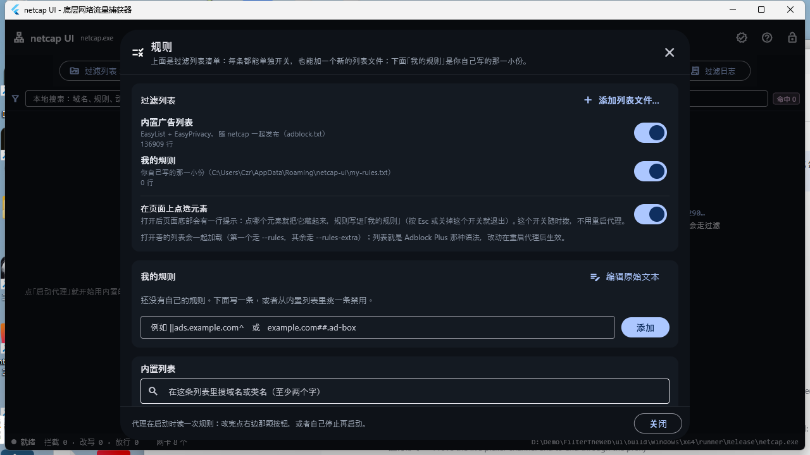
- **拦截代理面板（主窗口唯一的面孔）**：窗口打开就是一块「谁在请求什么、被怎么处理」的实时面板——顶部一行是 **`过滤列表：内置列表 + 我的规则 (+N 个自定列表)`**（按一下就打开规则页；原来是路径输入框 + `浏览…`，用户要求「规则借鉴其他软件那种管理方式」后删掉了）、`更多设置`、`日志 N`，以及**唯一的一颗主按钮**：没在跑的时候写着 `让所有程序走 netcap`（按一下＝启动代理并把系统代理接管过来），跑起来就变成红色的 `停止并还原`。**不再有单独的 `启动代理`**（用户 m17527：「如果这个新的功能能自动启动代理 那就没必要留着 启动代理 这个按钮了」；只想改显式代理、不碰系统设置的启动方式留在 `更多设置` 里的 `只启动代理（不改系统代理）`）；监听地址（`--serve`，默认 `127.0.0.1:8080`）、`去掉第三方 Cookie`（`--third-party-cookies`）与`记录放行的请求`（`--show-blocks`）都收进了`更多设置`里，因为这些设一次就不用再动了。**按一下 `让所有程序走 netcap`** 就等于把接管页里那个主开关打开：启动时由 netcap 把当前用户的系统代理临时指到它自己（`--system-proxy on`，退出时按快照还原），凡是读系统代理的程序（浏览器、微信/QQ、Electron 应用……）就都走过滤了，自己写死网络、不读系统代理的程序管不到——那种只能改用 TUN 接管；它和 TUN 互斥，正在跑的时候按下会先停再起（参数在启动时读取）；上游留空时 netcap 会自己试 `127.0.0.1:7890/7897/…`，一个都连不上就**拒绝**接管（退出码 4，机器不会断网）。反向操作只要再按一下（取消接管、只改显式设了代理的程序）。抓包侧的东西全在工具栏的 `抓包工具` 窗口里（`生成示例抓包` 与 `抓包选项` 也在它的标题栏上），`HTTPS 过滤页` 仍可从工具栏图标或 `更多设置` 进入。左下表格每行一条判定（时间、动作、方法、主机、目标 URL、状态码、命中的规则，动作按 `拦截`/`改写`/`隧道`/`放行` 着色），右侧「拦截统计 Interception」给出连接/请求/拦截/改写/重定向/放行/隧道/出错与上下行字节、「命中的规则 Rules」按次数排序、选中某一行时，右栏最上面就换成 `选中的这一条 Selected`（客户端、规则原文、理由、请求/响应字节），下面照旧是拦截统计与 netcap 日志（完整命令行不再贴出来）。代理的最终汇总只在它**停止**时打印，所以运行期间这些统计是界面按已到达的事件累加的，并标注「进行中」。响应改写（`$replace`/`$css`/…）同样以`改写`出现在这张表里，`detail` 会写明「改了几个地方、解掉了什么编码」。
- **流与 HTTP 面板**：界面自动带上 `--streams --http`（实时模式用 `--follow`，事务一完成就刷新），并可选择密钥日志（`--keylog`）——选好 `sample.keys` 后，样例抓包里的 HTTPS 会话会以**明文**列在这里（方法、URL、状态码、请求/响应字节数、`[解密]` 标记），下方是 TCP 流列表（`client -> server`、协议、包数、明文字节数、SNI、套件）。没有密钥日志时该面板会说明「HTTPS 仍是密文」而不是留空。整个页签（连同状态栏里的 `流 N · 解密 N · HTTP N` 计数）**只在确实抓到流或事务之后才出现**：`./build/netcap.exe -r sample.pcap -f "not tcp" -w only_udp.pcap` 这样只含 UDP/ARP/ICMP 的抓包读进界面时，页签行就是四个常驻页签，见 `ui_shot_no_stream.png`。

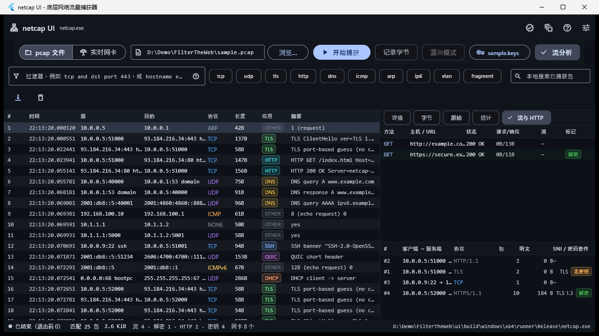

上图是本机实测截图（`.\netcap_ui.exe ..\sample.pcap ..\sample.keys`，窗口 1280×720）：启动即自动解码样例捕获并载入密钥日志，左侧是 25 个报文的列表（协议与应用着色，摘要列显示 `TLS ClientHello ver=TLS 1.2 SNI=…`、`HTTP GET /index.html`、`DNS query A www.example.com` 等）；右侧停在「流与 HTTP」页签，上表是两条事务——明文 `GET http://example.com/index.html -> 200 OK [13B]` 与解密后的 `GET https://secure.example.com/secure -> 200 OK [11B] (decrypted)`（传输 `HTTPS/1.1 (decrypted)`、完整度「请求与响应均完整」），下表是四条 TCP 流（`#2` 协议 `HTTP/1.1`、`#4` 协议 `HTTPS/1.1` 明文 184 B、`TLS 1.3`、标记`解密`）；底部状态栏给出 `退出码 0 · 匹配 25 包 2.6 KiB · 流 4 · 解密 1 · HTTP 2 · 密钥 4 · 网卡 8 个`。

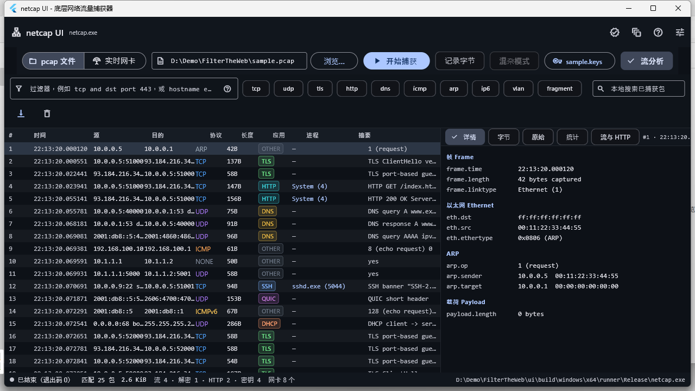

上图是同一份样例抓包在 `--attrib` 下的报文表（`netcap_ui.exe ..\sample.pcap ..\sample.keys --attrib --block tcp --block-mode dry-run`）：多出的一列`进程`写的是**镜像名加 PID**——`System (4)`、`sshd.exe (5044)`，查不到就是 `—`；右侧详情树照旧逐层展开这个包。同一次运行的「统计」页另有「进程分布 Processes」（`System 2 包 · 303 B`、`sshd.exe 1 包 · 94 B`）与「拦截 Interception」（策略行 `dry-run · 命中 15 · 执行 0 · 跳过 0 · 失败 0` 加逐条判定），后者见 `ui_shot_block.png`。

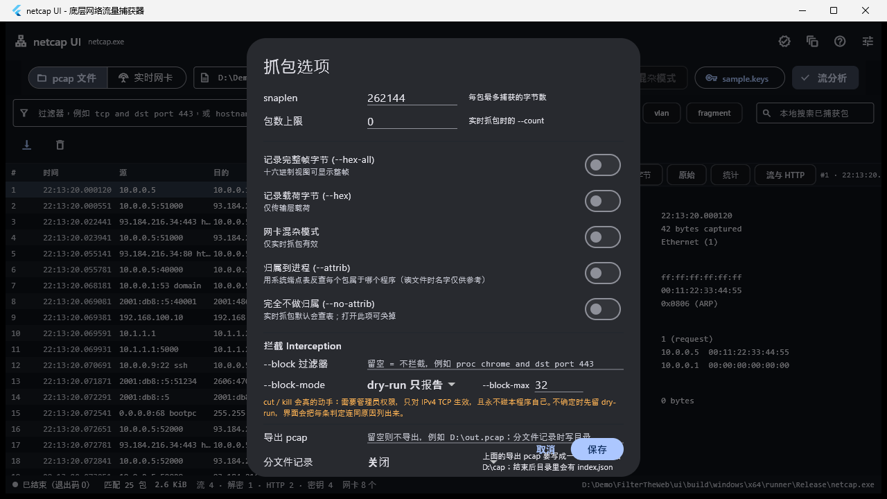

上图是「抓包选项」对话框：归属到进程 / 完全不做归属、拦截区（`--block` 过滤器、`--block-mode` 下拉、`--block-max`）、导出 pcap 与分文件记录。

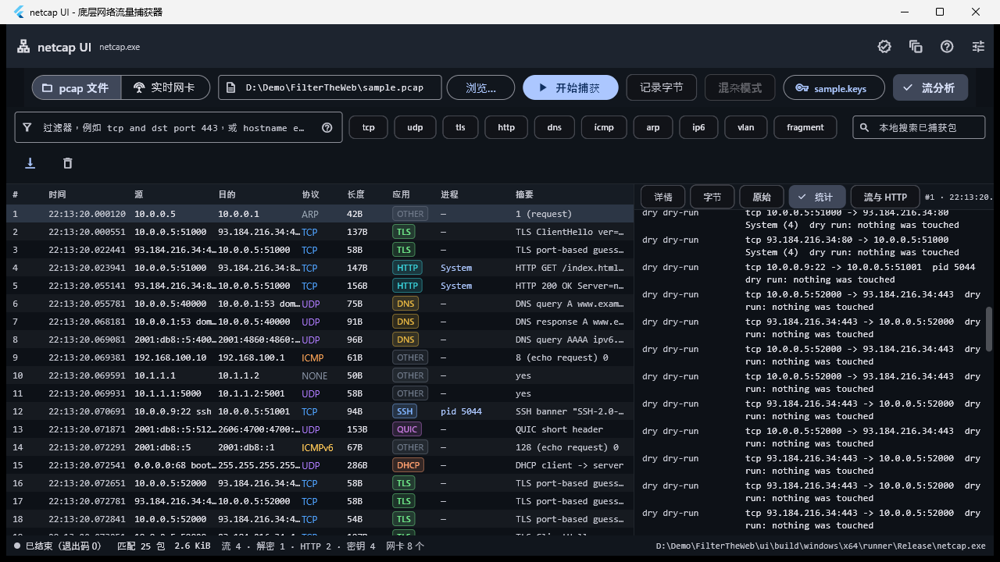

上图是「统计」页下半段的「拦截 Interception」：每条命中一条记录，写清模式（`dry-run`）、目标（`tcp 10.0.0.5:51000 -> 93.184.216.34:443`）与原因（`dry run: nothing was touched`），归属到的进程也一并列出（`System (4)`）；文本模式下同样的内容会以 `block  dry  dry-run …` 行实时打到 netcap 的 stderr。

另外，点进程格或长按该行即可「只看某一个进程」：搜索框被填成进程名、Pill 变成 `本地命中 1`，列表只剩这个进程的报文，详情面板自动跟到第一个可见行。走的是本地搜索，不会重新抓包；行为由 `ui/test/proc_test.dart` 与自测里的 `proc`/`pid` 过滤器用例覆盖。

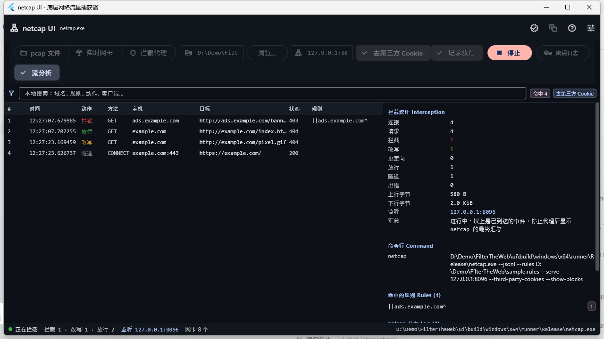

上图是本机实测的拦截代理面板（`netcap_ui.exe --rules sample.rules --serve 127.0.0.1:8096 --third-party-cookies --show-blocks`，随后用 `curl -x http://127.0.0.1:8096` 发了四个请求）：四条判定分别是 `拦截 ads.example.com/banner.gif 403`（规则 `||ads.example.com^`）、`放行 example.com/index.html 404`（状态码是上游真实回答，不是硬编码的 200）、`改写 example.com/pixel.gif 404`（带 `Referer: news.example.org` 与 `Cookie:` 的跨站请求被剥掉 Cookie）、`隧道 CONNECT example.com:443 200`；右侧统计 `连接 4 · 请求 4 · 拦截 1 · 改写 1 · 放行 1 · 隧道 1 · 上行 580 B · 下行 2.0 KiB`、规则榜 `||ads.example.com^ 1`、以及运行中提示；底部状态栏 `正在拦截 拦截 1 · 改写 1 · 放行 2 监听 127.0.0.1:8096`。

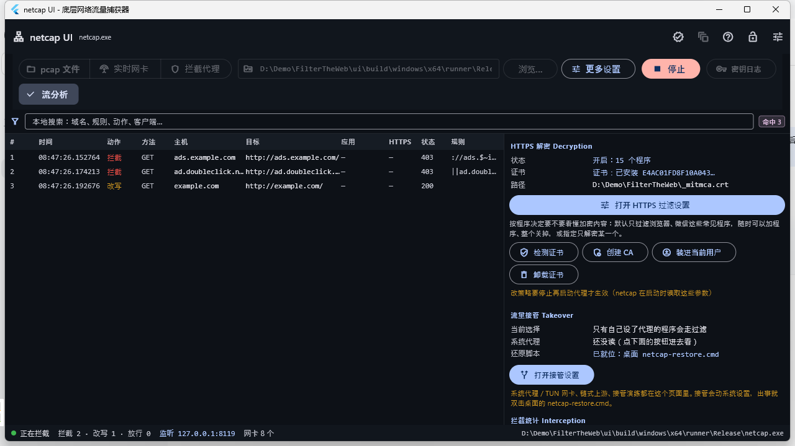

上图是不加任何规则参数的打包界面（`netcap_ui.exe --serve 127.0.0.1:8119`）：启动就自动用内置的 `rules\adblock.txt` 起了代理，表格里三条判定分别是被 `||ads.example.com^`、`||ad.doubleclick.net^` 拦下的两个 `403`（应用列空着是因为请求来自 curl，不是带进程归属的实时抓包）与放行的 `example.com 200`；右侧「拦截统计」实时累加，状态栏 `正在拦截 拦截 2 · 改写 1 · 放行 0 · 监听 127.0.0.1:8119`。

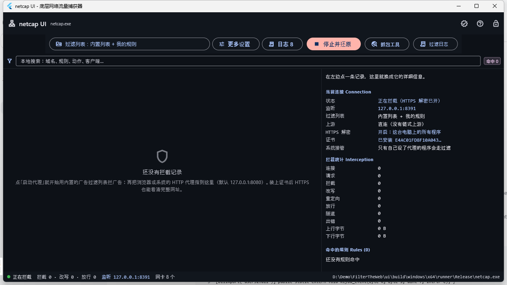

上图是在跑着的打包界面（`netcap_ui.exe --serve 127.0.0.1:8381 --mitm`——参数里给了 `--serve` 就自动开始拦）：工具栏从左到右是 `过滤列表：内置列表 + 我的规则`、`更多设置`、`日志 8`、红着的 `停止并还原`、`抓包工具`、`过滤日志`（`密钥日志` 与 `流分析` 只对 pcap 有用，代理模式下什么都不做，已经收进 `更多设置` 的「抓包与解密（pcap 侧）」里），**原来那三个数据源按钮没有了**；右栏最上面一行是「在左边点一条记录，这里就换成它的详细信息。」，接着「当前连接」七行分别是 `正在拦截（HTTPS 解密已开）`、`127.0.0.1:8381`、`内置列表 + 我的规则`、`直连（没有链式上游）`、`开启：这台电脑上的所有程序`、`已安装 E4AC01FD8F10A043…`、`只有自己设了代理的程序会走过滤`，下面是拦截统计与命中的规则——**栏里没有任何按钮、也没有命令行那块**；`HTTPS 过滤`、`流量接管` 与 `规则` 三个入口收在工具栏的 `更多设置` 对话框里，点开的是整页设置（`ui_shot_https_page.png`、`ui_shot_takeover_page.png`、`ui_shot_rules.png`），而 pcap/网卡那套东西在 `抓包工具` 窗口里。

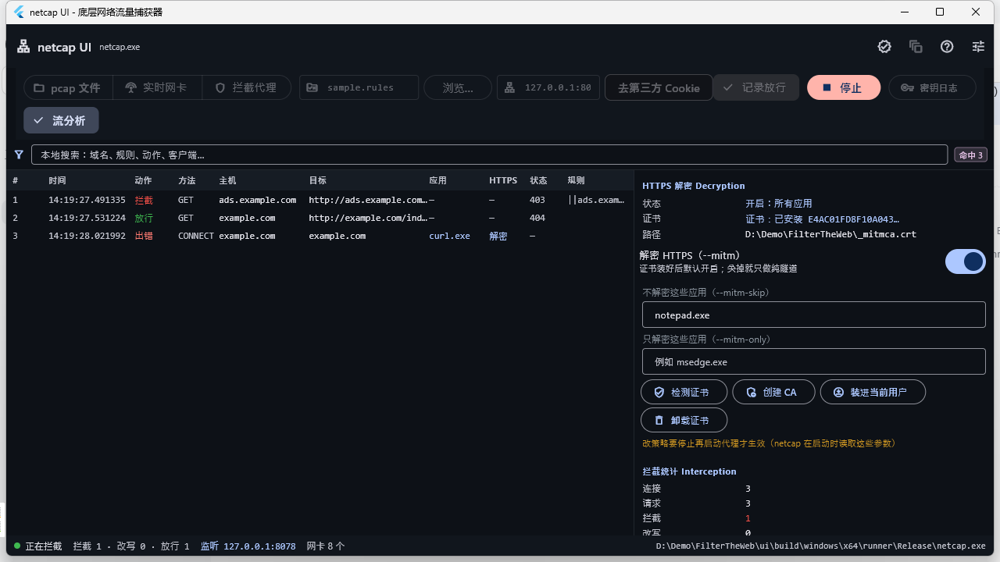

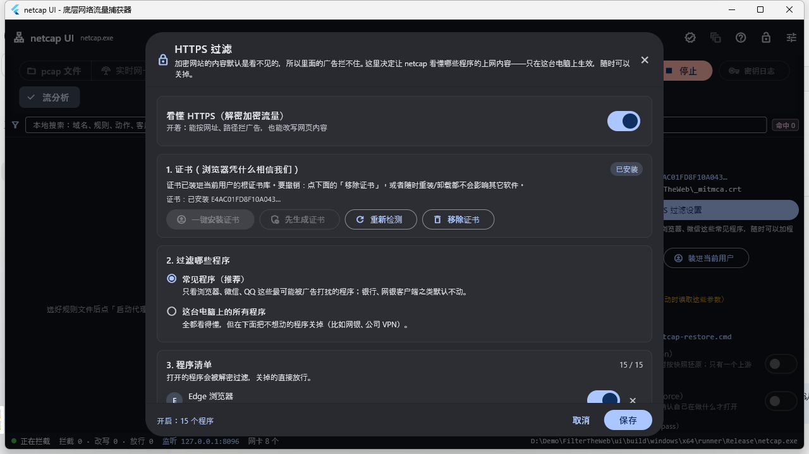

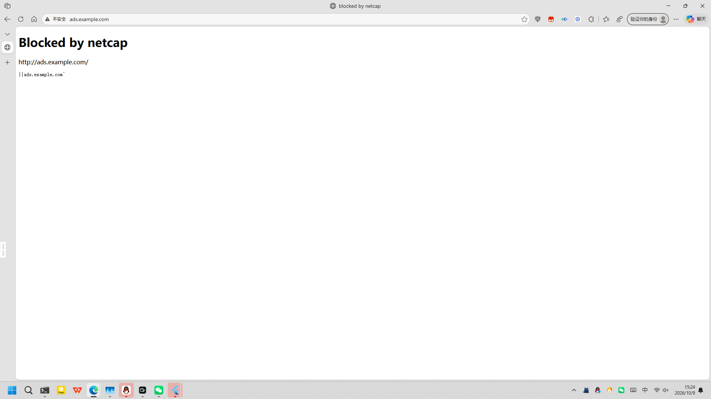

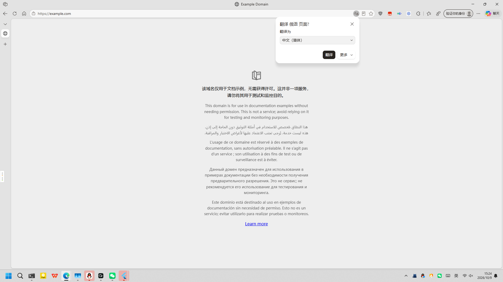

上图是同一条代理链路在浏览器里的两个结果（短暂接管系统代理 + 链式上游 `127.0.0.1:7890`，用一个临时 profile 的 Edge 访问）：第一张是 `http://ads.example.com/`——netcap 直接回的 `Blocked by netcap` 页（标签页标题就是这四个字）；第二张是 `https://example.com/`——真页面被正常解密并渲染出来，说明 MITM 链路对浏览器是可用的。拦截表里 `CONNECT example.com` 那条由 `msedge.exe` 发起、`HTTPS` 一栏写着`解密`。证书判定按 `--ca-show` 打印的序列号与 `certutil -user -store Root` 里的序列号比对，所以同名的旧 CA 不会被误认为「已安装」。

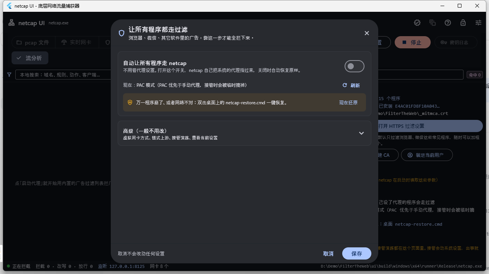

上图就是那一页（`netcap_ui.exe --rules sample.rules --serve 127.0.0.1:8125 --takeover-settings`，界面自己停在这一页）：第一屏只有**一个开关**`自动让所有程序走 netcap`、一行`现在：…`与`刷新`、一条琥珀色安全提醒（双击桌面 `netcap-restore.cmd` 一键恢复）配一个 `现在还原`，以及折叠的 `高级（一般不用改）`——bypass、force、虚拟网卡方式、链式上游、网卡名、隧道地址、5/12/30 秒演练、只读预检、当前系统代理四个值、命令预览全在里面；页脚左边写着 `取消不会改动任何设置`，右边是 `取消`/`保存`。**第一屏看不到任何命令行参数**，`ui/test/takeover_page_test.dart` 里有一条断言专门钉住这件事。

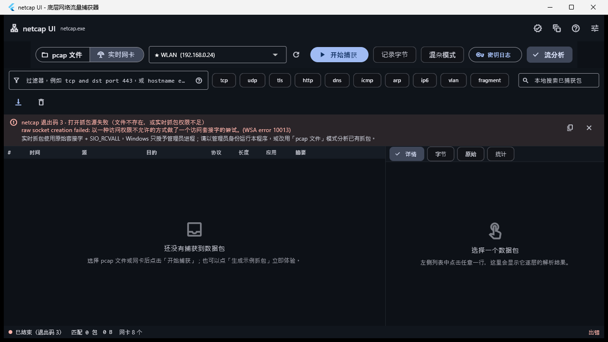

上图是非管理员点「实时网卡 → 开始捕获」的结果：错误条不再只给一句笼统的退出码说明，而是把 netcap 自己的 stderr 行一起摊开——`raw socket creation failed: …（WSA error 10013）`，并说明 `SIO_RCVALL` 只授予管理员进程、可以改用「pcap 文件」模式。以管理员身份运行本程序即可正常实时抓包。

### netcap.exe 的定位顺序

1. 环境变量 `NETCAP_EXE`（强制指定）。
2. 与应用 exe 同目录的 `netcap.exe`（打包后的默认情况）。
3. 从应用 exe 所在目录与当前工作目录逐级向上查找 `netcap.exe` 或 `build\netcap.exe`（覆盖 `flutter run` 的开发态）。
4. `where netcap.exe`。

都找不到时界面顶部给出提示，并保留手动模式的入口。

### 数据通道：`--jsonl`

`netcap --jsonl` 把结果写成 JSON Lines（每行一个对象、写完即 flush），日志与人类摘要全部走 stderr，stdout 只有 JSON。

| 行类型 | 何时出现 | 关键字段 |
|---|---|---|
| `hello` | 首行 | `tool, live, source, described, linktype, linktype_name, filter, snaplen, nanosecond, reassembly, keylog, keylog_loaded, keylog_entries` |
| `packet` | 每个命中报文 | `n, ts_us, time, len, origlen, truncated, malformed, reason, ip_version, src, dst, proto, sport, dport, sport_name, dport_name, flags, app, app_name, app_summary, hostname`，HTTP/TLS/DNS 追加 `http_method/http_uri/http_status`、`tls_sni`、`dns_qname`，`payload_len/payload_head`（前 64 字节），`-x/-X` 时追加 `payload_hex/frame_hex`，最后是 `tree`（有序的字段字典，值均为字符串）。 |
| `device` / `devices` | `-d --jsonl` | 网卡列表与其能力/权限说明 |
| `sample` | `-g --jsonl` | `path, packets` |
| `http` | `--http`（末尾一次性）或 `--follow`（事务完成即输出） | `stream, http2, stream_id, decrypted, client, server, transport, host, method, target, url, version, status, status_line, content_type, request_bytes, response_bytes, request_complete, response_complete, websocket, truncated, start_us, end_us, duration_ms, note, summary` |
| `stream` | `--streams`（summary 之后） | `index, client, server, protocol, app, sni, alpn, tls, decrypted, http, http2, keys_available, truncated, tls_version/tls_version_id, cipher/cipher_id, packets, client_bytes, server_bytes, plaintext_bytes, records, retransmits, out_of_order, overlaps, gaps, transactions, first_us, last_us, note` |
| `block` | `--block` 下的每条判定（`--jsonl` 时判定一发生就输出） | `state`（`dry` 只报告 / `done` 已执行 / `skip` 被安全阀拦下 / `fail` 执行失败）、`mode, target, process, pid, reason, error, ts_us` |
| `summary` | 末行 | 计数器、分片统计与 `apps[]`（按包数降序），另有 `streams, reassembly, tls_streams, decrypted_streams, http1_streams, http2_streams, http_transactions, http_decrypted_transactions, http2_transactions, reassembled_bytes, keys_loaded, keylog_entries`；进程级能力再加 `attribution`、`procs[]`、`split_by`、`split_files[]` 与 `block{enabled, mode, matched, attempted, performed, failed, skipped, last_error, actions[]}` |

`--jsonl` 与 `-w -` 不能同时使用（两者都要求占用 stdout），会以退出码 2 明确报错。

### 界面测试

```powershell
cd ui
flutter analyze     # No issues found!
flutter test        # 186 个测试全部通过
```

`test/models_test.dart` 用**逐字取自真实 netcap 输出**的 JSONL 片段锁住上面的契约（含 `stream` 与 `http` 两类新行）；`test/widgets_test.dart` 覆盖格式化函数与 hexdump/详情树渲染；`test/proc_test.dart` 覆盖进程/分文件/拦截的模型与参数（`proc` 列取值、`BlockAction.state` 四态、`toArgs()` 的选项顺序）以及真实后端的 `--attrib`、`--split-by app`（3 个文件 + `index.json`）与 `--block dry-run` 事件；`test/intercept_test.dart` 覆盖拦截代理面板（用真实 `--serve` 输出的三条 `intercept` 事件与一条 `intercept_summary` 校验解析、动作中文标签、跳转目标与本地搜索，校验 `SourceMode.proxy` 的命令行只含 `--rules/--serve/--third-party-cookies/--show-blocks`，并确认主窗口打开就是拦截视图（三个数据源按钮都已不存在）而 `抓包工具` 打开的是自带 pcap/网卡控件的窗口；另有一组 `HTTPS decryption policy` 用例：`--mitm`/`--mitm-skip`/`--mitm-only`/`--ca` 的 `toArgs()` 顺序与「只给 `--mitm-only` 时也必须带上 `--ca`」、事件里 `client_proc`/`mitm` 的解析与 `解密`/`跳过`/`未解密` 标签、缺这两个键时不抛异常、以及 `CaStatus` 在「没创建 / 创建了没装 / 装了 / 读不出来」四种状态下的文案与指纹）；`test/netcap_integration_test.dart` 会真的启动 `netcap.exe`（生成样例 → 解析 25 个报文 → 校验 ARP 端点、TLS SNI、HTTP、DNS 字段 → 用 `--keylog --streams --http` 校验 `HTTPS/1.1 (decrypted)`、明文 `GET /secure` 与 200 → 验证过滤器与退出码 2/3）；`test/rules_default_test.dart` 锁住**内置过滤列表**的查找规则（`pickRulesFile` 取第一个存在的候选、`defaultRulesFile` 会向上 9 层找 `rules\adblock.txt`、找不到返回 `null` 而不是抛异常、以及仓库里确实存在这份列表且带 netcap 的补充规则）。

### 界面侧限制

- 停止实时捕获时界面直接终止子进程（Windows 上是 `TerminateProcess`），因此**末行 summary 不会送达界面**，此时统计由界面按已收报文自行计算。
- 报文表上限 2 万行，本地搜索只作用于这部分已抓到的报文。
- 界面自身不实现任何协议分析：报文级解析、TCP 重组、TLS 解密、HTTP/2 解码全部来自后端，界面只是把 `packet`/`stream`/`http` 事件画出来。因此**不选密钥日志就看不到 HTTPS 明文**（面板会明确说明当前只有密文记录）。

## HTTPS 中间人解密（`--serve --mitm`）

`--serve` 不带 `--mitm` 时对 HTTPS 是**纯字节隧道**：`CONNECT` 里只有一个主机名，所以只能按域名拦。带上 `--mitm` 后，代理在隧道里当一次服务器——按 SNI 用本地 CA 现签一张叶证书给客户端，同时用自研 TLS 1.3 客户端连真实站点——于是请求行里的**完整 URL**也能参与规则匹配（`||example.com/path`、`$removeparam`、按路径放行/拦截都成立）。

### 一、先有你自己的本地 CA

```
$ netcap --ca-init                 # 写出 _mitmca.key 与 _mitmca.crt
```
`--ca-init` 只写这两个文件，并打印证书主题（`CN=netcap local CA`）、有效期、SHA-256 指纹与两条 `certutil` 命令，同时明确写着**netcap 不会替你装证书**。`--ca-show` 只读并报告，不动文件；`--ca <prefix>` 指定别的路径前缀。

要让浏览器信你，得自己把 `_mitmca.crt` 装进信任库（当前用户或整机，Firefox 走它自己的证书管理器）：

```
certutil -addstore -user Root _mitmca.crt        # 当前用户
certutil -addstore Root _mitmca.crt              # 整机，需要管理员
certutil -delstore -user Root "netcap local CA"  # 不想要了就删掉
```

### 二、跑起来

```
$ netcap --rules sample.rules --serve 127.0.0.1:8099 --mitm --ca _mitmca
netcap: local interception proxy on 127.0.0.1:8099 ... TLS decryption on
```
把浏览器或系统代理指向 `127.0.0.1:8099` 之后，拦截事件里会多出 `decrypted`（JSONL 里是 `"decrypted":true`），`url` 是完整的 `https://…`。`--mitm-insecure` 跳过对**上游**证书的校验；默认是严格校验，**校验不过不会把页面弄坏**：这条上游连接被交给盲转发，页面照常打开（事件记 `隧道` / `[mitm blind]` 并写明原因），只有在你想连这种源站也解密时才用 `--mitm-insecure`。

### 三、按应用开关（`--mitm-skip` / `--mitm-only` / `--mitm-strict`）

`--serve --mitm` 默认给**所有**应用解密。要放过某些应用（网银、会做证书固定的客户端），把它们的镜像名或路径写进 `--mitm-skip`；反过来只想解密指定的几个应用，用 `--mitm-only`。**名单非空时它就是全部规则**：`--mitm` 只表示「解密功能开着」，不能把名单放大回「所有应用」（见「`--mitm-only` 是名单」一节）。

```
$ netcap --rules sample.rules --serve 127.0.0.1:8099 --mitm --ca _mitmca --mitm-skip "bank.exe,pinapp"
$ netcap --rules sample.rules --serve 127.0.0.1:8099 --ca _mitmca --mitm-only msedge.exe
```

- 名字按**大小写不敏感的子串**匹配，也可以写完整路径（`--mitm-skip "C:\Program Files\Bank\bank.exe"`）；分隔符是逗号、竖线或分号，`--mitm-except` 是 `--mitm-skip` 的别名。
- 命中 `--mitm-only` 的应用即使没有 `--mitm` 也会被解密（这一条会顺带加载 CA）；被 `--mitm-skip` 命中的应用只做纯隧道。
- 判定要知道「这条连接是哪个程序发起的」，用的是和 `--attrib` 同一张 Windows 端点表（`GetExtendedTcpTable`）；查不到名字时**名单模式下不解密**（名单就该失败关闭），只有单开 `--mitm`（没有名单）时才「认不出也解密」。
- 每个拦截事件都带 `client_proc`（发起连接的程序名，拿不到就是空串）与 `mitm`（`"on"` / `"skip"` / `"off"`），`intercept_summary` 里另有 `mitm_skipped` 计数。文本模式会在行尾打印程序名与 `[mitm skip]`。
- 运行中改策略不会立刻生效：netcap 在启动时读这些参数，改完要重启代理（界面里也照此提示）。
- **自带信任库的客户端会被自动放过**（`src/blocker.cpp` 里的「拒签证书记忆」）：Node.js（DSH 的模型请求经由 `billion-context` 代理，就是它）、Go、Rust 这类程序**不读 Windows 根证书库**，只看自己带的那份 CA 清单；谈到我们现签的叶证书时它们直接挂断（Node 报 `UNABLE_TO_VERIFY_LEAF_SIGNATURE`）。以前这只会让那个程序彻底连不上（netcap 接管系统代理时表现为「每隔几秒一次 502」），现在同一个程序对同一个主机名**连挂两次**（120 秒内；如果它明确回了 TLS alert，一次就够）之后，这对「程序 + 主机名」被记下来并改用**盲隧道**：连接照常能通，按**域名**的规则照常生效（`block` 的 `CONNECT` 在解密之前就判了），只有它请求的**内容**不再被解密过滤——和 `--mitm-skip`、和上游证书验不过时的盲转发是同一个取舍。改判的那一刻记一条事件（`action=error`、`mitm="on"`、`detail` 写明原因），之后每条隧道记 `mitm="skip"`，`intercept_summary` 里会多出 `mitm_client_refusals` 计数；文本报告里是 `%llu pair(s) tunnelled after refusing our certificate`。
- 不想让它自动放行（宁可真连不上、也不要一个应用偷偷绕过内容过滤）就加 `--mitm-strict`：永不因证书被拒而改隧道，`connection closed` 仍按预连接静默处理，连接继续失败。
- 记忆按 **CA 指纹**绑定：`--ca-init` 重新生成 CA 之后，之前记下的判定失效，那对程序+主机名会重新试解密；进程重启也会清空。浏览器被取消的预连接只有在同一程序、同一主机名、120 秒内**重复两次**时才可能误触发（见「代理健壮性」一节），真触发了也只影响那一个程序那一个主机名的内容过滤。

### 四、能力与边界

- 自研 TLS 1.3（RFC 8446）：**只有 `TLS_AES_128_GCM_SHA256`**、只用 `x25519` 密钥交换、只用 `ecdsa_secp256r1_sha256` 与 `rsa_pss_rsae_sha256` 签名（RSA 走 CNG 验签，见「广告拦截实战」一节），ALPN 只谈 `http/1.1`。`key_share` 会先扫完客户端的整个列表找 `x25519`；如果一个都没给，就按 RFC 8446 §4.1.4 回一个 **HelloRetryRequest** 再要一次——OpenSSL 3.5 与 Chrome 现在默认只送后量子混合的 `X25519MLKEM768`，没有这一步现代浏览器根本连不上。会话恢复、0-RTT、客户端证书、KeyUpdate 都不做——对不上就明确报"不支持"，不半吊子实现。
- 证书链：本地 CA 自签 + 按 SNI 现签叶证书（SAN 用 `dNSName`，支持通配符场景），有效期不超过 397 天（浏览器会拒绝更长的叶证书），叶密钥按主机名缓存复用。
- 解开的记录走 HTTP/1.1 解析；因为 ALPN 只提供 `http/1.1`，浏览器会回落到 HTTP/1.1（HTTP/2 仍只能按域名拦）。
- 中间人**只在你显式给 `--mitm` 时**发生。

### 五、实测（本机）

```
$ netcap --rules sample.rules --serve 127.0.0.1:18096 --mitm --ca _mitmca --jsonl --show-blocks
# 客户端用 OpenSSL，并信任我们自己的 CA（请求写进文件再管道，别用 cmd 的 echo 链）
$ cmd /c "type _req.txt | openssl.exe s_client -proxy 127.0.0.1:18096 -connect example.com:443 \
        -CAfile _mitmca.crt -servername example.com -quiet -ign_eof" > _body.html
HTTP/1.1 200 OK
```
`_body.html` 是 example.com 的**真实页面**（129 字节，含 `Content-Type: text/html; charset=utf-8`），说明握手、按 SNI 签发的叶证书、上游校验、记录解密与转发整条链路都通了。`NETCAP_TLS_DEBUG=1` 会打印两侧的记录轨迹（角色前缀区分是谁的记录）。

```
[tls] srv-accept  <- #1 type=22 length=448   # 客户端的 ClientHello
[tls] srv-accept  <- #3 type=23 length=53    # 客户端的 Finished
[tls] srv-app     <- #7 type=23 length=56    # 解密出来的请求
[tls] cli-connect <- #4 type=22 length=122   # 真实站点的 ServerHello
[tls] cli-app     <- #8 type=23 length=929   # 上游的响应
```

自研 TLS 引擎有回归测试：`--selftest` 里跑一次**真实的回环握手**（我们自己的服务器 ↔ 我们自己的客户端，用当场签发的叶证书），外加记录封装、篡改必须被拒、序号推进、主机名不匹配必须拒绝等 61 条断言（`2488/2488` 的一部分）。

### 六、验证 HTTPS 时别用这台机器上的 curl

`curl 8.8.0 (Windows) libcurl/8.8.0 Schannel` 在这台机器上**任何** HTTPS 连接都失败，连直连都不行。

```
$ curl -s -o NUL -w "%{http_code} %{errormsg}" --noproxy '*' https://example.com/
000 A libcurl function was given a bad argument          # CURLE_BAD_FUNCTION_ARGUMENT (43)
```
同一个 curl 加 `-x` 代理、走 Clash（`127.0.0.1:7890`）、加 `--insecure`、`--tls-max 1.2` 全都是 error 43，而**纯 HTTP 是 200**——所以这是 curl/schannel 这一侧的问题（对应 curl issue [#13958](https://github.com/curl/curl/issues/13958) 与 [#18983](https://github.com/curl/curl/issues/18983)：经 `CONNECT` 建立、由 schannel 承载的 TLS 连接会中止），与本项目无关。验收请用 OpenSSL（`tools/mitm_check.py` 与 `openssl s_client` 都已验证），或用 Chrome / Firefox 这类自带 TLS 栈的浏览器；Edge 用系统 schannel，可能踩同一个坑。

**浏览器级验收做成了**（用户明确同意一次 ≤20 秒的系统代理接管；脚本是 `tools/browser_accept.ps1`——先确认桌面 `netcap-restore.cmd` 在，起 `--serve … --mitm --system-proxy on --upstream 127.0.0.1:7890`，用专用 profile 起 Edge 访问两个 URL 并截图，然后杀进程、必要时 `--system-proxy restore`、最后核对注册表与连通性）：

- `https://example.com/` 在 Edge 里渲染出**真实页面**（标题 `Example Domain`，见 `ui_shot_browser_https.png`）——这条 HTTPS 连接是我们当场签发叶证书解密后再加密给浏览器的；代理侧同时记录 `pass GET http://example.com/s.js  [decrypted]  [msedge.exe]  -> 304`。
- `http://ads.example.com/` 得到我们自己的 **`Blocked by netcap`** 页面（标题栏就是这个名字，页面里写着 `http://ads.example.com/` 与命中规则 `||ads.example.com^`，见 `ui_shot_browser_block.png`），代理侧记录 `block CONNECT https://ads.example.com/  [||ads.example.com^]  -> 403` 与 `block GET http://ads.example.com/  [||ads.example.com^]  -> 403`。
- 接管窗口内机器一直是通的：既因为链式上游 `--upstream 127.0.0.1:7890` 把原来的上网路径接在了后面，也因为这次抓图正好复现了那条 `std::length_error`（见「代理健壮性」）；那次它只丢掉一条连接（当时根因还没找到），现在已经连根修掉了。

## 命令行参数

```
Usage: netcap [options] [filter expression]

Sources:
  -i, --interface <name|index>  capture live from an interface
  -r, --read <file>             read packets from a pcap file ('-' = stdin)
  -d, --devices                 list capture-capable interfaces and exit
  -g, --generate-sample <file>  write a synthetic demo capture and exit

Output:
  -w, --write <file>            also write matching packets to a pcap file
                                ('-' = stdout; then the packet log goes to stderr)
                                with --split-by this is a directory instead
      --split-by <proc|app>     one pcap per process / per application
                                (needs -w <directory>; index.json lists them)
  -v, --verbose                 full field-by-field dump per packet
  -x, --hex                     hex+ASCII dump of the transport payload
  -X, --hex-all                 hex+ASCII dump of the whole frame
  -A, --ascii                   printable-only ASCII dump of the payload
  -n, --numeric                 numeric ports (no service names)
  -q, --quiet                   no per-packet output, only the summary
      --stats                   per-application packet counters
      --nanosecond              nanosecond timestamps in the written file
      --jsonl                   JSON Lines on stdout (one object per packet);
                                -d and -g honour it too

Analysis:
      --keylog <file>           SSLKEYLOGFILE secrets to decrypt TLS
      --streams                 TCP stream report (reassembly)
      --http                    HTTP/1.1 and HTTP/2 transactions
      --follow                  print each transaction as it completes
      --no-reassembly           do not reassemble TCP streams

Processes:
      --attrib                  attribute packets to the owning process
                                (already the default for a live capture)
      --no-attrib               never read the OS endpoint table

Blocking:
      --rules <file>            adblock / hosts style rule list
      --rules-extra <file>      a second list stacked on top of --rules (repeatable); the
                                interface keeps the user's own rules in
                                %APPDATA%\netcap-ui\my-rules.txt and passes it here
      --check-rule <line>       validate one rule line and exit: 0 = it would be used
                                (comment / network rule / element hiding rule), 1 = rejected,
                                with the reason on stdout
      --log-file <path>         append every decision to <path> as JSON Lines (the same schema
                                as --jsonl, plus a self-describing first line); flushed per
                                decision, rotates to <path>.1 at 8 MiB.  The interface passes
                                %APPDATA%\netcap-ui\filter-log.jsonl here when its log page
                                has 记到文件 switched on
      --serve [addr:]port       local HTTP intercept proxy that uses the rules
      --mitm                    decrypt TLS inside the proxy (needs a local CA)
      --mitm-insecure           when decrypting, do not verify the origin certificate
      --mitm-skip <list>        with --mitm, keep a plain tunnel for these applications,
                                so their HTTPS is never decrypted (comma or pipe separated,
                                matched case-insensitively against the image name or path,
                                e.g. --mitm-skip "bank.exe,pinapp")
      --mitm-only <list>        decrypt HTTPS only for these applications (also loads the
                                CA when --mitm is off), e.g. --mitm-only msedge.exe
      --mitm-strict             do not fall back to a plain tunnel when a client refuses our
                                certificate: such connections keep failing.  By default an
                                application that will not verify the netcap CA for a host name
                                (its own trust store, certificate pinning) is remembered and that
                                pair is tunnelled without decryption, so the application keeps
                                working; the event table says when that happened
      --ca <prefix>             CA files to use (default _mitmca => _mitmca.crt/.key)
      --ca-init                 create a local CA and exit (never touches your trust store)
      --ca-show                 report the local CA and exit
      --hosts [file]            plan (or with --hosts-apply: write) the hosts file
      --dns [addr:]port         DNS sinkhole for blocked names (default 127.0.0.1:5353)
      --wfp <spec>              install a kernel filter that drops matching traffic
                                (repeatable; see --wfp-help)
      --wfp-apply               really install them (otherwise they are only listed)
      --wfp-wait                stay alive until Ctrl+C, then remove them again
      --system-proxy <mode>     on|off|restore|status|check: point this user's system proxy
                                at the --serve endpoint while netcap runs, and put the
                                previous settings back on exit (HKCU only, no administrator)
      --system-proxy-bypass <list>  bypass list written on takeover (default <local>)
      --system-proxy-state <file>   where the previous settings are kept (default
                                netcap_sysproxy.state)
      --upstream <host:port>    chain every upstream connection through an HTTP proxy
                                (e.g. the local Clash port); a system proxy takeover is
                                refused when nothing answers behind us
      --system-proxy-force      take the system proxy over even with no upstream answering
      --origin-policy <p>       best|first: pick the fastest address a host resolves to, or
                                go back to dialling them in resolver order (default best)
      --origin-race <n>         how many addresses race at once when nothing is measured yet
                                (1..16, default 2)
      --origin-ttl <seconds>    how long a measurement is trusted before racing again
                                (0..86400, default 300, 0 means "race every time")

TUN (Wintun):
      --tun                     create/open the adapter and stop (nothing is routed yet)
      --tun-name <name>         adapter name (default netcap)
      --tun-address <a/n>       address and prefix length for the adapter (default 10.7.0.1/24)
      --tun-mtu <n>             adapter MTU (default 1500)
      --tun-hold <secs>         diagnostics: keep the session open and report the packets
      --tun-check               read-only: is wintun.dll usable, which default routes exist,
                                where would a takeover send traffic
      --tun-takeover            add a default route through the tunnel (purely additive:
                                it lowers the adapter's interface metric and adds one
                                route, never removes somebody else's; refused unless an
                                upstream answers and no other route already sits at
                                effective metric 0; rolls itself back after 2 s with no
                                traffic)
      --tun-seconds <n>         stop the takeover after n seconds (0 = until Ctrl+C)
      --tun-restore <file>      undo a takeover: delete only the route it added and put
                                the interface metric it lowered back
      --tun-dll <path>          use this wintun.dll instead of searching
      --tun-help                the long explanation

Capture:
  -f, --filter <expr>           userspace filter (see --filter-help)
  -c, --count <n>               stop after n matching packets
  -s, --snaplen <n>             bytes captured per packet (default 262144)
  -t, --timeout <ms>            blocking read timeout for live capture
  -p, --no-promisc              do not request promiscuous mode

Misc:
      --filter-help             print the filter grammar and examples
      --selftest                run the built-in verification suite
  -h, --help                    this message
      --version                 version information
```

过滤器表达式也可以直接作为位置参数给出（等价于 `-f`）。
退出码：`0` 正常、`1` 自测失败、`2` 用法或过滤器错误、`3` 打开捕获源或密钥日志失败。

## 特性（抓包地基）

- **抓包后端**
  - Windows：`AF_INET/SOCK_RAW` + `WSAIoctl(SIO_RCVALL)`，可枚举网卡、自动识别默认路由网卡（需管理员）
  - Linux：`AF_PACKET/SOCK_RAW` + `PACKET_RX_RING`（TPACKET_V2 mmap 环形缓冲，零拷贝），失败自动回退 `recvfrom`
  - 文件：自研 pcap 读写器，支持 `-r file` / `-r -`（stdin）、`-w file` / `-w -`（stdout）；
  - 流式管道：`-w -` 时逐包日志与统计摘要自动改到 stderr，stdout 上只有纯 pcap 字节流，可直接
    `netcap -r in.pcap -q -w - | tshark -r -` 或管道回灌 `| netcap -r - --stats`；
    实测：`-r sample.pcap -q -w - > out.pcap` 得到的文件与 `sample.pcap` **SHA-256 完全一致**，
    管道写 `-w - | -r -` 两端均读到 25 包。Windows 上还会在读取/写出第一个字节前就
    stdout/stdin 切到二进制模式（`_setmode(..., _O_BINARY)`）——否则文本模式会把包数据里的
    0x0a 变成 CRLF、把输入里的 CRLF 折叠掉，两种方向都会损坏 pcap。
- **链路层**：Ethernet、802.1Q / QinQ VLAN（最多两层）、Linux cooked SLL、BSD loopback（DLT_NULL）、裸 IP（DLT_RAW）
- **网络层**：IPv4（含选项长度、DF/MF、分片重组）、IPv6（逐跳/路由/分片/AH/目的选项扩展头链）、ARP/RARP
- **传输层**：TCP（含 MSS / 窗口缩放 / SACK permitted / 时间戳选项）、UDP、ICMP、ICMPv6
- **应用层识别**：HTTP/1.x（请求行、状态行、Host、UA、Content-Length、chunked、HTTP/2 preface）、TLS ClientHello（版本、SNI、ALPN、密码套件数）、DNS/mDNS（含名字压缩指针）、QUIC Initial、SSH banner、DHCP
- **过滤引擎**：递归下降解析的自研表达式语言，`not > and > or` 优先级、括号分组、隐式 `and`
- **IPv4 分片重组**：8 字节块粒度位图、超时回收、条目数上限淘汰、超大报文丢弃计数
- **TCP 流重组**：按四元组聚合双向流，序号排序、重传/完全重叠丢弃、部分重叠只取新增、乱序先缓存
  （缺口未填不交付）、32 位序号回绕、每条流与待处理缓冲双重上限、空闲超时回收；统计重传/乱序/重叠/缺口
- **TLS 解密**：读取 `SSLKEYLOGFILE` 格式密钥日志（`--keylog`），自研 AES-128/256-GCM、
  ChaCha20-Poly1305、AES-CBC(HMAC) 与 HKDF/PRF，支持 TLS 1.3（握手/应用密钥、记录内层类型）与
  TLS 1.2（`CLIENT_RANDOM` 主密钥、显式 nonce、MAC-then-encrypt）；没有密钥时只识别不猜测
- **HTTP 解析**：在重组且（必要时）解密的字节流上解析 HTTP/1.1（chunked、Content-Length、
  1xx、请求/响应配对、WebSocket 升级）与 HTTP/2（帧层 + HPACK），输出明文里的 URL、状态码、主机与字节数
- **输出**：单行摘要 / 逐字段详细模式 / 载荷或整帧 hex+ASCII dump / 按应用统计 / TCP 流与 HTTP 事务报告
- **拦截与改写**（这个工具的另一半用途：当广告/跟踪拦截器用）
  - 规则表：Adblock Plus / uBlock 风格子集（`||domain^`、通配符、锚点、`@@` 例外、`$important`）
    `$third-party`、资源类型、`$domain=`），外加 hosts 写法与元素隐藏规则的识别；`--rules-check` 报告理解结果与被跳过的行
  - 本地 HTTP 代理（`--serve`）：`block`（403 拦截页）/ `allow` / `redirect`（本地 stub）/ `tunnel`；
    请求侧可剥跟踪参数（`$removeparam`）与第三方 Cookie，可用 `--serve --mitm` 用本地 CA 现签叶证书解密 HTTPS（自研 TLS 1.3），并按应用开关（`--mitm-skip` / `--mitm-only`，界面里也能点）
  - **响应改写**：`$replace`（自研 Pike VM 正则改正文）/ `$csp` / `$header` / `$removeheader` /
    `$removecookie` / `$css` / `$script`，自动解 `chunked` 与 `gzip`/`deflate`、重算 `Content-Length`
    并丢掉失效的校验头；不能完整成帧时一个字节都不改
  - 系统级：hosts 文件写入（只动自己的标记块）、DNS 黑洞（命中回 `0.0.0.0`/`::`，其余转发上游）、
    WFP 内核过滤（按 IP/端口 BLOCK，需管理员）、`SetTcpEntry` 断流与结束进程
  - 进程归属与代理链路：显示每条连接属于哪个程序，并在 Clash/v2ray 之上还原真正发起流量的应用

## 抓包地基的设计原则

| 原则 | 做法 |
| --- | --- |
| 底层 | 每层协议头按字节偏移手工解析，不把包缓冲强转成 `struct`（避免未对齐访问的 UB） |
| 零依赖 | 只用 C++ 标准库 + 系统套接字 API；pcap 文件格式自己读写 |
| 可离线自测 | 内置 2220 项自测 + 合成样例 pcap，无需管理员权限即可验证全部解析逻辑 |
| 可表达高层语义 | 过滤器在用户态对**解析后**的数据求值，因此能匹配 TLS SNI、HTTP Host、URL 子串（内核 BPF 做不到） |

## 过滤器语法

```
Filter grammar (whitespace separated, '(' ')' group, precedence: not > and > or)
  protocols : ip ip4 ip6 tcp udp icmp icmp6 arp vlan fragment
              http https|tls dns mdns quic ssh dhcp
  addresses : [src|dst] host <ip>            e.g. host 10.0.0.5
              net <cidr>                    e.g. net 192.168.0.0/16
  ports     : [src|dst] port <n>             e.g. dst port 443
              portrange <a>-<b>             e.g. portrange 1-1024
  tags      : vlan <id>
  tcp       : tcpflags <set>                 syn | syn-ack | fin,psh | 0x12/0xff
  sizes     : len <op> <n>                   captured frame length
              ttl <op> <n>                   IP TTL / hop limit
  payload   : hostname <substr>              HTTP Host or TLS SNI substring
              url <substr>                   HTTP request-target substring
              payload <substr>               raw payload substring (case-insensitive)
  processes : proc                           packet was attributed to some process
              proc <substr>                  image name or image path substring
              pid <n>                        exact process id
  ops       : < <= > >= = !=   (for len/ttl)
  examples  : "tcp and dst port 443 and not net 10.0.0.0/8"
              "tls and hostname example.com"
              "http and url /login"
              "udp port 53 or (tcp port 80 and tcpflags syn)"
              "proc chrome and dst port 443"
              "pid 4242 and not host 127.0.0.1"
```

语义要点：

- `host` 只接受 IP 字面量；写主机名会提示改用 `hostname`（因为过滤发生在解析之后、DNS 反查之前）。
- 不带 `src`/`dst` 的 `host`、`port`、`net` **匹配任一方向**。
- `tcpflags 0x12/0xff` 表示 `(flags & mask) == (value & mask)`；`tcpflags syn` 等价于要求 SYN 位置位（可多个名字用逗号组合：`fin,psh`）。
- `hostname` 匹配 HTTP `Host` 或 TLS SNI（已转小写，子串、大小写不敏感）；`url` 匹配 HTTP 请求目标。
- `payload` 在传输层载荷中做大小写不敏感的子串搜索（二进制安全）。
- `len` 用捕获帧长（`frame_len`），`ttl` 是 IPv4 TTL 或 IPv6 跳限。
- `proc` / `pid` 需要调用方提供进程归属；实时抓包默认开启（见下一节），读文件时默认没有，所以它们对 `-r` 回放默认不匹配任何包。

## TCP 流重组、TLS 解密与 HTTP 解析

```powershell
# 生成样例抓包：25 个包，最后 10 个是一次完整的 TLS 1.3 会话
# （其中 HTTPS 响应被故意拆成两段且乱序发送，必须先重组才能解密）
# 密钥日志写到同名 sample.keys
.\build\netcap.exe --generate-sample sample.pcap

# 重组 + 解密 + 报告（实测输出）
.\build\netcap.exe -r sample.pcap --keylog sample.keys --streams --http -q

# 实时：随抓随报，每完成一对请求/响应就输出一个 http 事件
.\build\netcap.exe -i WLAN --keylog "%USERPROFILE%\keys.log" --follow --jsonl
```

```
tcp streams         : 4 (2 TLS, 1 decrypted, 2 HTTP/1.1, 0 HTTP/2)
http transactions   : 2 (1 decrypted, 0 HTTP/2)
key log             : 4 secret(s) from sample.keys

--- tcp streams (4) ---
 #2   10.0.0.5:51000 -> 93.184.216.34:80          HTTP/1.1       2 pkts         0 B
 #1   10.0.0.5:51000 -> 93.184.216.34:443         TLS            2 pkts         0 B  sni=example.com encrypted (no keys: use --keylog)
 #4   10.0.0.5:52000 -> 93.184.216.34:443         HTTPS/1.1     10 pkts       184 B  tls=TLS 1.3 TLS_AES_128_GCM_SHA256 alpn=http/1.1 sni=secure.example.com

--- http transactions (2) ---
 #2   GET    http://example.com/index.html                            HTTP/1.1 200 OK        13 B
 #4   GET    https://secure.example.com/secure                        HTTP/1.1 200 OK        11 B [decrypted]
```

### 重组语义

- 以 (源 IP, 源端口, 目的 IP, 目的端口, 协议) 为键聚合，取首个 SYN 的方向作为 client
- 每方向独立按 TCP 序号排序：重传与完全重叠丢弃、部分重叠只取新增部分、乱序先缓存，
  **缺口填上之前不交付**，保证交给 TLS/HTTP 解析器的字节流是连续的
- 32 位序号回绕按有符号差值处理；`FIN`/`RST` 记为流结束但保留已重组的字节
- 上限：`FlowConfig{max_stream_bytes=4 MiB, max_pending_bytes=1 MiB, max_streams=4096,
  idle_timeout_us=300 s}`；触顶的流被标记 `truncated` 并计数，而不是静默截断。
- 所有能解析的包都会喂给重组器（与 `-f` 无关）——过滤器只影响逐包日志，否则过滤会剪断流。

### 解密范围与限制

- 只支持**密钥日志**（`SSLKEYLOGFILE`）路径：`CLIENT_RANDOM`（TLS 1.2 主密钥）与
  `CLIENT/SERVER_HANDSHAKE_TRAFFIC_SECRET` 和 `CLIENT/SERVER_TRAFFIC_SECRET_0`（TLS 1.3）。
  不做 RSA 私钥解密，也不做 ECDHE 破解——那需要服务器私钥或中间人，超出抓包器范围。
- 支持的密码套件：TLS 1.3 的 `TLS_AES_128_GCM_SHA256`(0x1301)、`TLS_AES_256_GCM_SHA384`(0x1302)、
  `TLS_CHACHA20_POLY1305_SHA256`(0x1303)；TLS 1.2 的 ECDHE/RSA + AES-GCM、ChaCha20-Poly1305
  以及 AES-CBC(HMAC-SHA256/384)。仅 SHA-1 CBC 套件只报套件名、不解密。
- TLS 1.3 的握手密钥与应用密钥序列号各自从 0 开始独立跟踪；认证失败的记录**不推进序列号**，
  避免一次丢包导致后续记录全部解不开。密钥日志里 client_random 不匹配的行被忽略。
- 没有密钥时不做任何猜测：流仍被识别为 TLS 并给出 SNI/ALPN/版本/套件，但标记
  `encrypted (no keys: use --keylog)`，`decrypted=false`。
- 解密是逐记录进行的：先按记录头切分、再按方向与 epoch 选密钥，失败计数记入 `auth_failures`。

### HTTP 解析

- 判定顺序：ALPN 是否为 `h2` → 明文前缀是否为 HTTP/2 前言 `PRI * HTTP/2` → 是否为 HTTP/1.x →
  都没有则按端口回退：443/8443/993/995/465/990 → TLS，80/8080/8000/8008/3128/8888 → HTTP/1.x。
- HTTP/1.1：请求行/状态行、大小写不敏感的头部、`Content-Length`、`chunked`、
  `Connection: close` 的连接关闭定界，1xx 作为 informational 归入同一事务，
  `101 Switching Protocols` 标记为 WebSocket
- HTTP/2：帧头（长度/类型/标志/流 ID）、SETTINGS、HEADERS、CONTINUATION、DATA、PRIORITY、
  RST_STREAM、GOAWAY、PING、WINDOW_UPDATE；HPACK（静态表 + 动态表 + 整数前缀 + Huffman）解码
  `:method`/`:path`/`:authority`/`:status` 等伪首部
- 两种传输最终都归一到同一种记录：明文 URL、host、方法、状态码、Content-Type、
  请求/响应字节数、是否解密、是否 HTTP/2、是否完整

## 进程归属（哪个程序发的包）

netcap 会把每个包归属到本机拥有该连接的程序，不需要驱动、不需要管理员权限。

- 端点表来自 `GetExtendedTcpTable` / `GetExtendedUdpTable` 的 `OWNER_PID` 表类（和 `netstat -ano` 同一数据源），按原始字节偏移解析 IPv4/IPv6 与 TCP/UDP 四张表。
- 归属顺序：先用本包的「本端 (协议, 地址, 端口)」精确匹配；不中再用同一端口的全零地址（`0.0.0.0` / `::`）兜底，覆盖通配绑定和「包先到、连接行还没出现」的情况。
- 结果按**方向性五元组**缓存（出站与入站分开），命中即复用；端点表只在「从未读过或超过 1 秒」且距上次尝试超过 200 毫秒时刷新一次，所以即使在满速抓包下开销也只有每秒一次表读取。
- 所有超时比较用**单调时钟**，绝不使用包时间戳——pcap 回放的时间戳来自任意 epoch，用它做 TTL 会永不过期或立刻过期。
- **进程名**先走 `OpenProcess(PROCESS_QUERY_LIMITED_INFORMATION)` + `QueryFullProcessImageNameW`（能同时拿到镜像全路径）；这一步对受保护进程、其它会话、其它完整性级别的进程会被拒绝，于是再退回 `CreateToolhelp32Snapshot(TH32CS_SNAPPROCESS)` 快照的 `szExeFile`——快照**不需要打开任何句柄**，几乎能给每个进程名字（但没有路径）。名字为空时下次刷新会重试，不会把空名字缓存整场运行。真的拿不到名字（对端进程已经退出）时只剩 `pid N`，这是 Windows 的固有限制。
- 读文件时也会查询当前端点表（可用 `--no-attrib` 关掉）。此时端口多半已被别的进程占用，名字只能当作参考；实时抓包时该流自己的端点就在表里，归属是准确的。

输出位置：

- 文本行尾追加 `proc=<镜像名> (<pid>)`，例如 `... 200 OK Server=...  proc=chrome.exe (1234)`。
- JSONL 包对象追加 `proc`、`proc_path`、`proc_pid`、`proc_dir`（`out`/`in`）；`-v`/JSON 的字段树里是 `proc.name`、`proc.pid`、`proc.direction`、`proc.path`、`proc.source`。
- 结束时打印 `--- processes (N) ---`，按字节数降序；JSONL 的 summary 里是 `"attribution": true` 与 `"procs": [{pid, name, label, packets, bytes, flows, transactions}, ...]`。

```
$ netcap -i 1 -f "proc chrome and dst port 443" -q
--- processes (1) ---
chrome.exe (1234)              1421 packets     892144 bytes
```

### 按进程 / 按应用分文件记录

`-w` 加上 `--split-by` 后不再是单个文件，而是一个目录，每个进程（或每种应用协议）一个 pcap。

```
$ netcap -i 1 -w cap --split-by proc -q
--- split files (3) ---
proc-chrome.exe-1234.pcap               1421 packets     892144 bytes
proc-System-4.pcap                        88 packets      12044 bytes
proc-unattributed.pcap                    12 packets       1440 bytes
manifest            : cap\index.json
```

```
$ netcap -r sample.pcap -w cap --split-by app -q
--- split files (7) ---
app-TLS.pcap                              11 packets       1146 bytes
app-other.pcap                             6 packets        394 bytes
app-HTTP.pcap                              2 packets        303 bytes
...
```

- 文件名规则：`proc-<镜像名>-<pid>.pcap`（镜像名里的非 `[A-Za-z0-9._-]` 字符替换成 `_`）与 `app-<标签>.pcap`；没有归属的包进 `proc-unattributed.pcap`，没有识别出应用的进 `app-other.pcap`——**不会丢包**。
- 文件按需打开，同时最多 64 个；达到上限时最久未用的那个会被关闭，它的 key 再出现时以**追加**方式重新打开（`PcapWriter::open_append`），所以不会因为上限丢记录。`open_append` 只在文件缺失或为空时写全局头。
- 结束时在目录里写 `index.json`：`{"split":"app","files":[{"key","file","packets","bytes"}...],"packets":25,"bytes":2638}`，目录自解释。
- 同一次运行里首次使用某个 key 会**截断**同名旧文件，避免把上一次运行的残留混进来；不再出现的旧文件不会被删除。
- `--split-by proc` 会自动开启进程归属（等价于同时写上 `--attrib`）；`--split-by` 需要 `-w <目录>`，且不能与 `-w -`（stdout）一起用——两种情况都以退出码 2 报错。

## 在代理之上看真实程序（Clash / v2ray / Mihomo）

很多人本机跑着 Clash、v2ray、Mihomo 之类的代理来翻墙。这时候抓包看到的每一条连接都属于**代理进程**：`clash-win64.exe` 直连远端 443，浏览器只是对 `127.0.0.1:7890` 说了一句 CONNECT——回环流量在原始套接字里根本看不到。netcap 因此不靠「看回环」来还原，而是**读操作系统的端点表**（和 `netstat -ano` 同源）：

1. **应用 → 代理**：非代理进程的某个 TCP 连接，远端正好落在代理进程的监听端口上（`chrome.exe → 127.0.0.1:7890`）。
2. **代理 → 服务器**：代理进程自己那些远端不是回环的连接（`clash-win64.exe → 93.184.216.34:443`）。
3. 两半按「首次出现顺序」配对；能读到明文主机名（HTTP `Host`、TLS SNI）时改用主机名配对——后者可信度高得多。

```
$ netcap -i all --with-tunnel --attrib -q
--- processes (2) ---
System                              2 packets        303 bytes
sshd.exe                            1 packets         94 bytes
--- proxy correlation ---
proxy correlation   : 3 proxy process(es), 4 client socket(s), 3 of 5 outbound connection(s) matched
  proxy process     : clash-core-service.exe (10708)  listening on 127.0.0.1:53000
  proxy process     : clash-win64.exe (16664)  listening on 127.0.0.1:7890
  matched           : 121.14.75.217:443  <- QQ.exe (6980)  (order)
  matched           : 101.91.40.80:443  <- WeChatAppEx.exe (8448)  (order)
  matched           : 120.53.53.53:443  <- msedge.exe (44832)  (order)
  unmatched         : 143.20.116.90:16617  <- ?
```

逐包输出里多一个 `origin=`（在 `proc=` 之后）：

```
10.0.0.5:51000 -> 93.184.216.34:443   TCP 147B  proc=clash-win64.exe (16664)  origin=chrome.exe (4321) [order]
```

- **置信度一定会打印**：`[order]` 是按出现顺序配出来的**猜测**，`[host]` 是两边主机名一致的**证据**。netcap 从不把 `[order]` 说成事实。
- 过滤器关键字：`proxied`（这条经过代理且已关联上）、`via <进程>`（代理是哪个程序）、`origin <进程>`（真正发起的是哪个程序），三者都能与其它条件用 `and`/`or` 组合。
- 分文件也可以按「真实程序」切：`-w cap --split-by origin` 得到 `origin-chrome.exe-4321.pcap`、`origin-direct-chrome.exe-4321.pcap`（没走代理的）、`origin-unattributed.pcap`。
- 界面勾上「归属到进程」就同时得到代理关联；JSONL 里是 `origin/origin_pid/proxy/proxy_pid/proxy_confidence/proxy_basis`，详情树里是 `origin.name`、`origin.proxy`、`origin.confidence` 等键；summary 的 `proxy` 对象给出 `processes`/`client_sockets`/`outbound_connections`/`matched` 与逐个 `links[]`。
- 关掉：`--no-proxy`。

### 多网卡与隧道

- `-i` 可以**重复**：`-i 22 -i 17` 同时抓 WLAN 与 TAP 网卡（Windows 上每个接口一个原始套接字，`select` 多路复用）。
- `-i all` 抓所有 up、非回环、有 IPv4 的接口；`--with-tunnel`（别名 `--tunnel`）在此基础上把 TAP/TUN/Wintun/WireGuard 之类的**隧道适配器**一并加上（尽力而为，找不到不报错；显式写在 `-i` 里的接口找不到则报错，避免静默只抓一半）。
- `-d` 的每一行会带 `,tunnel`，`-d --json` 里有 `"tunnel":true`。本机实测：`17 cfw-tap 10.0.0.1 00:ff:a4:cb:c8:0e down,tunnel`（Clash for Windows 的 TAP 网卡，`TAP-Windows Adapter V9 #2`）、`20 以太网 2 169.254.116.26 down,tunnel`。
- 如果代理跑的是**TUN 模式**，TUN 网卡上就是**原始五元组**（源/目的都是真实地址），此时 `--with-tunnel` 能直接看到「谁在翻墙」，连顺序配对都不需要；系统代理模式下 TAP 网卡是 down 的，只能靠上面的端点表关联（本机就是这种情况，所以上面那些 `matched` 全部是 `(order)`）。

### 代理关联的限制

- 只在 Windows 上可用（数据源是 IP Helper 端点表）；Linux 后端目前只抓单接口，不参与关联。
- 认出代理需要线索：进程名像代理（`clash`/`mihomo`/`v2ray`/`xray`/`sing-box`/`nekoray`/`tun2socks`…）或监听端口在常见代理端口表里（`7890-7899`、`1080`、`10808-10811`、`9050`…，**故意不含 8080**）。绑定 LAN 地址上的 7890 服务不会被误判成代理。
- 顺序配队在并发建连时可能错位；能读到 SNI/`Host` 时优先用主机名配对，所以 HTTPS 站点（TLS 1.2/1.3 的 ClientHello 里 SNI 是明文）通常能拿到 `[host]`，QUIC 或纯密文流量拿不到。
- 回环流量本身仍然看不到（Windows 的 `SIO_RCVALL` 不解回环），关联完全建立在端点表上——这也是**不需要管理员权限**的原因。

## 拦截（切断连接 / 结束进程）

`--block <filter>` 对匹配的流量执行动作，**默认是 `dry-run`：只报告，不动任何东西**，必须先看到想要的判定再换成 `cut` / `kill` / `both`。

```
$ netcap -i 1 --block "proc chrome and dst port 443" --block-mode cut --block-max 8
block  done cut     tcp 10.0.0.5:51000 -> 93.184.216.34:443  chrome.exe (1234)  connection cut
block  skip cut     tcp 10.0.0.5:51002 -> 93.184.216.34:443  chrome.exe (1234)  already acted on this connection within 500 ms
--- interception (2 matched, 1 attempted, 1 done, 0 failed, 1 skipped) ---
block policy        : block mode cut, max 8 action(s), cooldown 500 ms, guarding pid 21044
```

先空跑一遍，看一眼"如果真动手会切谁"。

```
$ netcap -r sample.pcap --block "hostname example.com" --block-mode dry-run -q
block  dry  dry-run tcp 10.0.0.5:51000 -> 93.184.216.34:443          dry run: nothing was touched
block  dry  dry-run tcp 10.0.0.5:51000 -> 93.184.216.34:80           dry run: nothing was touched
block  skip dry-run udp 10.0.0.5:40000 -> 10.0.0.1:53                not a TCP connection with ports (only TCP connections can be cut)
--- interception (6 matched, 0 attempted, 0 done, 0 failed, 0 skipped) ---
```

四种模式：

| 模式 | 动作 | 说明 |
| --- | --- | --- |
| `dry-run` | — | 默认值。只报告判定，不计数、不调用任何系统接口 |
| `cut` | `SetTcpEntry(MIB_TCP_STATE_DELETE_TCB)` | 让 TCP 栈拆掉这条连接（**只支持 IPv4**）。需要管理员 |
| `kill` | `OpenProcess(PROCESS_TERMINATE)` + `TerminateProcess` | 结束持有这条连接的进程。需要该进程的归属（见上一节） |
| `both` | 先切连接再结束进程 | —— |

安全阀（都在策略层，先拒绝再动手）：

- 只处理**有端口的 TCP** 包；UDP/ICMP 只会被记成 `skip`，连 `dry-run` 也照样拒绝——空跑要如实预告真跑的结果。
- `--block-max N`（默认 32，`0` 表示不限）是硬上限，达到后一律 `skip`。
- 同一条连接在 `cooldown_us`（默认 500 ms）内只处理一次，重传不会引发重复动作。
- `kill` 永不杀 netcap 自己（`guard_pid = GetCurrentProcessId()`），也永不碰 `netcap.exe`、`pid 0/4`（Idle/System）；没有归属信息时会拒绝而不是猜一个进程。
- `include_loopback` 默认允许，策略层可以关掉本机回环。
- 任何动作失败（例如非管理员下用 `SetTcpEntry`）都会逐条打印原因，并让进程以**退出码 4** 结束。

JSON 里同样有完整记录。

```json
"block":{"enabled":true,"mode":"dry-run","matched":6,"attempted":0,"performed":0,
         "failed":0,"skipped":0,"last_error":"",
         "actions":[{"target":"tcp 10.0.0.5:51000 -> 93.184.216.34:443","process":"","pid":0,
                     "mode":"dry-run","performed":false,"skipped":false,
                     "reason":"dry run: nothing was touched","error":""}]}
```

### 关于"按镜像路径阻断"（为什么没做）

"永远别让 chrome.exe 上网"这种做法**不能**用上面两个 API 实现：`SetTcpEntry` 只能拆掉已经存在的连接，`TerminateProcess` 只是杀进程。**真正在内核协议栈上丢包的是 WFP 过滤器**——见下一节的 `--wfp`，它已经可以按**地址 / 端口 / 协议 / 程序路径**丢弃流量。区别在于：
- `--block`（`SetTcpEntry`/`TerminateProcess`）作用于**已经建立的连接**，改的是现成连接的状态；
- `--wfp` 作用在**连接建立之前**（`ALE_AUTH_CONNECT` v4/v6，入站用 `ALE_AUTH_RECV_ACCEPT`），由 BFE 直接丢包，所以它拦得住第一次连接；
- 但两者都只能匹配 IP / 端口 / 协议 / 程序，**匹配不了域名**（`ads.example.com`）。按域名拦截要靠 DNS 黑洞（`--dns`，见上）或 HTTPS 中间人（`--serve --mitm`，见上）把名字变成地址。

`--block-mode help` 与 `block_platform_note()` 里的说法依然成立：那两个 API 本身不提供按程序阻断。

## WFP 内核级阻断（`--wfp`）

`--block` 只能拆已经建立的连接。**要在连接建立之前就丢掉它**，得用 Windows Filtering Platform 与 BFE 去拦。`--wfp` 就是这条路径：它在 `ALE_AUTH_CONNECT`（出站 v4/v6）或 `ALE_AUTH_RECV_ACCEPT`（入站）层装一个 `BLOCK` 过滤器，内核直接丢包，用户态程序看到的是 `WSAEACCES`（`以一种访问权限不允许的方式做了一个访问套接字的尝试`）。

一个 spec 由空格分隔，**程序路径以外的部分可以任意组合**：

```
netcap --wfp 203.0.113.5:443/tcp --wfp-apply      # 一个地址、端口、协议
netcap --wfp 'in port=53/udp' --wfp-apply         # 入站 DNS
netcap --wfp 'app=C:\games\x.exe tcp out'         # 只拦这个程序的出站 TCP
netcap --wfp 'C:\Program Files\Google\Chrome\Application\chrome.exe'
```

- `1.2.3.4`、`1.2.3.4:443`、`[2001:db8::1]:443`、`1.2.3.4:53/udp`
- `port=443`（`port=53/udp` 也认）、`tcp|udp|icmp|any`、`in|out`（默认 `out`）。
- `app=<路径>` 要**直接写绝对路径**；路径**含空格**，所以它**吃掉 spec 剩下的部分**，请把它放在最后，并给整个 spec 加引号。如果后面跟的确实是另一个 spec 片段（`tcp`、`out`、`port=`…），解析会继续，`app=C:\games\x.exe tcp out` 里协议与方向依然生效。

干跑（不加 `--wfp-apply`，真实输出）：

```
$ netcap --wfp 'C:\Program Files\Google\Chrome\Application\chrome.exe' --wfp 'in port=53/udp'
wfp filters         : 2
  block any outbound to any address from C:\Program Files\Google\Chrome\Application\chrome.exe
  block udp inbound to any address:53
wfp platform        : Windows Filtering Platform via fwpuclnt.dll (the BFE service); installing a filter needs Administrator rights
elevation           : standard user (--wfp-apply will fail with access denied; run netcap from an Administrator terminal)
dry run             : nothing was installed (add --wfp-apply)
```

要点：

- **必须管理员**。而且要小心：`FwpmEngineOpen0` 在普通用户下**也会成功**，失败发生在 `FwpmFilterAdd0`（`拒绝访问。(Win32 error 5)`）。所以程序会单独探测令牌的提权位并打印 `elevation`，让你在动手前就知道这一枪会不会空。
- **过滤器跟着进程走**：引擎用 `FWPM_SESSION_FLAG_DYNAMIC` 打开，`--wfp-wait` 会一直等到 Ctrl+C 再逐个 `FwpmFilterDeleteById0` 删除；**进程被强杀也不留垃圾**（动态会话随句柄消失）。
- 提权后的完整命令（把 spec 换成你要的）：

  ```powershell
  Start-Process -Verb RunAs -FilePath .\build\netcap.exe `
    -ArgumentList '--wfp','203.0.113.5:443/tcp','--wfp-apply','--wfp-wait'
  ```

- 为什么不能"按域名拦"：WFP 只认地址/端口/协议/程序；域名要先用 `--dns` 黑洞或 HTTPS 中间人翻译成地址。
- 自测里有六十多条断言覆盖 spec 解析（地址/端口/协议/方向/程序路径/裸路径/`port=53/udp`）、描述文案、未开引擎时的拒绝、提权探测，以及一次对 `192.0.2.1:443`（TEST-NET-1，永不路由）的**真实尝试**：提权时安装→取 id→报告→删除→重复删除失败，未提权时则要求错误里有 `Win32 error` 或 `Administrator` 字样。

## 输出格式

```
22:13:20.000551  IPv4 TCP     10.0.0.5:51000               > 93.184.216.34:443(https)     .S......   137B  TLS ClientHello ver=TLS 1.2 SNI=example.com
─ 时间(UTC)      └版本 └传输层  └源端点                      → 目的端点(服务)             └TCP标志  └帧长  └应用层摘要
```

- TCP 标志按 tcpdump 顺序 `FSRPAUEC` 显示，未置位处为 `.`。
- 帧被 snaplen 截断时显示为 `137B (of 1514)`。
- `-v` 追加 `link / vlan / network / arp / transport / payload / app` 逐字段行。
- 结束时打印统计：收到的包、匹配的包、字节数、畸形帧、分片重组、写入条数，以及按应用分类的包/字节计数；有进程归属时再打印 `--- processes (N) ---` 块。

## 架构与关键设计

- **零拷贝视图**：`PacketView` 只是指向后端缓冲区的非拥有视图，仅在**下一次读取之前**有效；`Dissector` 用完即弃，需要保留的报文才复制成 `Packet`。
- **不做未对齐强转**：所有整数字段经 `rd16be/rd32be/...` 逐字节读取，包缓冲可以是任意对齐。
- **用户态过滤**：`Filter` 在完整解析后的 `PacketInfo` + `AppInfo` 上求值，因此能表达内核 BPF 表达不了的条件；代价是内核仍会把所有报文交给用户态。
- **分片重组**：以 `(version, proto, id, src, dst)` 为键，8 字节块粒度位图记录已到片段；只有收到 `MF=0` 的末片后 `total` 才可信，未收到末片的孤立首片不会被误判为完整数据报；超时（30 s）、条目上限（1024）、单数据报上限（1 MiB）都会回收并计入 dropped。
- **pcap 读写**：写文件固定小端 + 微秒（`--nanosecond` 则用纳秒 magic）；读文件识别小端/大端 × 微秒/纳秒四种组合，损坏记录（>64 MiB）直接拒绝；读到 pcapng 会提示 `editcap -F pcap in.pcapng out.pcap`。

## 平台与权限

| 平台 | 抓包方式 | linktype | 权限 |
| --- | --- | --- | --- |
| Windows | `AF_INET/SOCK_RAW` + `SIO_RCVALL` | DLT_RAW (12，仅 IPv4) | **必须管理员**，否则报 `WSA error 10013` 并提示改用 `-r` |
| Linux | `AF_PACKET/SOCK_RAW` + `PACKET_RX_RING` | DLT_EN10MB (1) | root 或 `setcap cap_net_raw,cap_net_admin=eip ./netcap` |
| 其他 POSIX | 无实时后端（编译为占位实现，给出说明） | — | 用 `-r` 文件模式可用 |

非管理员环境下 `netcap` 仍是一个完整的**离线分析器**：`-r`、过滤器、`-v`、`-x/-X/-A`、`-w`、`--stats`、`--selftest` 全部可用。

## 构建

需要 CMake ≥ 3.16 和支持 C++20 的编译器（自测代码使用了指定初始化器，因此必须是 C++20）。

**Windows（MinGW-w64 + Ninja，已实测通过）**

```powershell
cmake -S . -B build -G Ninja -DCMAKE_BUILD_TYPE=Release `
      -DCMAKE_CXX_COMPILER="C:/ProgramData/mingw64/mingw64/bin/g++.exe" `
      -DCMAKE_MAKE_PROGRAM="D:/ninja/ninja.exe"
cmake --build build
```

**Linux**

```bash
cmake -S . -B build -G Ninja -DCMAKE_BUILD_TYPE=Release
cmake --build build
```

产物为单文件可执行程序 `build/netcap`（Windows 下为 `build/netcap.exe`）。

**一条命令（推荐）：`.\build.ps1`**

```powershell
.\build.ps1
```

它做三件事，任何一步失败都以非零码退出：编译（没有 `CMakeCache.txt` 时自动先跑一次 cmake 配置）→ 跑 `--selftest` 并要求 "all good" → 把新编译出来的 `netcap.exe` **复制到界面可执行文件旁边**（`ui\build\windows\x64\runner\Release\netcap.exe`）。第三步不是顺手做的：界面找 netcap 时「自己旁边那一份」永远赢过 `build\netcap.exe`（见下面「GUI 跑的是它旁边那份 `netcap.exe`」一节），不复制的话命令行是新的、界面还是上次拷过去的旧的。

```powershell
.\build.ps1                              # 编译 + 自测 + 送到界面旁边
.\build.ps1 -Reconfigure                 # 重新跑一次 cmake 配置
.\build.ps1 -WaitSeconds 120             # 界面还开着（文件被锁）：等它停止后再复制
.\build.ps1 -SkipBuild -SkipSelftest     # 只重新复制一次
.\build.ps1 -SkipUiCopy                  # 只要命令行产物，别动界面那份
.\build.ps1 -ExpectedChecks 2559         # 自测条数必须正好是 2559（0 = 不校验，只要求 all good）
.\build.ps1 -SelftestTimeoutSeconds 600  # 自测最多跑 600 秒（默认 300；本机实测约 100 秒）
```

自测条数记在 `build\.selftest-count` 里：**掉下来会警告**（说明有断言被顺手删掉了），涨上去就记新的——本项目一直靠这个数当回归基准，现在它自己会看着。目标文件被界面锁着时脚本不会假装成功，会明说「在界面上按停止」并给出 `-WaitSeconds` 的用法，然后以退出码 1 结束。

**自测在这台机器上要跑一百秒左右**（`2559/2559 checks passed (all good)`，实测 `103.4 s`），不是卡死：脚本会把它跑在一个后台作业里，用 `Wait-Job -Timeout` 分开「真卡住」和「就是慢」——超时就停掉作业并报 `FAIL 自测超过 N 秒还没结束（已经停掉，作业状态 Running）`，而不是干等或误报。之所以绕这一下：同一个退出码有四种读法，这台机器的 Windows PowerShell 5.1 上只有作业这一种能同时拿到**真退出码**和**超时**——`& netcap --selftest 2>&1 | Tee-Object …` 会给出假的 `$LASTEXITCODE`（曾报「退出码 1」而日志里明明是 all good），而 `Start-Process -PassThru` 的 `.ExitCode` 永远是空的（实测连 `Start-Process cmd /c exit 7` 都读不到 7，`Refresh()` 也没用）。

（脚本里有中文，所以它必须存成 **UTF-8 with BOM**：Windows PowerShell 5.1 会把没有 BOM 的 `.ps1` 按系统 ANSI 码页（这里是 GBK）读，中文注释变成乱码并连带让脚本解析失败——第一版就是这么挂的。改完脚本记得确认头三个字节还是 `EF BB BF`。）

Windows（MinGW）下会静态链接 C++ 运行库（`-static -static-libgcc -static-libstdc++`），所以 `netcap.exe` **不依赖 libstdc++-6.dll / libgcc_s_seh-1.dll / libwinpthread-1.dll**：可以直接拷到别的机器上运行，也可以被界面作为子进程启动（动态链接时缺 DLL 会以 `0xC0000139` STATUS_ENTRYPOINT_NOT_FOUND 直接失败，界面上表现为「生成示例失败（退出码 -1073741511）」）。

## 目录结构

```
include/netcap/   公共头文件
  common.hpp      整数读写（rd16be/rd32be/…）、时间戳、IP/MAC 格式化、解析、校验和、hexdump
  packet.hpp      PacketView(非拥有零拷贝视图) / Packet / DLT 常量 / AppKind
  dissect.hpp     L4 枚举、TcpInfo/IcmpInfo/PacketInfo、Dissector(含分片重组)
  app.hpp         HttpInfo / TlsInfo / DnsInfo / AppInfo、extract 接口
  filter.hpp      Filter 表达式引擎
  pcap.hpp        PcapReader / PcapWriter
  crypto.hpp      SHA-256/384/512、HMAC、HKDF、AES-GCM/CBC、ChaCha20-Poly1305、GHASH
  flow.hpp        FlowKey/HalfStream/TcpStream/FlowTable（TCP 流重组）
  http.hpp        HttpMessage/HttpParser/HttpTransaction/HttpAnalyzer（HTTP/1.x）
  http2.hpp       H2FrameInfo/HpackDecoder/H2Connection（HTTP/2 帧层 + HPACK）
  tls.hpp         KeyLogStore/TlsSession/tls_cipher_suite（TLS 记录层与解密）
  p256.hpp        P-256 曲线：ECDH、ECDSA（RFC 6979）、SEC1 点序列化
  x25519.hpp      X25519（RFC 7748）密钥交换
  x509.hpp        DER/PEM、CA 自签、按 SNI 签发叶证书、链校验与主机名匹配
  tls13.hpp       自研 TLS 1.3：Tls13Server（面向浏览器）/ Tls13Client（面向真实站点）
  analyze.hpp     Analyzer：把重组 → 解密 → HTTP 串起来并产出 StreamReport/HttpRecord
  proc.hpp        ProcessTable/ProcAttributor：把本端 (proto,addr,port) 反查成进程
  split.hpp       SplitWriter：按进程 / 按应用把报文分写进多个 pcap
  block.hpp       Blocker：切断 TCP 连接 / 结束进程（dry-run / cut / kill / both）
  capture.hpp     CaptureBackend 抽象、CaptureConfig、DeviceInfo、设备枚举
  selftest.hpp    run_selftest() / write_sample_pcap() / sample_keylog_path()
src/
  common.cpp  packet.cpp  dissect.cpp  app.cpp  filter.cpp  pcap.cpp
  crypto.cpp  flow.cpp  http.cpp  http2.cpp  tls.cpp  analyze.cpp
  p256.cpp  x25519.cpp  x509.cpp  tls13.cpp   密码学原语 / 曲线 / 证书 / 自研 TLS 1.3
  proc.cpp  split.cpp  block.cpp     策略层：端点表缓存、分文件调度、拦截安全阀
  proc_win.cpp  proc_stub.cpp        归属的平台层（Win32 IP Helper 端点表 / 其它平台占位）
  block_win.cpp                      拦截的平台层（SetTcpEntry / TerminateProcess）
  capture.cpp         后端公共部分 + pcap 文件后端
  capture_win.cpp     Windows SIO_RCVALL 原始套接字后端
  capture_posix.cpp   Linux AF_PACKET + TPACKET_V2 环形缓冲后端
  selftest.cpp        2220 项自测 + 合成样例 pcap 生成器（含密钥日志）
  main.cpp            命令行前端
CMakeLists.txt
ui/                   Flutter 桌面界面（Windows，零第三方依赖）
  lib/main.dart        主界面：抓包控制、报文表、详情/字节/原始/统计面板
  lib/src/netcap.dart  定位并驱动 netcap.exe，解析 --jsonl 输出
  lib/src/models.dart  JSONL 契约的 Dart 模型
  lib/src/widgets.dart 通用控件：hexdump、详情树、文件浏览器（可切「保存模式」：文件名预填、同名文件红字提示并改成 `覆盖保存`）、状态徽标
  test/                单元/widget/端到端测试（端到端测试真的会启动 netcap.exe）
  windows/             Flutter Windows 平台工程
tools/
  mitm_check.py        独立客户端检查：用 Python 的 OpenSSL 栈走 CONNECT + HelloRetryRequest 验证 MITM
  proxy_fuzz.py        用 14 种敌意 HTTP 请求轰拦截代理，每轮最后用一条正常请求确认代理还活着
  repro_length_error.ps1  复现那次崩溃：短暂接管系统代理 + 用 Edge 施压，前后核对注册表与连通性（已随根因修复失效，留作回归）
  browser_check.ps1    用专用 profile 起 Edge 加 --proxy-server，抓浏览器侧截图（本机 Edge 忽略这个开关）
  browser_accept.ps1   浏览器级验收：短暂接管系统代理 → Edge 跑两个 URL → 截图 → 还原并核对连通性
  abort_client.js      在握手的不同阶段把连接掐掉（半截记录 / 截断 ClientHello / 直接 destroy）
  shot_takeover.ps1    给「流量接管」页面抓界面截图（右侧栏瘦身后只剩状态行）
  shot_takeover_page.ps1  给「流量接管」整页抓界面截图（`--takeover-settings` 自动停在它上面）
  probe_origin.cpp     逐地址测 TCP 连接时间，验证「解析顺序不是速度排名」
  picker_check.js      把注入的点选脚本与那段 bootstrap 从 src/picker.cpp 里抽出来，用最小 DOM 跑 62 条断言（含「按钮一按，已打开的页面自己进入点选」、十字光标、以及「面板自己的按钮不会被 capture 监听器吞掉」）
  picker_shot.ps1      在真浏览器里截一张点选窗口（只驱动自己起的 profile，不动系统代理）
  tls12_probe.cpp      用 TLS 1.2 客户端单独接 `openssl s_server -tls1_2` 上对拍（握手 + 读一条响应）
  tls_policy_check.ps1 版本/套件矩阵（1.0/1.1/1.2）与证书策略（自签、名字不对）的四组对拍
  verify_prf.py        TLS 1.2 PRF 的独立实现（Python 的 hmac/hashlib），交叉校验 master 与 key block
  ui_ads_accept.ps1    界面级广告过滤验收：起打包的 netcap_ui（内置列表）→ 用 `curl -x` 打真实广告地址 → 截图
  ui_browser_accept.ps1 界面 + 真实浏览器 + 有界系统代理接管的验收：核对还原脚本与上游、抄注册表快照、
                       Edge 打开 CSDN 文章页、截界面图、还原并逐项核对（15 秒上限）
  bench_crypto.cpp     密码学原语基准（P-256 / AES-GCM / ChaCha20-Poly1305 / SHA）
  perf_*.ps1 / perf_mitm.py  端到端吞吐与延迟基准
  brotli_probe.cpp     解码器对拍（用 libbrotli 生成的向量），另有 `--store` 写出只含存储块的流
  quic_probe.cpp       QUIC Initial：按 RFC 9001 A.2/A.3 向量验证密钥派生、头保护、CRYPTO 重组与 SNI/ALPN
  h3_probe.cpp         QUIC 1-RTT + HTTP/3：RFC 9001 A.5 短头解密、RFC 9204 B.1 的 QPACK 静态表解码
  sysenv_probe.cpp     环境变量管道自检（scratch 变量 NETCAP_SYSENV_PROBE，19 条，绝不碰 SSLKEYLOGFILE）
  css_match_check.py / css_inject_probe.py / page_peek.py  注入的隐藏 CSS 与页面真实类名的对拍
  chunked_br_check.py / br_live_check.py  经代理取回响应，核对分块与 `br` 重编码后的头/体一致
  connect_probe.py     只发 CONNECT、或 CONNECT+TLS+GET（外加 `--follow`），看浏览器预连接留下的痕迹
rules/
  adblock.txt          内置过滤列表：EasyList + EasyPrivacy 合并成一份（137928 行 / 112157 条规则）
                       头部写明两条上游列表的出处与许可；界面在用户没选列表时默认用它
  easylist.txt         上游原始文件（留档，便于重新合并；可以不打包）
  easyprivacy.txt
```

## 自测

```powershell
.\build\netcap.exe --selftest
# 2488/2488 checks passed (all good)
```

覆盖范围：端序读写器、IP/MAC 格式化与解析（含 `::ffff:192.168.1.1`、`::1`、`::`）、CIDR 解析与匹配、IPv4 头校验和、VLAN/IPv6 扩展头、TCP 选项/DF/TTL、IPv4 分片重组（首片保留 → 末片补齐 → UDP 端口与载荷正确）、畸形输入与截断帧、DLT_RAW/DLT_NULL、应用层提取（HTTP 请求与响应、TLS SNI、DNS 问答、SSH、QUIC、DHCP、ICMPv6）、约 40 条过滤器正反用例、pcap 往返写入与读取（含手写大端文件、纳秒文件、垃圾文件、pcapng 拒绝路径）、抓包层（设备枚举 / 能力探测 / 文件后端）。

本轮新增的覆盖：SHA-256/384/512 与 HMAC（NIST 向量）、HKDF（RFC 5869 向量）、AES-128/256-GCM 与 AES-CBC（NIST 向量）、ChaCha20-Poly1305（RFC 8439 向量）；TCP 重组（乱序、重传、部分重叠、缺口、序号回绕、上限与截断）；HTTP/1.1（chunked、`Content-Length`、连接关闭定界、1xx、101）；HPACK（RFC 7541 附录 C 的全部用例，含动态表演进）；TLS 记录层、ClientHello/ServerHello、TLS 1.3 记录封装后再解回、TLS 1.2 GCM/CBC 解密路径；以及 `Analyzer` 的端到端：样例 pcap + `sample.keys` → 乱序记录先重组、再解密、最终产出 `GET https://secure.example.com/secure` 与 `200 OK`，并用「不给密钥日志」的第二遍确认什么都没解密。另有一个**在内存中构造的 HTTP/2 over TLS 1.3 会话**（HPACK 编码的 `GET /` + `200 OK` + DATA 帧，ALPN=`h2`），验证「重组 → 解密 → 帧层 → HPACK → `HttpRecord{http2=true}`」整条链路，并检查 `protocol()=="HTTPS/2"`、`stream_id` 与响应体字节数。第三遍是 **TLS 1.2 + AES-128-GCM**（`CLIENT_RANDOM` 主密钥 → `tls12_prf` 展开密钥 → 记录层 nonce/AAD 解密），断言版本与套件号、`protocol()=="HTTPS/1.1"` 与 `GET /legacy`/`200 OK`；它的第一个版本还顺带验证了 ALPN 决定 L7（会话里 ALPN 一旦是 `h2`，同一份字节就会被当成 HTTP/2 解析）。

进程级能力另有 39 条断言：`ProcessTable` 的注入式端点表（精确匹配、通配绑定、大小写不敏感按名查、出站/入站方向、TCP 与 UDP 端口不混淆、无端口返回空）、进程名回退（`CreateToolhelp32Snapshot` 快照能列出本机进程并给本测试二进制命名）、`ProcAttributor` 的缓存与 TTL（单调时钟、命中/未命中计数、注入的表永不被刷新）、过滤器新 `proc`/`pid` 原语正反用例、`SplitWriter` 的 LRU 重开与 `index.json`/追加写、`Blocker` 的 dry-run、冷却、动作上限、系统进程与自身保护（注入 actor，不真切真杀），以及一次对不存在连接的无害 `SetTcpEntry` 探测。

`--generate-sample` 产出的 25 个报文（含一次完整 TLS 1.3 会话）可以用 Wireshark/`tcpdump -r` 正常打开，同时 `sample.keys` 可直接喂给 Wireshark 的 **Pre-Master-Secret log filename**。

响应改写另有 60 条断言：自研正则引擎（Pike VM 的字面量/字符类/锚点/`\b`/量词与懒惰形式/`{n,m}`/`\xHH`/分组/`(?i)`、`replace_all` 的 `$1` 与 `$$`、错误模式必须被拒、以及 `(a+)+$` 对 40 个 `a` 的 ReDoS 守卫要求线性完成）、响应头编辑与长度/验证头重算、chunked 解码、自研 inflate（gzip 与 zlib 两种尾校验）、注入位置，最后是**回环上的真实代理**：五条响应型规则 → 客户端看到 `Goodbye`、`x-netcap: yes`、没有 `x-drop`/`Set-Cookie`、注入落在 `</head>` 之前、`Content-Length` 与正文一致，再加 chunked 与 **chunked+gzip** 两种成帧（用 88/8b/8c）。

规则引擎另有 120 条断言：广告规则语法（host / generic / `@@` 例外优先、资源类型判定、`$domain` 的包含与排除、`$~type` 负类型、`$removeparam` / `$redirect` / `$replace` / `$csp` / `$header` / `$css` / `$script` 的选项解析，以及被跳过行的报告），以及**索引与全扫描的差分**——10 条规则 × 13 个 URL × 4 种资源类型（52 次比较，覆盖命中、例外、纯字面量、`^` 分隔符、首尾锚点、`$~script` 这些形态），开与关 `set_literal_index()` 得到的 `action` 与命中的规则原文必须逐字一致——索引漏掉一条规则就是漏拦一个广告，这条差分是它的护栏。

## 已知限制

- Windows 的 `SIO_RCVALL` 只能接收 **IPv4** 报文（无链路层头，故 linktype 是 DLT_RAW），且**没有**内核级丢弃计数与硬件时间戳（时间戳取收包时刻，`GetSystemTimeAsFileTime` 精度）。
- Linux 后端为单帧块（`tp_block_size == tp_frame_size`）配置，未实现 VLAN 标签的内核剥离控制与 `PACKET_FANOUT` 多队列。
- 无线 802.11 头（DLT_IEEE802_11）已定义常量但未解析。
- TCP 重组默认开启、TLS 解密默认关闭（需 `--keylog`）；SHA-1 CBC 套件、TLS 压缩、DTLS、以及跑在
  QUIC 上的 TLS 1.3（UDP）都不解密。没有密钥日志时 HTTPS 只能看到 SNI/ALPN/版本/套件与记录长度。
- 重组不跨隧道：HTTP `CONNECT`/SOCKS 里的内层流量不会递归解析；HTTP/2 按流 ID 区分多路复用，
  但不解释优先级与流依赖。
- 靠连接关闭定界的响应体在抓包结束（或流仍未关闭）时无法定界，事务被标记 `truncated`。
- 解密只验证 AEAD/MAC，不做证书链校验，也不还原压缩后的正文（HTTP `Content-Encoding` 原样给出）。
- 界面（`ui/`）目前只有 Windows 桌面目标；报文表上限 2 万行，流/HTTP 记录上限 5000 条，停止实时捕获会终止子进程因而拿不到末行 summary。
- 进程归属依赖操作系统的端点表（Windows 的 IP Helper `GetExtendedTcpTable`/`GetExtendedUdpTable`），因此只在 Windows 上可用；**读 pcap 文件时看到的名字/路径来自当前机器的连接表**，与抓包时的真实进程无关。
- 拦截只能切 **IPv4 TCP** 连接（`SetTcpEntry`）；`kill` 需要管理员权限，且系统进程（pid 0/4）与抓包器自身一律拒绝。
- `--wfp` 需要**管理员**（`FwpmFilterAdd0` 才会 access denied），过滤器是**会话级**的、随进程消失；它按地址/端口/协议/程序匹配，**匹配不了域名**；`app=` 与裸路径只能写绝对路径，且要放在 spec 最后（路径可以含空格）。
- `--dns` 默认端口 5353 是因为 Windows 自己的 mDNS 解析器占着 53；要接管真实 53 端口需要管理员，并要改系统 DNS 指向它。
- 分文件记录最多同时打开 64 个 pcap，超出的按 LRU 关闭再以追加模式重开，计数在 `index.json` 里累计。
- IPv6 分片重组复用同 IPv4 的实现（同一张表，键含版本），但未处理 IPv6 分片头中 identification 回绕场景。
- 无 pcapng 读写（仅识别并提示转换）。

## 性能（本机实测）

<details>
<summary>展开查看完整实测数据</summary>

数字来自 `tools/` 下的基准脚本，全部跑在本机回环上（MinGW Release 构建，Windows）：

| 项目 | 结果 | 脚本 |
| --- | --- | --- |
| 规则加载 | 5201 条 / 99.8 KiB：启动到监听 ≈ 0.55 s（1 条规则也 ≈ 0.55 s，可见是进程启动开销，不是规则解析） | `tools/perf_plain.ps1` |
| 明文 HTTP 代理吞吐 | **138 MiB/s（1.16 Gbit/s）**（直连 236 MiB/s） | 同上（8 MiB 下载） |
| 明文 HTTP 每请求延迟 | 新连接 17–31 ms（直连新连接 12–26 ms，差值是代理多一次上游连接） | 同上 |
| 并发能力 | 8 线程 × 100 请求 = **384 req/s**、0 失败 | `tools/perf_tls.ps1` |
| 内存 | 工作集 **9.8 MiB**（1000 条规则，跑完 10.0 MiB），CPU 0.30 s | 同上 |
| 抓包分析 | 5.8 MiB / 5 万包：纯解析 0.05 s（**107 MiB/s ≈ 110 万包/秒**），加流重组 + HTTP 0.06 s，加 TLS 解密 0.06 s | 同上 |
| 自测 | 2220 项（≈ 28 s） | 同上 |
| HTTPS MITM 握手 | 浏览器一侧 **2.6 ms**；上游首次 **390 ms**（TCP 202 + TLS 188），复用的上游连接是 **0.02 ms** | `NETCAP_MITM_TRACE=1` |
| HTTPS MITM 吞吐 | **148 MiB/s（1.2 Gbit/s）**；同一个 8 MiB 文件直连 TLS 是 692→735 MiB/s（直连值随机器负载浮动） | `tools/perf_mitm.py` |
| 响应改写 | 84 KiB 页面 `$replace` + 头改写 241 ms（含 curl 启动），改写确实生效（6016 → 102400 字节） | `tools/perf_tls.ps1` |

慢的部分**不在**网络、规则引擎或抓包路径，而是两个自研密码学原语（`tools/bench_crypto.cpp`，同一台机器）。

| 原语 | 本实现 | OpenSSL 3.2 量级 | 差距 |
| --- | --- | --- | --- |
| P-256 密钥生成 | **0.061 ms/次**（固定基点 comb） | ~0.05 ms | ~1× |
| P-256 ECDH | **0.237 ms/次** | ~0.1 ms | ~2× |
| P-256 ECDSA 签名 | **0.093 ms/次** | ~0.05 ms | ~2× |
| P-256 ECDSA 验签 | **0.141 ms/次**（CNG；关掉就是 0.262，见下） | ~0.1 ms | ~1.4× |
| AES-128-GCM | 2.0–2.2 ms / 16 KiB 块 **~6 MiB/s** | 1–3 GiB/s（AES-NI） | ~300× |
| ChaCha20-Poly1305 | **0.019 ms / 16 KiB 块 ≈ 820 MiB/s**（ChaCha20 与 Poly1305 都走 SSE2；Poly1305 还是流式的） | ~1 GiB/s | ~1.3× |
| SHA-256 | 3.8 ms / MiB ≈ 260 MiB/s | ~1.5 GiB/s | ~6× |

（`bench_crypto` 的 P-256 / AES-GCM / SHA 每项只跑 4–5 次，同机不同时刻抖动能到 ±30%（表里的 P-256 是空载时取的；边跑游戏边测会看到 ECDH 0.38、验签 0.5 这类数字）。ChaCha20/Poly1305 那两行每次 40 次，稳定性好得多。）

场外补充：P-256 的**域乘法**（每次标量乘要做几百次）这一版从 CIOS 改成两段式 SOS，同一台机器 300 万次取优：**63.4 ns → 48.7 ns/次（1.30×）**，这是上表 P-256 四项的共同底数。

已经做完的（都在这一版里，每一步后 `--selftest` 都是 2488/2488）：

1. **P-256 换 Montgomery 域 + wNAF + 固定基点 comb**：137 / 283 / 151 / 280 ms → **0.061 / 0.237 / 0.093 / 0.262 ms**（约 2000–3000×；这是可移植路径的数字，验签开启 CNG 之后是 0.141 ms）。里面包含混合坐标加法（madd-2007-bl）、Montgomery 批量求逆（每 64 个窗口一次转仿射）、以及用二元扩展欧几里得替换 Fermat 求逆。
2. **TLS 1.3 优先协商 ChaCha20-Poly1305**：服务端偏好 0x1303，密钥长度随套件（32/16 字节），ChaCha20 用 SSE2 一次算四个块 —— 因为这个 build 没有 AES-NI，这条协商让 MITM 吞吐不再被 AES-GCM 卡住。
3. **上游连接复用**：按 `host:port` 池化上游连接（每源最多 4 条、空闲 20 s 过期；TLS 池里连会话秘密一起存，明文池里就是裸 socket），用 `HttpResponseFramer` 判断响应边界（Content-Length / chunked / 无正文状态码 / 关闭定界），可复用的放回池子 —— 同一主机的第二个请求，上游握手从 390 ms 变成 **0.02 ms**；明文路径以前对上游**无条件**写 `Connection: close`，现在也吃到了这份复用（见「客户端 keep-alive：一个连接不再只说一次话」）。
4. **P-256 的 Montgomery 乘法改成两段式（SOS）**：原来是 CIOS（乘加与归约交织成一条进位链），现在是 `limbs_mul4`（完全展开的 4×4 教科书乘法）+ `mont_reduce8`（在 `t += q*m` 上做 SOS 归约），两条进位链互相独立，乱序核能重叠执行。同一台机器 300 万次取优：**63.4 ns → 48.7 ns/次乘法（1.30×）**；改到 SOS 时踩过两个坑（展开乘法漏写回 `t[1..3]`、SOS 循环漏写回 `t[i+1..i+3]`），都靠「与旧的 CIOS 实现逐位对比 2000 组随机乘积」抓出来。
5. **Poly1305 改成流式（`init`/`update`/`finish`）**：AEAD 以前为了 hash 会拼一块 `aad||pad16||ct||pad16||len(aad)||len(ct)` 的**整块副本**（外加一次密文拷贝），16 KiB 记录光拷贝就 0.037 ms —— 比 Poly1305 本体的 0.012 ms 还贵两倍。现在就是流式 hash：`chacha20_poly1305 16 KiB` **0.064 → 0.031 ms（2.1×）**。教训：先量清楚钱花在哪，再决定「向量化」值不值。
6. **Poly1305 走四路 SIMD**：四个 block 不能共用一个乘数（递推是 `h' = ((h+m0)r + m1)r + …`），所以一组写成 `h' = (h+m0)·r⁴ + m1·r³ + m2·r² + m3·r¹` —— 每条 lane 带自己的 r 幂，两条 2-lane SSE2 流覆盖四个 lane，内层循环一次 shuffle 都不需要（_mm_mul_epu32 全程待在 64 位 lane 里）。poly1305 16 KiB **0.012 → 0.006 ms**、chacha20_poly1305 16 KiB **0.031 → 0.019 ms**（相对本轮开工前的 0.064 是 3.4×）。踩过的坑：把四个 32 位肢展开成 64 位 lane 时错用了 _mm_unpacklo_epi64（正确做法是 _mm_unpacklo_epi32 / _mm_unpackhi_epi32 做 32→64 展开），RFC 8439 的 AEAD 向量当场 FAIL AEAD tag；修好后补了一条「SIMD 与标量逐长度对比」（0/1/15/16/17/63/64/65/127/128/129/1000/16384）把这条路径钉住。
7. 已修掉的一项：MITM 两条腿以前漏设 TCP_NODELAY（明文路径有），小记录会被 Nagle + 延迟 ACK 拖慢，现在两条腿都设了。
8. **验签走 Shamir 联合 + Q 的仿射表**：一次验签要做 `u1·G + u2·Q`，原来两个表都是 Jacobian 点（每次加法 16M）；现在换成预计算的**仿射表**（`generator_affine_table` 只转一次，Q 的表在批量求逆里一次转完），数字位加法全部走 `jp_add_mixed`（8M+3S，省一半）。验签 **0.293 → 0.262 ms**，加倍仍是主项，所以没有数量级变化。

还能再压的（按收益）：

1. **P-256 专用素数惰性归约（评估过，便携 C 里判定不划算）**：p = 2^256 - 2^224 + 2^192 + 2^96 - 1 给出 `2^256 ≡ 2^224 - 2^192 - 2^96 + 1`，但每次折叠只能把超过 256 位的部分压掉约 32 位（512 → 481 → 450 → …），便携 C 里要 ~7 次串行折叠才落到 288 位以下，再补几次条件减 —— 这与现在 48.7 ns 的 SOS Montgomery 基本打平，却要把整个 p 域从 Montgomery 域换成普通域（`fe_to_mont`/`fe_from_mont` 退化成恒等）。本机实测与推导都指向同一个结论：**再快只能是 x64 手写汇编**（OpenSSL nistz256 那种特殊素数惰性归约，~5–10 µs/op 的另一条量级），代价是给签发证书的代码引入一段不可审计的汇编，所以留在「未做」里。
2. **Poly1305 再往前只能上 AVX2**：四路 SSE2 已经落地（见上），要在 0.006 ms / 16 KiB 上再砍只能上 8 路 AVX2，还要额外处理 256 位 lane 的进位；相对已经删掉的 0.037 ms 拷贝开销，收益已经很小。
3. **验签剩下的只有点加倍次数**：混合加法已经做完，`u1·G + u2·Q` 的加倍链再省不了多少（P-256 没有可用的自同态，上不了四维 GLV）。
4. **Windows CNG/BCrypt：已默认开启（验签 0.262 → 0.141 ms，1.9×）**：代码接好了（`p256_ecdsa_verify` 走 BCRYPT，签名接口多了 `public_hint` 便于把私钥导进去），但**密钥生成故意留在可移植路径**——CNG 的 keygen 是「一次完整标量乘 + 导出私钥」，实测 0.315 ms，而我们只要 0.044 ms。之前那条「偶发不一致」其实有两个独立原因，都不是随机数问题：
   - **CNG 导不出 ECDH 原始共享密钥**：`BCryptDeriveKey(..., BCRYPT_KDF_RAW_SECRET, ...)` 在本机返回 `STATUS_NOT_SUPPORTED`（`0xC00000BB`），所以 CNG 的 ECDH 分支**从未成功过**；自测里「CNG 必须与可移植 ECDH 逐字节一致」那条交叉校验于是次次失败。现在 `cng_ecdh_available()` 只探测一次并记住，缺这项能力时直接用可移植路径，自测也只在能力存在时才交叉校验。
   - **自测本身有数据竞态**：`test_tls13` 的回环测试把服务端放在线程里，断言 `server.ok` 之前**没有 join**，客户端只要收到服务端的 Finished 就可能先读到 `ok == false`（CNG 只是把时序挪了一点）。现在断言之前先 `join()`。
   - 顺手修掉的一处语义问题：`cng_verify` 以前把 `BCryptVerifySignature` 的**任何**非零返回都当成「签名无效」，现在只把 `STATUS_INVALID_SIGNATURE` / `NTE_BAD_SIGNATURE` 当判定，其它状态一律退回可移植路径 —— 技术故障不该伪装成「签名不对」，否则一次偶发故障看起来就像密码学不一致。
   - 现状是**默认开启**（`cng_allowed()` 只认 `NETCAP_NO_CNG=1` 与 `NETCAP_CNG=0` 这两个关闭写法；加速器随时可以拒绝，拒绝时每个入口都会退回可移植路径，`p256_selfcheck()` 仍然拿大整数路径当参照交叉校验两个方向）。默认开着连跑 8 次 `--selftest` 都是 2488/2488，`NETCAP_NO_CNG=1` 另跑 10 次同样干净。想自己复核可以用 `tools/cng_case.cpp`（`sig` / `check` / `gen` / `self` 四种模式，确定性密钥，两个进程逐字节对比）。

### 多 IP 服务端：去最快的那个地址（`--origin-*`）

一个大站的名字通常解析出好几个地址，而**解析顺序不是速度排名**——本机实测（`tools/probe_origin.cpp`，每个地址测两次取最快）：

```
example.com:443 resolves to 2 address(es), 2 attempt(s) each, connect timeout 3 s
  rank address                                    family    connect resolver
  1    172.66.147.243                             ipv4    200.39 ms        2
  2    104.20.23.154                              ipv4    218.08 ms        1  <- resolver's first choice
first vs fastest: 17.70 ms saved per new connection

www.bing.com:443 resolves to 2 address(es), 2 attempt(s) each, connect timeout 3 s
  1    202.89.233.101                             ipv4     47.02 ms        2
  2    202.89.233.100                             ipv4     52.41 ms        1  <- resolver's first choice
first vs fastest: 5.39 ms saved per new connection
```

所以上游拨号不是「按解析顺序试到第一个通的」，而是：

1. **记住每个地址的往返时间**（按 `host:port` 存），连接成功就记，失败就退避（1 s 起翻倍，上限 60 s）；
2. 没有可用记忆时**同时**向最多 `--origin-race` 个地址发起连接——它们在同一条起跑线上，先完成的那个就是最快的那个。竞速结束后还会再等最多 20 ms 把落后者也量出来，这样下次不用再赌；
3. 有记忆时直接用记忆中最快的地址，**不再竞速**；测量超过 `--origin-ttl` 秒才重新竞速；
4. 上游连接池的键从 `host:port` 变成 `host:port#地址`——停在慢边缘节点上的连接不会顶替通往快节点的连接。

```
netcap: origin example.com:443              104.20.23.154                            race runner-up 194.32 ms
netcap: origin example.com:443              172.66.147.243                           race winner 194.16 ms
netcap: origin example.com:443              172.66.147.243                           remembered best 221.80 ms
```

（`NETCAP_ORIGIN_TRACE=1`；最后一行是 20 秒后池子过期、重新拨号时只用了记忆里的地址，`race` 一次都没发生。）

| 开关 | 默认 | 作用 |
| --- | --- | --- |
| `--origin-policy best\|first` | `best` | `first` 回到老行为：按解析顺序逐个试，只把测量写进日志 |
| `--origin-race <n>` | `2` | 一次竞速同时发起几条连接（1–6）；调大更准、也更吵 |
| `--origin-ttl <秒>` | `300` | 测量保鲜期；`0` 表示每次都重新竞速 |

事件与统计：JSONL 里每个拦截事件多出 `origin_ip` / `origin_rtt_us`，`--stats` 的拦截统计多出 `origin_resolves` / `origin_races` / `origin_measured` / `origin_failovers`。**注意**：配了 `--upstream` 时域名由上游代理解析，选择地址这一步不适用（那时 `origin_ip` 为空）。

出问题时先看阶段耗时：`NETCAP_MITM_TRACE=1 netcap --serve 127.0.0.1:8093 --rules sample.rules --ca _mitmca --mitm` 会把 MITM 路径每个阶段打到 stderr。
```
netcap: mitm ca+leaf              0.94 ms      # 首次为该 SNI 签发叶证书（换算法前 283 ms）
netcap: mitm client tls           2.63 ms      # 与浏览器的 TLS 1.3 握手（一次 ECDSA 签名，换算法前 160 ms）
netcap: mitm upstream tcp       201.54 ms
netcap: mitm upstream tls       188.50 ms      # 与源站的 TLS 1.3 握手（一次 ECDSA 验签）
netcap: mitm read request         0.02 ms
netcap: mitm send request         0.15 ms
netcap: mitm first byte back    192.52 ms      # 之后就是纯中继
```

同一主机上的第二个请求就只剩这一行（上游连接从池子里拿，不再握手）：

```
netcap: mitm upstream pooled      0.02 ms
```

### 规则引擎与 13.8 万行的真实列表（字面量索引）

真实过滤列表比样例大五个数量级——EasyList 8.1 万行 / 2.1 MB、EasyPrivacy 5.7 万行 / 1.5 MB）装进同一个 `RuleSet` 后是 **112,113 条规则**（host 规则 99,491、generic 12,622、元素隐藏 24,679）。`tools/bench_rules.cpp` 用 `--rules` 的同一份代码量它：

```
loaded 112113 rule(s) from 2 file(s) in 374 ms
  lines 137868, block 110507, allow 1605, host 99491, generic 12622, element-hide 24679, comments 1048, skipped 28

ordinary traffic: 20020 decision(s) in 804.4 ms
  40.18 us per decision (24889 decisions/s, single thread)
  block 9, allow 2, modify 0, redirect 0, pass-through 20009
  11 of 20020 requests had a rule on them (0.1%) -- a 100-request page costs 4.02 ms of rule time

requests that hit the list: 4000 decision(s) in 141.2 ms
  35.30 us per decision (28332 decisions/s, single thread)
  block 3979, allow 4, modify 0, redirect 0, pass-through 17
  3983 of 4000 requests had a rule on them (99.6%) -- a 100-request page costs 3.53 ms of rule time

without the literal index: 1567.34 us per decision (39.0x slower, same answers: yes)
without the literal index: 1331.34 us per decision (37.7x slower)
```

两组语料分别是「普通流量」（20 条真实种子 URL + 2 万条同站资源，几乎全是未命中）和「命中列表的请求」（直接从加载进来的列表自己的 host 里抽样，99.6% 命中）——后者才是判定代价的上限。

索引之前是 **2487 µs/decision**（一个 100 请求的页面要 **249 ms** 规则时间），慢在两处：每条 generic 规则都要跑一遍匹配，而且**每条规则都重新小写一遍 URL**。现在：

- **字面量索引**：每条 generic 规则在编译时抽出「任何匹配都必须包含」的最长普通字符段（模式里 `*`/`^` 之外的那段，`required_literal()`），取前四个字节做键放进 `unordered_map`；请求侧只小写一遍 URL，用四个字节的滑动窗口取候选，再并上「没有字面量的规则」（`^ad^`、纯锚点这类）。上面两组语料里索引给出**完全一致的判定**（`same answers: yes`），快 **38–59×**。想看线性扫描的样子用 `RuleSet::set_literal_index(false)`（基准里的对照组就是它）。
- **`$~type` 支持**：`||example.com^$~script`（除脚本外都算）、EasyList 的 `-ad-manager/$~stylesheet` 以前整行被跳过，现在解析成「排除这些类型」；被跳过的行从 **683 降到 28**（多了 655 条规则）。剩下的 28 行都是 `/…/` 正则模式，仍然明确不支持——宁可跳过也不假装命中。
- 一个 100 请求页面的规则成本约 **4 ms**，相对一次上游握手 390 ms 可以忽略；HTTPS 解密后每个请求都要过一遍这里，所以这个数字是现在的最低门槛。

列表不进仓库，自己拉取：

```
Invoke-WebRequest https://easylist.to/easylist/easylist.txt     -OutFile _lists\easylist.txt
Invoke-WebRequest https://easylist.to/easylist/easyprivacy.txt  -OutFile _lists\easyprivacy.txt
g++ -std=c++20 -O2 -Iinclude tools/bench_rules.cpp src/rules.cpp src/regex.cpp src/common.cpp -o tools/bench_rules.exe
tools\bench_rules.exe _lists\easylist.txt _lists\easyprivacy.txt
```

</details>

## 验证记录（本机实测）

<details>
<summary>展开查看完整实测数据</summary>

```
$ cmake -S . -B build-check -G Ninja -DCMAKE_BUILD_TYPE=Release -DCMAKE_CXX_COMPILER=g++.exe
$ cmake --build build-check
[17/17] Linking CXX executable netcap.exe   # 全新目录从零配置+编译，无残留缓存

$ ./build/netcap.exe --selftest
2488/2488 checks passed (all good)

$ ./build/netcap.exe --generate-sample sample.pcap
wrote 25 synthetic packets to sample.pcap
# 同目录同时写有 sample.keys，是 TLS 1.3 密钥日志

$ ./build/netcap.exe -r sample.pcap -f "tls or http"
22:13:20.000551  IPv4 TCP  10.0.0.5:51000   > 93.184.216.34:443(https)  .S......   137B  TLS ClientHello ver=TLS 1.2 SNI=example.com
22:13:20.022441  IPv4 TCP  93.184.216.34:443(https) > 10.0.0.5:51000      .S..A...    58B  TLS port-based guess (no complete record in this segment)
22:13:20.023941  IPv4 TCP  10.0.0.5:51000   > 93.184.216.34:80(http)    ...PA...   147B  HTTP GET /index.html Host=example.com
22:13:20.055141  IPv4 TCP  93.184.216.34:80(http) > 10.0.0.5:51000       ...PA...   156B  HTTP 200 OK Server=netcap-selftest Content-Length=13

$ ./build/netcap.exe -r sample.pcap --stats
packets seen        : 25
packets matching    : 25
bytes matching      : 2638
malformed frames    : 0
source packets      : 25 (backend total)
ipv4 reassembly     : 1 datagram(s) seen, 1 reassembled, 0 dropped, 0 pending
tcp streams         : 4 (2 TLS, 0 decrypted, 1 HTTP/1.1, 0 HTTP/2)
http transactions   : 1 (0 decrypted, 0 HTTP/2)
key log             : none - pass --keylog <file> to decrypt TLS
--- applications ---
TLS            11 packets       1146 bytes
DNS             3 packets        262 bytes
HTTP            2 packets        303 bytes
SSH             1 packets         94 bytes
QUIC            1 packets        153 bytes
DHCP            1 packets        286 bytes
other           6 packets        394 bytes

$ ./build/netcap.exe -r sample.pcap --keylog sample.keys --streams --http -q
tcp streams         : 4 (2 TLS, 1 decrypted, 2 HTTP/1.1, 0 HTTP/2)
http transactions   : 2 (1 decrypted, 0 HTTP/2)
key log             : 4 secret(s) from sample.keys

--- tcp streams (4) ---
 #2   10.0.0.5:51000 -> 93.184.216.34:80          HTTP/1.1       2 pkts         0 B
 #1   10.0.0.5:51000 -> 93.184.216.34:443         TLS            2 pkts         0 B  sni=example.com encrypted (no keys: use --keylog)
 #3   10.0.0.9:22 -> 10.0.0.5:51001               TCP            1 pkts         0 B  unrecognised application protocol
 #4   10.0.0.5:52000 -> 93.184.216.34:443         HTTPS/1.1     10 pkts       184 B  tls=TLS 1.3 TLS_AES_128_GCM_SHA256 alpn=http/1.1 sni=secure.example.com

--- http transactions (2) ---
 #2   GET    http://example.com/index.html                            HTTP/1.1 200 OK        13 B
 #4   GET    https://secure.example.com/secure                        HTTP/1.1 200 OK        11 B [decrypted]

（回归：`tls_parse_record_header()` 以前只读了 5 字节、不校验记录签名，明文 HTTP/1.1 与 SSH 流都会被误判成 TLS，
 `#2` 因此没有事务；现在签名不匹配就返回 0（205 → 816 项自测把这条路径钉住了；
 之后的进程归属 / 分文件 / 拦截 / 进程名回退自测把总数推到 919 项，规则引擎与
 本地拦截代理、hosts 写入、DNS 黑洞与 WFP 过滤器、TLS 引擎与 HTTP 响应分帧再推到 2220 项）

$ ./build/netcap.exe -r sample.pcap --keylog sample.keys --http --follow --jsonl -q
（stdout 恰好 29 行 json = 1 hello + 25 packet + 2 http + 1 summary；人类可读报告走 stderr）
{"type":"http","stream":2,"http2":false,"decrypted":false,"client":"10.0.0.5:51000",
 "server":"93.184.216.34:80","transport":"HTTP/1.1","host":"example.com","method":"GET",
 "target":"/index.html","url":"http://example.com/index.html","version":"HTTP/1.1",
 "status":200,"status_line":"HTTP/1.1 200 OK","content_type":"text/html",
 "response_bytes":13,"request_complete":true,"response_complete":true,...}
（下一条是解密后的 HTTPS 事务）{"type":"http","stream":4,"http2":false,"decrypted":true,
 "client":"10.0.0.5:52000","server":"93.184.216.34:443","transport":"HTTPS/1.1 (decrypted)",
 "host":"secure.example.com","method":"GET","target":"/secure",
 "url":"https://secure.example.com/secure","version":"HTTP/1.1","status":200,
 "status_line":"HTTP/1.1 200 OK","content_type":"text/plain","request_bytes":0,
 "response_bytes":11,"request_complete":true,"response_complete":true,"websocket":false,
 "truncated":false,"start_us":1700000000073511,"end_us":1700000000073721,"duration_ms":0,
 "note":"decrypted","summary":"GET https://secure.example.com/secure -> 200 OK [11B] (decrypted)"}

$ ./build/netcap.exe -r sample.pcap --no-reassembly --streams -q
--- tcp streams (0) ---
(no TCP stream was reassembled)

$ ./build/netcap.exe -r sample.pcap --keylog nope.keys -q
netcap: cannot open key log file 'nope.keys'        # 退出码 3
```

pcap 往返（注意用 `cmd /c` 而不是 PowerShell 的 `>`，后者会把二进制当文本、插入 CRLF）：

```
> cmd /c ".\build\netcap.exe -r sample.pcap -q -w - > rt.pcap 2> nul"
> fc /b sample.pcap rt.pcap          # 无差异；两者都是 3062 字节，SHA-256 相同
> .\build\netcap.exe -r rt.pcap -q --stats
packets seen        : 25
packets matching    : 25
```

$ ./build/netcap.exe -i 1 -c 1          # 非管理员终端
netcap: raw socket creation failed: 以一种访问权限不允许的方式做了一个访问套接字的尝试。(WSA error 10013)
Live capture on Windows needs Administrator privileges: SIO_RCVALL puts the raw socket into
promiscuous receive-all mode, which the OS only grants to elevated processes. ...
```

### 代理健壮性（本机实测）

**「怎么出错了？」——8 行红字其实是浏览器的预连接**（用户 2026-10-10 的截图：8 行 `出错` 全是 `CONNECT`、状态 `−`）：浏览器会为了「万一要用」先开几条 `CONNECT`，用不上就立刻关掉，一条 TLS 都没谈。以前这种连接被记成 `TLS handshake with the client failed: connection closed` 并计进 `出错`，看起来像代理坏了。现在 `server.accept()` 失败且原因是 `connection closed` 时只累加 `stats.mitm_preconnect` 并安静地关掉连接（`src/blocker.cpp`），真正的握手失败仍照旧报错。复现与验证用 `python tools/connect_probe.py <端口> <主机> [--insecure] [--follow]`：那个工具能分别做「连上就断」（预连接）与「CONNECT + TLS + GET」，`--follow` 还会像浏览器一样跟一次跳转。修前那条探针会产出 `action=error method=CONNECT host=cn.bing.com status=0 detail=… connection closed`，修后只剩 `action=modify method=GET host=cn.bing.com status=200`；`--selftest` 2488/2488。

这个毛病有**第二半**，是用户点开那行红字才拿到的理由：`no complete request head: connection closed` —— 浏览器有时会把 TLS **谈完**（它要看证书和 ALPN 的答复），然后一个请求都不发就把 socket 丢掉。这同样不是故障，现在这个分支也只累加 `mitm_preconnect` 再安静关闭（真正的握手失败、真正的半截请求头仍然报错）。复现方式是「TLS 完成后立刻 EOF」：

```powershell
cmd /c "openssl s_client -quiet -proxy 127.0.0.1:8421 -connect cn.bing.com:443 < NUL"
# 修前：action=error method=CONNECT host=cn.bing.com detail=no complete request head: connection closed
# 修后：一条事件都不产生（error 0 条），表格里不再有这行红字
```

**第三半：自带信任库的客户端拒签证书，看起来和预连接一模一样**（用户 2026-10-10/11 报的「netcap 干扰 DSH 通信」就是它）：Node.js 拿到我们的叶证书、发现它不在自己那份 CA 清单里（`UNABLE_TO_VERIFY_LEAF_SIGNATURE`），于是**不发 alert 就把 socket 丢掉**——在 `server.accept()` 看来同样是 `connection closed`，所以上面那个「安静」分支恰好把最需要看见的失败也一起吞了。`billion-context` 的本地代理正是如此：netcap `--system-proxy on` 接管系统代理后它按连接跟随（`[upstream-proxy] api.deepseek.com via http://127.0.0.1:8080/ (source=windows-system)`），握手被拒 → 上游失败 → 它给客户端回 `HTTP/1.1 502 Bad Gateway` → DSH 记 `DeepSeek Messages request failed (502)`（毫秒配对：17:42:20.476Z 对 17:42:20.480Z、17:43:29.469Z 对 17:43:29.471Z；netcap 自己的判定日志里一条 deepseek 都没有，因为连接在握手阶段就没了）。现在这半也补上了记忆：同一程序对同一主机名的第二次 `connection closed` 会写明原因，并把这对记为盲隧道（见「按应用开关」一节的 `--mitm-strict`），修后同一个 Node 客户端第 5 次起 `TLS OK`：

```powershell
# 复现（不碰系统代理，安全）：build\netcap.exe --serve 127.0.0.1:8581 --rules rules\adblock.txt `
#   --ca _mitmca --mitm --upstream 127.0.0.1:7890
# 客户端：node 经该代理 CONNECT api.deepseek.com:443（用自己那份 CA 清单，不读 Windows 证书库）
# 修前：每次 attempt 都 UNABLE_TO_VERIFY_LEAF_SIGNATURE
# 修后：attempt 1–4 失败（程序名 / 拿不到程序名两个桶各记两次），attempt 5–8 TLS OK (TLS_AES_256_GCM_SHA384)
```

**第四半：没有可用 IPv6 的机器上，一个只有 AAAA 记录的名字被解析失败写成了我们的 502**（用户 2026-10-11 的要求：「如果本机有 IPv6 的情况下对 IPv6 真实处理，没有的情况下绕过所有 IPv6 过滤」）：Windows 的连通性探测 `ipv6.msftncsi.com` 只有 AAAA 记录（CNAME 到 `a978.i6g1.akamai.net`），而这台机器**没有任何可用的全局 IPv6 地址**（只有一堆 `fe80::…` 与 `::1`），于是 `getaddrinfo` 直接失败——而 `gai_strerrorA()` 在 Windows 上对 `WSAHOST_NOT_FOUND` 返回**空串**，日志就成了 `cannot resolve ipv6.msftncsi.com ()`：看起来像我们把网弄坏了（同一时刻 `www.msftconnecttest.com/connecttest.txt` 经我们返回 `200 Microsoft Connect Test`，IPv4 侧一切正常）。现在的改动：

- **解析失败写明真实原因**：`origin_gai_text()`（`src/origin.cpp`）把 `WSAHOST_NOT_FOUND` / `WSATRY_AGAIN` / `WSANO_RECOVERY` / `WSANO_DATA` 翻译成人话，并且**永不返回空串**；`dial_direct()`（`src/blocker.cpp`）里那个只印数字码的旧文案也统一到它。
- **没有可用 IPv6 时把这句话说出来**：`machine_has_ipv6()` 枚举 up 状态接口上的全局单播 IPv6（排除 loopback / link-local / site-local / Deprecated），为假时在解析失败后面追加「this machine has no usable IPv6 address」。
- **`--system-proxy on` 把那个探测留在直连**：没有可用 IPv6 时自动把 `ipv6.msftncsi.com` 拼进 `ProxyOverride`（原本的 `<local>` 保留），并在启动日志里说明原因。这台机器能不能上 IPv6 不该由代理假装知道：直连它会像应该的那样失败，而 IPv4 那条探测仍走我们、仍是 200。这串列表由纯函数 `system_proxy_bypass_auto()` 生成（有 5 条单测），所以它不是临时拼出来的字符串；真正接管系统代理仍然需要你同意一次（见「验收」一节的 ≤20 秒演练）。
- **有可用 IPv6 时行为不变**：`origin_resolve()` 本来就同时给出 A 与 AAAA，`OriginPicker` 会一起起跑（Happy Eyeballs），所以「IPv6 真实处理」一直是默认路径，不需要额外开关。

```powershell
# 复现（不碰系统代理）：build\netcap.exe --serve 127.0.0.1:8585 --rules rules\adblock.txt --log-file _ncsi.jsonl
#   客户端（python，经该代理）：http://ipv6.msftncsi.com/ncsi.txt 与 http://www.msftconnecttest.com/connecttest.txt
# 修前：error GET ipv6.msftncsi.com status=502 detail=cannot resolve ipv6.msftncsi.com ()
# 修后：error GET ipv6.msftncsi.com status=502 detail=cannot resolve ipv6.msftncsi.com
#         (the name has no address record (WSAHOST_NOT_FOUND); this machine has no usable IPv6 address)
#       同一次运行里 www.msftconnecttest.com/connecttest.txt 仍是 200 Microsoft Connect Test
# 状态码没有变，也不该变：上游确实取不到东西，把失败伪装成 200 更不诚实；改的是「理由」。
```

**HTTP/3（QUIC）与我们的关系，以及为什么不摘 `Alt-Svc`**：浏览器只有**先看到 `Alt-Svc: h3=…`**（或 DNS 的 HTTPS 记录）才会去试 QUIC，而 QUIC 跑在 **UDP 443、直连源站**——HTTP 代理在协议上就看不到这种流量。曾经的做法是「把 `Alt-Svc` 摘掉，逼浏览器留在 TCP 上」（`strip_alt_svc_header()` 保留在 `src/rewrite.cpp`，自测 5 条断言仍在，`--selftest` 2488/2488）。**这个做法已经撤掉**（用户 2026-10-10 明确要求：QUIC 要能用，同时我们还要能解密它）：摘头只是把 QUIC 关掉，而关掉不等于看得见。现在响应头**一字节不动、原样透传**，QUIC 该走走。
要**既让 QUIC 通、又能解密**，唯一的路是 netcap 自己终结 QUIC：用 `--tun --tun-takeover` 的 Wintun 网卡接住 UDP 443（**不需要另一个代理**——TUN 就是 netcap 自己造的网卡、自己终结流量；只有本机要经 Clash 出网时才需要 `--upstream`）。分两步：
1. **解析 QUIC Initial（已经做了，代价确实小）**：Initial 的密钥可以由包里的 DCID 直接推导（RFC 9001 §5.2，不需要任何秘密），所以不解密正文也能拿到 **SNI/ALPN**。落地物：`include/netcap/quic.hpp` + `src/quic.cpp`（RFC 9000 变长整数、Initial 密钥派生与头保护、AEAD、`CRYPTO` 帧重组、ClientHello 里取 SNI/ALPN；QUIC v1 与 v2（RFC 9369）都支持；真实流量走有状态路径——ClientHello 常跨多个 Initial，`QuicCryptoStream::absorb` 按包号顺序收，乱序会明确报错。短头 1-RTT、Retry、0-RTT、Handshake、ChaCha20 头保护这些**不做**，各给一条精确错误串）。用 RFC 9001 附录 A 的官方向量做过对拍：`tools/quic_probe.exe --selfcheck` 全 PASS（secret/key/iv/hp 字节相符、AEAD tag 验过、明文字节以 `060040f1010000ed0303` 开头、帧是 `CRYPTO(241) + PADDING(917)`、SNI 读出 `example.com`）。
   接进 TUN 裁决的样子（`src/tunrelay.cpp` 的 `tunrelay_inspect`）：端口是 TLS 类端口时先按 QUIC Initial 解析，拿到 SNI 后走同一张规则表——**命中就丢掉这个 Initial**（UDP 没有 RST 可发，丢掉 Initial 就是全部答案；浏览器随后重试或回落 TCP，那条路上我们是完整 MITM，能给它 403 页），放行就照原样转发，reason 里写明 `(alpn h3)`。合成向量验证：SNI 为 `ads.example.com` 的 Initial 得到 `verdict=reset host=ads.example.com reason=block by '||ads.example.com^' (alpn h3)`，`example.com` 放行，短头包不被按名拦。
   它**只能**做到「按域名丢包」：看不见 HTTP/3 的 URL/路径（那要在 1-RTT 密钥里），也不能把隐藏 CSS 注进去。
   - **接着把 1-RTT 与 HTTP/3 也读出来了（已完成，仍然是「只看不改」）**：`include/netcap/h3.hpp` + `src/h3.cpp` 从一条 **1-RTT 流量密钥**推出 `quic key`/`quic iv`/`quic hp`（HKDF-Expand-Label；因为 32 字节秘密对 AES-128-GCM 与 ChaCha20-Poly1305 是同一种长度，接口第一个参数就是**套件号**——实际用法是三个套件各试一次，错的会以 `quic: packet failed to authenticate` 失败），拆掉头保护、重建包号、按 nonce = iv ⊕ pn 解包，然后走 1-RTT 帧、HTTP/3 帧与 **QPACK 静态表**（Huffman 表复用 `src/http2.cpp` 那张），最后 `h3_request_from_stream()` 给出完整的 `:method/:scheme/:authority/:path` ——也就是**URL 级别**的裁决依据。密钥更新（`quic ku`）也实现了：`QuicShortHeader::key_phase` 暴露那一位，翻相位时对端秘密过一次 `quic_next_secret` 就能跟上。证据是 RFC 官方向量：**RFC 9001 附录 A.5** 是 RFC 里唯一的短头 1-RTT 向量（ChaCha20-Poly1305；顺带纠正一句：A.2/A.3 是 Initial，不是 1-RTT）+ RFC 9204 附录 B.1 的 QPACK 例子，再加自造往返（所有包号长度、两个密钥相位、篡改必须被拒）。`tools/h3_probe.exe --selfcheck` 全 PASS，`--keyset/--packet/--stream/--uni/--dump` 可以单独验某一项。
   - **密码日志的标签**：`netcap::parse_keylog`（`src/crypto.cpp`）认的是 TLS 行（第二字段是 32 字节的 `CLIENT_RANDOM`）。**QUIC 行的第二字段是 8 字节连接 ID，它会被跳过**，所以 QUIC 那条线走专门的 `include/netcap/quickeys.hpp`：先认 `QUIC_CLIENT_TRAFFIC_SECRET_0`/`QUIC_SERVER_TRAFFIC_SECRET_0`，没有就退回 `CLIENT_TRAFFIC_SECRET_0`/`SERVER_TRAFFIC_SECRET_0`，并按名字里的 `_N` 记住密钥代次。
- **同长改写已经接进 TUN 数据面**：`include/netcap/quic_rewrite.hpp` 把一个 HTTP/3 请求在**同一个数据报里**改掉——保留受保护的头与包号（只重封 payload），编码器只发字面量，剩下的空间用 PADDING 帧填回原长度；不够放就**原样放行**（不会截断、不会改包号、不会多发字节）。因为改完必须能再次解开并读出新路径，所以它在返回前会自己先验一遍；`quic_rewrite_selfcheck()` 的 19 条断言跦盖了签封、打开、改写、回读、无规则放行、零余量下的缩短、以及“改大了就拒绝”这几种形态。纯删除更简单：丢掉数据报就是全部答案（浏览器会重试或回落 TCP，那里我们看得见整个 URL）。**还没在真实网卡上跑过**：它只在 TUN 接管 + 有密钥日志时生效。
   - **密钥是怎么来的（对用户不可见）**：Chromium 系浏览器只在**启动它的进程**的环境里已经有 `SSLKEYLOGFILE` 时才会写密钥，所以 TUN 接管开始时 netcap 把 `%APPDATA%\netcap-ui\quickkeys.log` 写进 `HKCU\Environment`、广播 `WM_SETTINGCHANGE`（`include/netcap/sysenv.hpp`，不需要管理员，原值先落快照再改注册表），退出、Ctrl+C、崩溃（terminate handler）都会把原值放回去、并把密钥文件零写后删除。**界面上不出现这一项，也不是「日志功能」**——用户的原话是「它的作用就是用来搞QUIC 而不是作为日志」。已经在跑的浏览器不会继承新环境（Windows 的固有限制），所以要让哪个浏览器被读到，它必须在接管开始**之后**启动；`--quic-keys <path>` 可以指定密钥文件的位置（内部开关，只给 TUN 路径用）。会话期间这个文件是明文，结束后 `sysenv_purge_file` 只是尽力而为地零写删除，不是安全擦除。
   - **UDP 在接管期间真的会被转发（这是 QUIC 能「走」的前提）**：接管之前 netcap 先找出**默认路由原本来自哪张网卡**（`tun_pick_physical_ifindex`，纯函数、6 条自测：跳过自己的隧道接口、取有效 metric 最低的那个），转发每条 UDP 流时用 `IP_UNICAST_IF`/`IPV6_UNICAST_IF`（Linux 上 `SO_BINDTOIFINDEX`）把 socket **钉在那张网卡上**再 `connect`——不钉的话数据报会直接回到隧道里。找不到可用的物理网卡（或只能钉到隧道自己）就**照旧丢掉**，绝不冒成环的风险：整机断网这条底线不换。`--tun-check` 会只读地预告这个决定（`netcap: udp, if a takeover forwards it, would leave through interface 22`）。顺带的好处：接管期间 **DNS-over-UDP 也是通的**（以前 UDP 一律丢，只有 DoH/DoT 能用）。
   - **明确不做（每条都有精确错误串，绝不给错值）**：动态 QPACK 表（`qpack: Required Insert Count is N, so this field section uses the dynamic table, which we do not track`，以及三条引用动态表的变体）、静态表越界（`… names static index N, but the static table ends at 99`）、长头包（Initial/Handshake/0-RTT 在这里不解，`quic: packet has the long header bit set, so it is not a 1-RTT packet`）、未知帧类型、伪头与流规则（缺 `:authority` 之类一律报错）。
   - **诚实状态**：这一段只有官方向量与自造向量验证过，**没有真实浏览器样本**——本机没有 `*.keylog`，无头 Edge 加了 `--ssl-key-log-file --enable-quic --origin-to-force-quic-on=…` 等 18 秒也没写出密钥日志文件，所以 Chromium 到底用哪个标签仍未确认；要抓真 QUIC 包还得先有 TUN（管理员权限）。
   - **顺手修掉的真缺陷（HTTP/2 也跟着受益）**：做这件事时把 `src/http2.cpp` 的 HPACK Huffman 表与 RFC 7541 附录 B 全 257 行逐行对拍，发现 **`'>'`（符号 62）那一行写成了 `{0xff, 8}`，而 RFC 是 `(4091, 12)`**。8 位的 `11111111` 是另外一百多个码的前缀，于是 Huffman 字符串里**每一个 `>` 都会被解成一个多余的符号、并把后面整串位移**——HTTP/2 的头值因此会静默解错。已改成 `{0xffb, 12}`，并在 `--selftest` 里加了一条**会真的失败**的回归断言（Huffman 字面值 `>a` 必须解成 `>a`）：把那一行换回旧值时整套是 `2287/2305`，改回来是 `2488/2488`。
2. **完整终结 QUIC**（还没做，代价大）：面向浏览器的 QUIC 服务端 + HTTP/3（QPACK 只开静态表，`SETTINGS_QPACK_MAX_TABLE_CAPACITY=0` 就不会被要求用动态表），拿到 `:authority`/`:path` 按规则裁决，再用已有的 HTTP/1.1 上游腿转发。要补的是包号空间、头保护、ACK/流控、CRYPTO/STREAM 帧——TLS 1.3、AEAD、HKDF、TUN 数据面这些零件已经有了。

**要看见 QUIC 里面的 URL（不只是 SNI），只有三条路，能力差别很大**：

| 路线 | 能看见什么 | 能改吗 | 前提/代价 |
| --- | --- | --- | --- |
| 解析 Initial（**已做**） | SNI、ALPN，也就是「连的是谁」 | 能丢包（按域名拦） | 零密钥，谁都能解；看不见路径 |
| 解析 1-RTT + HTTP/3（**已做**，靠密钥日志/自备密钥） | 完整请求行：`:method/:scheme/:authority/:path` + 请求头 | **已经在 TUN 数据面上接了**：`src/tunpipe.cpp` 的 `quic_filter()` 拿密钥日志里的流量密钥解开 1-RTT，走 HTTP/3 帧与 QPACK 静态表拼出完整 URL，再走同一张规则表：命中就丢掉这个数据报（并把流标成结束）；**等长重加密也已经接上去**：`include/netcap/quic_rewrite.hpp` + `src/quic_rewrite.cpp` 在同一个数据报里重封**同一个包号**（只重编字段段、剩下用 PADDING 填回原长度，放不下就原样放行），`src/tunpipe.cpp` 的 `quic_filter()` 负责替换 | 需要那条连接的流量密钥；1-RTT 是加密的，密钥不在手里就只剩 Initial 那层 |
| 浏览器密钥日志（`SSLKEYLOGFILE`） | HTTP/3 的请求头与路径（Wireshark 就是这样解 HTTP/3 的） | **不能改** | 只是解析，够做「看见 + 统计 + 记录」；而且 UDP 443 的包得先被我们接住（`--tun --tun-takeover`），否则包都到不了我们手里 |
| 自己终结 QUIC（上面第 2 步） | 全部，且能裁决与注入 | 能改 | 工作量最大 |
| X-Ray-TLS 式内存抠密钥 | 请求头与路径 | **不能改** | Eurecom 的原型（ACM AsiaCCS 2024，仓库自标 Concept）是 **Linux + root** 的 eBPF/uprobe 方案，做法是从目标进程内存里重建 TLS/QUIC 会话密钥，扛得住 PFS 与证书固定，但它只把密钥交给定制 tshark 去解 pcap——既不能改流量，也不能直接链进我们这个零依赖的 Windows 程序。要移植就得自己写 `ReadProcessMemory` + 握手前后内存差分，并且需要管理员权限 |

所以「既能通、又能解密、还能改」在 QUIC 上不存在捷径。**用户的决定（2026-10-10）是：不自己终结 QUIC，一切按「想办法改写」走，除非能证明改写做不到。** 照这条线，现在的账是这样的：
- **能看见**（Initial 的 SNI + 1-RTT 的完整 URL）——两块都做完了。
- **能拦**：丢掉一个包就够（UDP 没有 RST），按域名或按 URL 都行。
- **能改写的范围是「等长或变短」，而且这一点可以证明**：重新加密时用**同一个包号**（AAD 重算即可，头保护不受影响）、总长度不变就不必改 `content-length`、不多发字节就不碰 RFC 9000 §4.1 的流控上限、也不用与真服务器抢包号与 ACK 空间。要改头的话，QPACK 允许把字段段整体用**纯字面量**重编码。
- **加长做不到**（除非将来推翻这条结论）：`content-length` 要改、还要发出原包放不下的字节 → 必须自造新包并接管服务端的包号空间，那就等于终结。
- **`br` 压缩体是硬骨头**：等长改写要把改后的 HTML **压回不超过原长度**，而我们只有解码器、没有 Brotli 编码器；用存储块虽然能精确控长，但比压缩后大得多——所以「注入隐藏 CSS」这类**加长**改写，在压缩体上目前**证明不了**，要么补一个 Brotli 编码器，要么把这类响应改成 identity（那也要重编码头）。这一步还没做。
- **存储块这条路已经量过了**：`brotli_compress_stored()`（`include/netcap/brotli.hpp`——只写未压缩的存储块，因此**输出长度在写之前就能算出来**，公式就是 `brotli_stored_size(n)`）拿真实 bing 正文量过：189363 字节的 HTML 写出来 **189373 字节**（libbrotli 解回、逐字节相同），而同一个响应的线上 `br` 正文只有 **59636 字节**。压缩体上有 **3.2×** 的缺口，靠存储块**填不平**——所以能等长改写的只有「原本几乎没压缩」的响应，或者我们注入的东西小到能塞进原响应的空隙。结论没变，但现在是**量过的**结论。
- **没命中规则就不解压（这一条是修出来的缺陷）**：`apply_response_rewrite()` 原来只要看到 `Content-Encoding: gzip|br|deflate` 就无条件解开、并按 identity 发出去，于是被抓到的 `br` **脚本 / JSON** 会被整体解压（体积翻几十倍），而且一个字节没改也记成`改写`。现在只在 `response_body_is_text()` 且（规则里有 `$replace`，或 `Content-Type` 是 `text/html`）时才解码；其它一律原样透传，理由写进 `detail`（`the body stays br: nothing in our rules edits this media type`）。验收 `tools/br_encoding_gate_check.py`（本地源站同时给出 `application/javascript` 与 `text/html` 两个 `br` 响应，裸 socket 经代理取回）：脚本仍是 `br`、`content-length 44`、**与源站逐字节相同**；页面被解开成 identity、`content-length` 与正文一致、注入 **13654** 条隐藏规则。自测 `--selftest` 2488/2488。
- **`br` 回填：编辑完的页面想回到 `br` 里，得先证明它值得**：`src/rewrite.cpp` 会记下原身的字节数，编辑后用 `brotli_encode`（`quality 5`、`allow_stored_fallback=false`、`limit` 就是原身大小）试一次；**只有编码成功、不超预算、并且我们自己的 `brotli_decompress` 解回来与编辑后的正文逐字节相同**才把 `Content-Encoding: br` 装回去，否则以 identity 发出并写明「装不回 N 字节」。给客户端一个解不开的 `br` 比体积大得多糟糕，而 QUIC 路径恰恰需要「不长大」这个性质。编码器已经修好并达标（见下面那条数字），所以现在的正常结果是**回到 `br`**；装不回去（预算不够）才退成 identity。
- **域名带端口时元素隐藏会整片失效**（真缺陷，已修）：`cosmetic_applies()`（`src/rules.cpp`）拿 `request.host` 与规则里的域名比较，而代理下这个 host 可能是 `127.0.0.1:8899` 这种带端口的形态 —— 该站点所有 `host##选择器` 规则会静默不生效（本机自建源站的验收脚本就是这么被发现不对的）。修法是比对前先剥掉端口（`[::1]` 形态不误伤），自测补 2 条：`blog.csdn.net:8443` 命中、`example.com:8080` 不命中。
- **压缩闸门的端到端验收**（`tools/br_encoding_gate_check.py`，自建源站 + 真代理）：`/asset.js`（`application/javascript` + `br`）必须**逐字节原样**回到客户端、`Content-Encoding: br` 保留；`/page.html`（`text/html` + `br`）必须被解开、注入隐藏规则、以 identity 发出。本机实测两行结果是 `content-encoding: br / 44 bytes same as origin: True` 与 `content-encoding: (none) / 135 bytes / injected rules: 1`。
- **HTTP/3 写入端（QPACK，只有静态表）**：`include/netcap/h3_write.hpp` + `src/h3_write.cpp`（已登记进 `CMakeLists.txt`，`--selftest` 里由 `test_h3write()` 覆盖）：字段段编码（静态表名引用 + 字面量，Huffman 可钉住策略）、HEADERS/DATA 帧、整响应、以及`h3_encode_response_stream()`（带流类型前缀，能被我们自己的读取器原样吃回去）。证据：RFC 9204 B.1 在 `kNever` 下**逐字节**复现 `0000510b2f696e6465782e68746d6c`，RFC 7541 C.4 的四条向量也逐字节命中；`tools/h3_write_probe.exe --selfcheck` 八组全过。写它的时候抓到一个**真实线格式 bug**：字面量字段名的 flags 位被当成整个 flags 传下去，`001N` 模式里的 `0x20` 丢了，输出 `07 02 78 2d…` 而不是 `27 02 78 2d…`（读取器按后缀形式拒绝它）。按设计不做动态表、后缀基形式、`Required Insert Count ≠ 0` 与 `N=1`，这些一律**明确报错**而不是猜。
- **等长改写只在载荷可压缩时成立（这条现在是量出来的，不是猜的）**：编码器能把「改完的页面」精确压回指定长度（`--target N` 实测 59636 与 60000 都恰好命中、且解回原文），但**随机不可压缩载荷做不到**——它的骨架开销至少 3 字节，所以「target 等于原始长度」对任何 Brotli 编码器都不可达。扫描结果：长度 60 的载荷、目标 60 不可达（空元数据块 + 结尾块最少占 2 字节），而 59 / 61 / 62 / 63 / 64 都能精确命中；`--limit` 小于自然尺寸时一律明确报错（`57204 bytes exceeds limit 57203`），绝不吐错流。所以 QUIC 等长改写只对**可压缩的**响应成立；压缩不了的（图片、随机数据）我们只能丢掉数据报或原样放行。
- **Brotli 编码器（`src/brotli_encode.cpp`）**：已经真的到了目标线以内。189363 字节的 bing 正文（源站自己发的 `br` 是 59636）：q0 135585 / q1 59444 / q4 57648 / q5 **57204** / q6 57194 / q7 **56001** / q9 **55677** / q11 55677；同一份数据的 libbrotli 1.2.0 是 55994 / 55324 / 50895（q5/q9/q11）。目标 ≤57000，**q7 起就达标**。每一个输出都做了双向验证：我们自己的解码器解回来逐字节相同，python-brotli（1.2.0）也解回来逐字节相同。`--target N` 能精确产出 N 字节（59636 与 60000 都实测过，解出来仍是原文）——这就是 QUIC 等长改写要的那个原语。
- `$removeheader=x-drop,removecookie` 里的 `removecookie` 被 `split_options()` 吞进前一个选项的值，两个删除都失效。现在吃自由文本的键收窄为 `css|script|replace|csp|header`（`header` 的值可能含逗号所以保留）。
- 裸 `$removecookie` 存成 `"*"`，而删 cookie 的循环只做名字相等比较，于是 `Set-Cookie` 一条都没删；现在 `"*"` 表示全删。
- `chunked_decode()` 定义了却从未被调用，而且顺序放错（先解压后解帧）：分块响应的原始块长被当成正文改写、`Content-Length` 被设成块长度，chunked+gzip 还会报 `a gzip stream does not start with 1f 8b`。现在先在硬状态检查之后解分块、再解压，末尾用 `changed || reframed` 决定是否重算长度（自测用的 88b/8c 就是分别钉住 chunked 与 chunked+gzip）。

### HTTPS 中间人解密（本机实测）

```
$ ./build/netcap.exe --ca-init
# 打印 subject `C=CN, O=netcap, CN=netcap local CA`、3650 天有效期、
#      sha-256 `e4ac01fd8f10a04396fd7630bccfa6a8c9e9bafaa0a0eca7a41bd3d326664293`、
#      以及两条 certutil 命令（当前用户 / 整机），并注明 netcap 不会替你装进信任库。
```

端到端（请求先写进文件再管道给 OpenSSL；用 `cmd` 的 `echo` 链只会把最后一条送进去）：

```
$ Set-Content _req.txt "GET / HTTP/1.1`r`nHost: example.com`r`nConnection: close`r`n`r`n" -NoNewline
$ Start-Job { ./build/netcap.exe --rules sample.rules --serve 127.0.0.1:18096 --mitm --ca _mitmca --jsonl --show-blocks }
$ cmd /c "type _req.txt | openssl.exe s_client -proxy 127.0.0.1:18096 -connect example.com:443 `
          -CAfile _mitmca.crt -servername example.com -quiet -ign_eof" > _mitm_body.html
$ Get-Content _mitm_body.html | Select-Object -First 2
HTTP/1.1 200 OK
Content-Type: text/html; charset=utf-8            # 929 字节 example.com 真实页面
```

打开 `NETCAP_TLS_DEBUG=1` 时的两侧记录轨迹（角色前缀区分是谁的记录，否则同名计数器会把人带偏）：

```
[tls] srv-accept  <- #1 type=22 length=448   # 客户端的 ClientHello（SNI example.com、10 个套件，含 0x1301 与 0x0403）
[tls] srv-accept  <- #3 type=23 length=53    # 客户端的 Finished
[tls] srv-app     <- #7 type=23 length=56    # 解密出来的 `GET / HTTP/1.1`
[tls] cli-connect <- #4 type=22 length=122   # 真实站点的 ServerHello
[tls] cli-app     <- #8 type=23 length=929   # 上游的响应
```

再跑一遍「和真实浏览器同款」的后量子客户端。Python 的 `ssl` 模块就是 OpenSSL，而 OpenSSL 3.5 与 Chrome 124+
默认只送混合组 `X25519MLKEM768` 这一个 key share——这条路径会触发 **HelloRetryRequest**，普通 x25519 客户端永远走不到。
仓库里带了可复跑的检查脚本 `tools/mitm_check.py`：

```
$ Start-Job { ./build/netcap.exe --jsonl --follow --rules sample.rules --serve 127.0.0.1:18099 `
              --mitm --ca _mitmca --show-blocks }
$ python tools/mitm_check.py 18099 _mitmca.crt
example.com/        -> 200  bytes=577
    leaf cn=example.com issuer=netcap local CA san=(('DNS', 'example.com'),)
ads.example.com -> refused the tunnel: Tunnel connection failed: 403 Forbidden
RESULT: PASS
$ Get-Content _mitm5.jsonl                     # 代理自己记的两条判定
{"type":"intercept","action":"pass","method":"GET","url":"http://example.com/","host":"example.com","client":"127.0.0.1:48212","rule":"","detail":"","decrypted":true,"status":200,"request_bytes":83,"response_bytes":928,...}
{"type":"intercept","action":"block","method":"CONNECT","url":"https://ads.example.com/","host":"ads.example.com:443","client":"127.0.0.1:48224","rule":"||ads.example.com^","detail":"","decrypted":false,"status":403,"request_bytes":67,"response_bytes":283,...}
```

`decrypted:true` 就是「HTTPS 被解开、规则看到完整 URL」的证据；被拦的主机在 CONNECT 阶段就被 403 顶回去，
连隧道都不建（客户端看到的是 `Tunnel connection failed: 403 Forbidden`），这一条同时验证了 HTTPS 域名拦截。

本机的 CA 已经装进**当前用户**的受信任根证书库（`certutil -addstore -user Root _mitmca.crt`，只影响这一个
Windows 用户；卸载用 `certutil -delstore -user Root "netcap local CA"`）。

`curl` 的对照实验（**不经 netcap 也失败**，所以验证 HTTPS 不能用它）：

```
$ curl.exe -s -o NUL -w "%{http_code} [%{errormsg}]" --noproxy '*' https://example.com/
000 [A libcurl function was given a bad argument]      # 直连；curl 8.8.0 Schannel
$ curl.exe -s -o NUL -w "%{http_code}" -x http://127.0.0.1:7890 http://example.com/
200                                                    # 同一个 curl 走 Clash 发纯 HTTP 却正常
```

```
$ ./build/netcap.exe --selftest | Select-String 'checks passed'
2488/2488 checks passed (all good)   # 含 61 条 TLS 1.3 断言：回环握手 / 记录篡改必须被拒 /
                                     # 序号只在成功时推进 / 叶证书与主机名不匹配必须拒绝
```

### Wintun TUN（本机实测）

```
# 只读检查：认出自带的 wintun.dll、列出两条默认路由、算出接管时的上游
$ ./build/netcap.exe --tun-check
netcap: tun available: using D:\Demo\FilterTheWeb\build\..\third_party\wintun\wintun.dll
netcap: 2 default route(s) right now:
        0.0.0.0/0 via 10.0.0.0 ifindex 17 luid 0x6008007000000 metric 1
        0.0.0.0/0 via 192.168.0.1 ifindex 22 luid 0x47008000000000 metric 0
netcap: a takeover would chain through 127.0.0.1:7890

# 指定一个 32 位的副本：明确告诉你是它不行，然后继续用能用的那个
$ ./build/netcap.exe --tun-check --tun-dll 'C:\Program Files (x86)\WattAccelerator\wintun.dll'
netcap: tun available: using D:\Demo\FilterTheWeb\build\..\third_party\wintun\wintun.dll
        (--tun-dll was rejected: C:\Program Files (x86)\WattAccelerator\wintun.dll -> %1 不是有效的 Win32 应用程序。(wrong architecture: this build is 64-bit, that DLL is not))

# 非管理员：适配器建不出来，且没有碰路由表
$ ./build/netcap.exe --tun
netcap: --tun: could not open or create the Wintun adapter 'netcap': 拒绝访问。(creating an adapter needs administrator rights the first time)
exit=4

# 管理员：适配器就绪，并且真的收到主机 IP 栈发来的包
$ ./build/netcap.exe --tun --tun-address 10.7.0.1/24 --tun-hold 10
netcap: tun: netcap (10.7.0.1/24, mtu 1500, ifindex 52, luid 0x35008000000000)
netcap: packet 1, 76 bytes: 60000000 0024 00 01 fe80::c770:74c0:110e:755f -> ff02::16 ...
netcap: packet 2, 40 bytes: 46 00 0028 a920 0000 01 02 9191 0a070001 e0000016 9404 ...
netcap: packet 3, 242 bytes: 45 00 00f2 ... 0a070001 0a0700ff udp 27036 -> 27036 ...
netcap: the tunnel carried 10 packet(s), 1127 bytes, in 10 s

# 同一时刻在别的 shell 里就是查不到这张网卡（Wintun 的接口只存在于会话期间）
> netsh interface ipv4 show interfaces     # 只有 1/22/2/18/6/14/20/17，没有 52
> Get-NetAdapter -IncludeHidden            # 没有 Wintun 设备
> Get-PnpDevice -Class Net                 # 也没有
```

- 三个包的意思分别是：IPv6 的 **MLDv2 报告**（目的 `ff02::16` = all-routers）、**IGMPv3 报告**（源地址正是刚配上的 `10.7.0.1`，说明 IPv4 地址真的挂在这张网卡上；该包带 Router Alert 选项，所以 IHL=6）、以及某个程序发往 `10.7.0.255` 的 **UDP 广播**。也就是说「主机 IP 栈 → Wintun → netcap 用户态」这条链路是通的；反方向由对称的 `WintunSendPacket` 负责。
- 路由表、注册表在 `--tun` / `--tun-hold` / `--tun-check` 各步中都没有被修改（前两者只开网卡，`--tun-check` 纯只读）。
- 自测新增 45 条 TUN 断言：快照往返与非法快照拒绝、`tun_mask_from_prefix` 边界（`/0`、`/20`、`/24`、`/32`、越界）、默认适配器名、DLL 搜索路径里确实有 `wintun.dll`、`--tun-help` 文本、快照文件读写与缺失文件报错、关闭状态下的接管/写包/读包必须被拒、以及本机默认路由的实读与解析。
- **接管安全性有 21 条纯逻辑断言**（不碰任何真实路由）：`tun_plan_text`/`tun_plan_parse` 的往返（`route` / `ifmetric` / `taken` 三种行、旧版 `netcap-tun-routes 1` 文件仍可解析且"没有要删的路由"、不完整的 `ifmetric` 行与垃圾行必须被拒）、`tun_effective_metric` 的两部分都要算、以及 `tun_takeover_is_safe` 的四种判定（别的路由都 >0 时放行；已有路由有效 metric 为 0 时拒绝并说明原因；接口 metric 读不出来按 0 拒绝；表里只有自己以前留下的那条时放行）。
- **只读预检的真机输出**（`--tun-check`，正是当初把机器断网的那种布局）：

  ```
  netcap: 2 default route(s) right now:
          0.0.0.0/0 via 0.0.0.0 ifindex 17 luid=0x6008007000000 metric 1 (interface 1 -> effective 2)
          0.0.0.0/0 via 192.168.0.1 ifindex 22 luid=0x47008000000000 metric 0 (interface 35 -> effective 35)
  netcap: a tunnel default route (effective metric 0) would win, so a takeover is allowed
  netcap: a takeover would chain through 127.0.0.1:7890
  ```

  Clash 的 cfw-tap 有效 metric 是 **2**（路由 1 + 接口 1），物理 WLAN 是 **35**（0 + 35）。早期实现把自己的路由 metric 记成 0 却把**接口** metric 留在 5（→ 有效 5），比不过 cfw-tap 的 2，可物理默认路由已经被删掉，于是全网黑洞。现在先压接口 metric、再追加路由，并且**先判断"能不能赢"**（上面第三行）。
- **回滚路径也实测过**：桌面 `netcap-restore.cmd`（纯离线）在**管理员**下真跑一次的结果是 `routes identical: True`、`proxy identical: True`、`http-example=200`、`https-deepseek=200`，`-DryRun` 打印完整计划且一行不改。
- `--selftest` 是 `2488/2488 checks passed (all good)`（`build` 与 `build-dbg` 一致）。

### Flutter 界面（本机实测）
```
$ ./ui/build/windows/x64/runner/Release/netcap_ui.exe
ALIVE pid=34380
title=[netcap UI - 底层网络流量捕获器]

$ ./ui/build/windows/x64/runner/Release/netcap_ui.exe sample.pcap sample.keys
captured=1280x720 ok=True bytes=101939    # PrintWindow + System.Drawing 抓图，见 ui_shot.png
                                           # 界面显示的是 25 包 / 2.6 KiB / 退出码 0 / 流 4 / 解密 1 / HTTP 2 / 密钥 4 / 网卡 8 个
                                           # 「流与 HTTP」页签：GET https://secure.example.com/secure -> 200 OK [11B] (decrypted)

$ ./build/netcap.exe -r sample.pcap -f "not tcp" -w only_udp.pcap -q
records written     : 10 to only_udp.pcap    # 只剩 10 个 UDP / ARP / ICMP 报文，没有 TCP
$ ./ui/build/windows/x64/runner/Release/netcap_ui.exe only_udp.pcap
captured=1280x720 ok=True bytes=76782        # PrintWindow 抓图，见 ui_shot_no_stream.png
                                             # 页签行只有 详情/字节/原始/统计，「流与 HTTP」不出现
                                             # 状态栏也只有 `匹配 10 包 979 B 网卡 8 个`，不再报 `流 0 · 解密 0 · HTTP 0`

$ cd ui && flutter analyze
No issues found! (ran in 1.9s)

$ cd ui && flutter test
00:01 +77: All tests passed!

$ cd ui && flutter test          # 把 MinGW 从 PATH 里去掉再跑一遍：后端是静态链接的，照样全过
00:01 +77: All tests passed!

$ # 进程归属 / 拦截 / 分文件：界面支持把这些后端选项直接写在命令行上
$ ./ui/build/windows/x64/runner/Release/netcap_ui.exe sample.pcap sample.keys --attrib --block tcp --block-mode dry-run
captured=1280x720 ok=True bytes=101759        # 见 ui_shot_proc.png
                                              # 报文表多出「进程」列（System (4) / sshd.exe (5044) / —）
                                              # 统计页「进程分布 Processes」：System 2 包 303 B、sshd.exe 1 包 94 B
                                              # 拦截 Interception（见 ui_shot_block.png）：dry-run · 命中 15 · 执行 0 · 跳过 0 · 失败 0
$ ./ui/build/windows/x64/runner/Release/netcap_ui.exe sample.pcap sample.keys   # 「抓包选项」对话框
captured=1280x720 ok=True bytes=92863         # 见 ui_shot_settings.png（归属开关、拦截区、分文件下拉）

$ # 拦截代理面板：命令行直通让界面直接进代理模式并开始监听，无须手点
$ ./ui/build/windows/x64/runner/Release/netcap_ui.exe --rules sample.rules --serve 127.0.0.1:8096 --third-party-cookies --show-blocks
$ curl.exe -s -o NUL -x http://127.0.0.1:8096 http://ads.example.com/banner.gif                          # 被拦 403
$ curl.exe -s -o NUL -x http://127.0.0.1:8096 http://example.com/index.html                               # 放行 404
$ curl.exe -s -o NUL -x http://127.0.0.1:8096 http://example.com/pixel.gif -H "Referer: http://news.example.org/article" -H "Cookie: sid=1"
$ curl.exe -s -o NUL -x http://127.0.0.1:8096 https://example.com/                                        # 隧道
captured=1280x720 ok=True bytes=60929         # 见 ui_shot_intercept.png
                                              # 表格四条：拦截 403（规则 ||ads.example.com^）/ 放行 404 / 改写 404 / 隧道 200
                                              # 统计：连接 4 · 请求 4 · 拦截 1 · 改写 1 · 放行 1 · 隧道 1 · 上行 580 B · 下行 2.0 KiB
                                              # 状态栏：正在拦截 拦截 1 · 改写 1 · 放行 2 监听 127.0.0.1:8096

$ # HTTPS 解密开关：装过 CA 就默认对全部应用开启，排除列表按镜像名匹配
$ ./build/netcap.exe --ca-show --ca _mitmca
ca certificate : _mitmca.crt
subject        : netcap local CA
serial         : 2021e3623877a4b76e5889a3c8876503     # 与 certutil -user -store Root 里的「序列号」一致
sha-256        : e4ac01fd8f10a04396fd7630bccfa6a8c9e9bafaa0a0eca7a41bd3d326664293
$ certutil -user -store Root "netcap local CA" | Select-String 序列号
序列号: 2021e3623877a4b76e5889a3c8876503              # 界面据此判定「已安装」，同名旧证书不会算错
$ ./ui/build/windows/x64/runner/Release/netcap_ui.exe --rules sample.rules --serve 127.0.0.1:8078 --mitm --mitm-skip notepad.exe --show-blocks
$ curl.exe -s -o NUL -w '%{http_code}' -x http://127.0.0.1:8078 http://ads.example.com/banner.gif           # 403
$ curl.exe -s -o NUL -w '%{http_code}' -x http://127.0.0.1:8078 http://example.com/index.html                # 404
$ curl.exe -s -o NUL --cacert _mitmca.crt -w '%{http_code}' -x http://127.0.0.1:8078 https://example.com/    # 000（本地 curl/schannel 的问题）
captured=1280x720 ok=True bytes=61546         # 见 ui_shot_mitm.png
$ powershell -File tools\shot_https_page.ps1 -WaitSeconds 14
captured=1280x720 ok=True bytes=80082         # 见 ui_shot_https_page.png（--https-settings 启动即弹出「HTTPS 过滤」页面）
                                              # 证书：已安装 E4AC01FD8F10A043… / 状态：开启：所有应用 / 排除列表：notepad.exe
                                              # 表格：应用一栏为 curl.exe，HTTPS 一栏为「解密」

$ ls ui/build/windows/x64/runner/Release
data/  flutter_windows.dll  native_assets.json  netcap.exe  netcap_ui.exe     # netcap.exe 由构建自动复制过来

$ ./build/netcap.exe -r sample.pcap --jsonl --count 1
{"type":"hello","tool":"netcap 1.0","live":false,"source":"...sample.pcap","linktype":1,"linktype_name":"Ethernet",...}
{"type":"packet","n":1,"time":"22:13:20.000120","proto":"ARP","src":"10.0.0.5","dst":"10.0.0.1","app":"","tree":{"arp.op":"1 (request)",...}}
{"type":"summary","seen":1,"matched":1,"bytes":42,"apps":[{"kind":"","name":"unknown","packets":1,"bytes":42}]}
```

</details>
